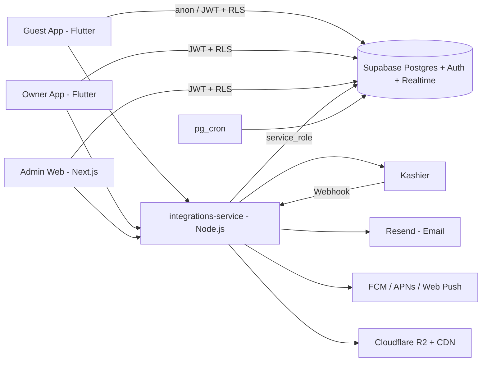

# OnAir — Backend Master Plan (Supabase)

> **الوثيقة:** الخطة الكاملة للـ Backend الموحد لكل منصة OnAir (تطبيق المستأجر + تطبيق المالك/المكتب/المساعدين + لوحة الإدارة).
> **المنفّذ:** Codex (أو أي مطوّر Backend) — الملف ده مكتوب عشان يتنفذ مباشرة في Supabase.
> **المرجع الأعلى للمنتج:** [OnAir Master Plan.md](OnAir%20Master%20Plan.md). الملف ده هو **المرجع الوحيد لأسماء الجداول والأعمدة والحالات والصلاحيات والدوال والإشعارات**. أي اسم مختلف في خطة تطبيق أو عقد قديم، الاسم اللي هنا هو اللي يمشي.
> **خطط التطبيقات:** [OnAir Guest App Plan.md](OnAir%20Guest%20App%20Plan.md) · [OWNER_APP_PLAN.md](OWNER_APP_PLAN.md) · [ADMIN_WEB_PLAN.md](ADMIN_WEB_PLAN.md)
> **تاريخ الإنشاء:** 28 أكتوبر 2026

---

## 0. قرارات حاكمة للـ Backend

| # | القرار | التفاصيل |
|---|---|---|
| B1 | **مشروع Supabase واحد لكل بيئة** | `onair-staging` و`onair-production`. **كل التطبيقات التلاتة بتقرا وتكتب في نفس قاعدة البيانات.** |
| B2 | **ممنوع تكرار الجداول** | جدول واحد للأشخاص (`profiles`) لكل أنواع المستخدمين: مستأجر، مالك، مكتب، مساعد، موظف OnAir. جدول عضوية واحد (`workspace_members`) لموظفي الملاك/المكاتب **ولموظفي OnAir** (OnAir نفسها Workspace من نوع `platform`). جدول إشعارات واحد لكل التطبيقات. |
| B3 | **مفيش SMS نهائيًا** | لا مزود SMS ولا Phone Auth في Supabase. كل الأكواد (OTP) بتتبعت **على البريد المسجل بيه الحساب** عبر Resend. |
| B4 | **الدخول بالبريد + كلمة المرور** في التطبيقات التلاتة | التسجيل بيطلب: الاسم، البريد، كلمة المرور، **رقم الهاتف (مصري +20)**، و«هل الرقم ده عليه واتساب؟»، ولو لأ يقدر يضيف **رقم واتساب اختياري** مختلف. |
| B5 | **تأكيد البريد والهاتف بكود واحد على البريد** | كود 6 أرقام بيتبعت للبريد عند التسجيل، وإدخاله بيأكد البريد **ورقم الهاتف المسجل** مع بعض. تغيير الرقم بعد كده بيحتاج كود جديد على البريد. |
| B6 | **موظفو OnAir:** كلمة مرور + كود على البريد في **كل دخول** | مربوط بجلسة Supabase الحالية (جدول `private.otp_challenges` بغرض `staff_login`). |
| B7 | **الكتابة الحساسة عبر دوال RPC فقط** | التطبيقات بتقرا تحت RLS، ومفيش `insert/update/delete` مباشر من أي تطبيق على أي جدول (الاستثناء الوحيد: `favorites`). كل الأوامر دوال `security definer` بتتحقق من الهوية والصلاحية والحالة قبل الكتابة. |
| B8 | **Node.js للتكاملات بس** | خدمة واحدة `integrations-service`: Kashier (بدء الدفع + Webhook + الاسترداد + التسويات)، Resend (البريد والأكواد)، FCM/APNs (Push)، Cloudflare R2 (روابط رفع/تحميل موقعة)، عمّال الإرسال والمطابقة. |
| B9 | **نظام إشعارات موحد** | كل حدث مهم بيولّد إشعارات لكل الأطراف المعنية في نفس الـ Transaction (المستأجر، المالك/المكتب ومساعديه المسؤولين، موظفي OnAir المسؤولين، ولوحة الإدارة). القسم 9. |
| B10 | **المال `bigint` بالقرش + `currency`** | ممنوع `float/double/numeric` بدون داعي للمبالغ. العملة `EGP` فقط حاليًا. |
| B11 | **التواريخ** | تواريخ الإقامة `date` بنطاق نصف مفتوح `[check_in, check_out)`. الأوقات `timestamptz` (UTC) والعرض بتوقيت `Africa/Cairo`. |
| B12 | **الحالات `text` + `CHECK`** | مش Postgres enums، عشان إضافة قيمة جديدة تبقى Migration بسيطة من غير كسر. |

> **ملاحظة أمانة على B5:** الكود على البريد بيثبت إن **صاحب الحساب** أكد الرقم، لكنه مش بيثبت إنه مالك الشريحة. ده قرار منتج مقصود لإلغاء SMS.

---

## 1. البنية العامة



| الطبقة | المسؤولية |
|---|---|
| **Postgres (public)** | الجداول اللي التطبيقات بتقراها تحت RLS + دوال RPC بالبادئات `guest_` / `partner_` / `admin_` / `common_` |
| **Postgres (private)** | دوال مساعدة (صلاحيات، تسعير، قيود محاسبية، إشعارات) وجداول حساسة (`otp_challenges`, `provider_webhook_events`). مش مكشوفة في الـ API (`private` مش في `exposed schemas`) |
| **Supabase Auth** | الحسابات بالبريد/كلمة المرور، كود تأكيد البريد واستعادة كلمة المرور (SMTP = Resend، القوالب فيها `{{ .Token }}` بس، **من غير روابط**) |
| **Realtime** | `notifications` و`case_messages` (تحت RLS) — التحديث اللحظي لحالة الحجز بيوصل كإشعار |
| **pg_cron** | المهام الزمنية الداخلية (انتهاء مهلة المالك، التذكيرات، SLA) |
| **integrations-service (Node.js)** | كل اتصال خارجي أو سر (Kashier، Resend، FCM، R2) |

### 1.1 مستودع الـ Backend

```text
onair-backend/
├── supabase/
│   ├── config.toml
│   ├── migrations/            # بالترتيب في القسم 13
│   ├── seed.sql               # بيانات Staging المشتركة (القسم 14)
│   └── tests/                 # pgTAP: RLS، العزل، القيود، الدوال
├── services/integrations/     # Node.js (TypeScript)
│   ├── src/routes/            # /v1/... (القسم 10)
│   ├── src/workers/           # deliveries, kashier-reconcile, kashier-payouts
│   └── src/templates/         # قوالب البريد (عربي/إنجليزي)
├── contracts/
│   ├── node-api.openapi.yaml  # عقد خدمة Node
│   ├── rpc.md                 # توقيعات الدوال (مولّد/محدّث مع كل PR)
│   └── error-codes.md
└── docs/                      # نسخة من الملف ده
```

> لو فيه Migrations قديمة متطبقة على Staging بأسماء مختلفة، **ما يتعملش DROP**. تتكتب Migrations إضافية توصل للشكل ده، والقديم يتشال بعد ما التطبيقات تنتقل (expand → migrate → contract).

---

## 2. الأدوار والصلاحيات

### 2.1 أنواع المستخدمين (كلهم في `profiles`)

| النوع | إزاي بيتعرف | التطبيق |
|---|---|---|
| **مستأجر (Guest)** | أي `profile` نشط. مش محتاج عضوية | Guest App |
| **مالك فردي / مدير مكتب (Principal)** | `workspace_members.is_principal = true` في Workspace نوعه `individual_owner` أو `office` | Owner App |
| **مساعد مالك/مكتب** | عضو في Workspace شريك بقوالب صلاحيات | Owner App |
| **موظف OnAir** | عضو في الـ Workspace الوحيد نوعه `platform` | Admin Web |

نفس الشخص ممكن يبقى مستأجر ومالك ومساعد عند مكتب تاني، **بنفس الـ profile**.

### 2.2 كتالوج الصلاحيات (`permissions`)

**نطاق الشريك (`scope = 'partner'`):**

| المفتاح | المعنى |
|---|---|
| `workspace.manage` | بيانات الجهة، مستندات الاعتماد، وسيلة استلام التسويات |
| `staff.manage` | دعوة وتعديل وإيقاف وإنهاء الموظفين |
| `properties.view` | عرض الشقق المخصصة |
| `properties.manage` | إنشاء/تعديل/إرسال للمراجعة/إيقاف مؤقت |
| `calendar.manage` | غلق وفتح الفترات وتعديل السعر الأساسي |
| `policies.manage` | تخصيص العربون والإلغاء في حدود المنصة |
| `bookings.view` | عرض الحجوزات |
| `bookings.respond` | قبول/رفض طلبات الحجز |
| `bookings.request_cancellation` | طلب إلغاء حجز مؤكد من OnAir |
| `stays.handover` | «تم تسليم الشقة» و«استلمت الشقة والمفاتيح» |
| `cash.collect` | تسجيل تحصيل نقدي (لو مسموح للعقار وللشخص) |
| `damage.manage` | فتح ومتابعة مطالبات الأضرار |
| `finance.view` | الـ Financial Hub والكشوف والتصدير |

**نطاق المنصة (`scope = 'platform'`):**

| المفتاح | المعنى |
|---|---|
| `platform.staff.manage` | موظفو OnAir وقوالبهم (في حدود صلاحيات المفوِّض) |
| `users.view` | عرض المستأجرين والشركاء |
| `identity_documents.view` | فتح مستندات الهوية (روابط مؤقتة) |
| `partners.review` | اعتماد/رفض/إيقاف حسابات الملاك والمكاتب |
| `properties.review` | اعتماد/رفض الشقق والنسخ المعدلة |
| `properties.suspend` | إيقاف إداري لشقة + تحديد المحصّلين النقديين |
| `bookings.view_all` | كل الحجوزات |
| `bookings.monitor` | استقبال تنبيهات الحجوزات الجديدة والمتأخرة (لوحة التحكم) |
| `bookings.record_phone_decision` | تسجيل قرار المالك الهاتفي |
| `bookings.manage` | إلغاء إداري، No-show، إعادة فتح، استثناءات Check-in/out، عروض بديلة |
| `support.handle` | حالات الدعم والرد عليها |
| `support.assign` | توزيع الحالات |
| `refunds.request` · `refunds.approve` · `refunds.execute` · `refunds.verify` | مراحل الاسترداد (فصل أدوار) |
| `cash.collect` · `cash.receive_handover` | تحصيل نقدي واستلام عهدة لموظفي OnAir |
| `settlements.prepare` · `settlements.approve` · `settlements.execute` · `settlements.verify` | تسويات الملاك (فصل أدوار) |
| `kashier.reconcile` | مطابقة دفعات Kashier وتأكيد وصول الصافي للبنك |
| `accounting.view` · `accounting.post_manual` · `accounting.approve` | الدفتر والقيود اليدوية |
| `reviews.moderate` | مراجعة التقييمات |
| `tasks.assign` | إنشاء وإسناد مهام الموظفين |
| `settings.manage` · `settings.manage_finance` | الإعدادات العامة/المالية والمرجعيات والأسئلة الشائعة |
| `audit.view` | سجل التدقيق |

### 2.3 القوالب الجاهزة (`role_presets`)

| القالب | النطاق | الصلاحيات |
|---|---|---|
| `partner_owner` | partner | كل صلاحيات الشريك (بياخده الـ Principal تلقائيًا ومينفعش يتشال منه) |
| `partner_manager` | partner | الكل ما عدا `workspace.manage` و`finance.view` |
| `partner_reception` | partner | `properties.view`, `bookings.view`, `stays.handover`, `cash.collect` |
| `partner_accountant` | partner | `bookings.view`, `finance.view` |
| `super_admin` | platform | كل صلاحيات المنصة |
| `admin` | platform | الكل ما عدا `platform.staff.manage` الكامل و`settings.manage_finance` ومراحل المال التنفيذية |
| `customer_support` | platform | `users.view`, `bookings.view_all`, `bookings.monitor`, `bookings.record_phone_decision`, `support.handle`, `refunds.request`, `reviews.moderate` |
| `finance` | platform | `bookings.view_all`, `refunds.*`, `cash.receive_handover`, `settlements.*`, `kashier.reconcile`, `accounting.*` |
| `field_staff` | platform | `properties.view` على المسند، المهام المسندة، `cash.collect` لو مخول |

- العضو ممكن ياخد **أكتر من قالب** + `extra_permissions` + `revoked_permissions`.
- **ممنوع** حد يدّي صلاحية مش معاه (يتفحص في `partner_update_member` و`admin_update_staff`).
- **فصل الأدوار** يتفحص في الدوال: منشئ/معتمد الاسترداد ≠ منفّذه ≠ المتحقق منه؛ منشئ القيد اليدوي ≠ معتمده؛ مُعد التسوية ≠ معتمدها ≠ المتحقق منها. الخطأ: `SEPARATION_OF_DUTIES`.

### 2.4 دوال الصلاحيات (private)

| الدالة | المعنى |
|---|---|
| `private.current_profile_active()` | الحساب موجود ونشط (مش موقوف أو محذوف) |
| `private.member_permissions(member_id) returns text[]` | (القوالب ∪ extra) − revoked |
| `private.has_permission(workspace_id, perm, property_id default null) returns bool` | عضو نشط + الصلاحية + (`all_properties` أو الشقة مخصصة له) + الـ Workspace مش موقوف |
| `private.staff_session_verified() returns bool` | فيه `otp_challenges` بغرض `staff_login` مستهلك لنفس `auth.jwt()->>'session_id'` وصالح |
| `private.has_platform_permission(perm) returns bool` | عضو نشط في workspace المنصة + الصلاحية + `staff_session_verified()` |
| `private.workspace_recipients(workspace_id, perm, property_id)` | قائمة المستخدمين اللي يستلموا إشعار جهة عمل (القسم 9) |
| `private.platform_recipients(perm)` | قائمة موظفي OnAir اللي يستلموا إشعار |

كلها `security definer`, `stable`, `set search_path = public, private, pg_temp`.

---

## 3. قواعد عامة لكل الجداول

1. كل جدول في `public`: **RLS مفعّل** + Policies قبل ما يترفع. الـ CI يرفض أي Migration بتسيب جدول من غير RLS.
2. أعمدة قياسية: `id uuid primary key default gen_random_uuid()`, `created_at timestamptz not null default now()`, و`updated_at` بـ Trigger لما يكون الجدول بيتعدّل.
3. الكتابة من التطبيقات **عبر RPC فقط** (B7). الـ Policies للقراءة (`select`) بس، ما عدا `favorites`.
4. **ممنوع `DELETE`** لأي سجل مالي أو تاريخي (bookings, payments, refunds, journal_*, audit_log, booking_events...). الإلغاء بحالة، والتصحيح بقيد عكسي.
5. أي تغيير حساس بيتسجل في `audit_log` من جوه نفس الدالة.
6. الأخطاء: `raise exception '<CODE>' using errcode = 'P0001'` وأكوادها في القسم 11.
7. الـ Extensions: `pgcrypto`, `btree_gist`, `pg_cron`, `pg_trgm`, `unaccent`.
8. الفهارس على كل FK وعلى أعمدة الفلترة (status, workspace_id, property_id, user_id, created_at).

---

## 4. الجداول — المرجعيات والإعدادات

### 4.1 `locations`
| العمود | النوع | ملاحظات |
|---|---|---|
| `id` | uuid PK | |
| `parent_id` | uuid FK → locations, null | المحافظة parent = null |
| `level` | text | `governorate` · `city` · `area` |
| `name_ar`, `name_en` | text | |
| `search_text` | text | الاسم بعد التطبيع العربي (أ/إ/آ→ا، ة→ه، ى→ي، حذف التشكيل) + فهرس `gin_trgm_ops` |
| `is_active` | bool default true | |
| `sort_order` | int | |

RLS: `select` لـ `anon` و`authenticated` (النشط فقط). الكتابة: `admin_upsert_location` (`settings.manage`).

### 4.2 `amenities`
`key text PK`, `label_ar`, `label_en`, `icon`, `is_active`, `sort_order`. نفس RLS المرجعيات.

### 4.3 `property_types`
`key text PK` (`apartment`, `studio`, `duplex`, `chalet`, `villa`, `room` — القائمة الأولية في الـ seed)، `label_ar`, `label_en`, `is_active`, `sort_order`. نفس RLS المرجعيات.

### 4.4 `app_config` (صف واحد)
| العمود | ملاحظات |
|---|---|
| `id` | `smallint PK check (id = 1)` |
| `min_build_guest_android`, `min_build_guest_ios`, `min_build_partner_android`, `min_build_partner_ios` | int |
| `support_phone`, `support_whatsapp` | E.164 |
| `guest_terms_version`, `partner_terms_version` | text |
| `terms_url`, `privacy_url` | text |
| `updated_at`, `updated_by` | |

RLS: `select` للكل. الكتابة: `admin_update_app_config` (`settings.manage`).

### 4.5 `platform_settings`
| العمود | ملاحظات |
|---|---|
| `key` | text PK |
| `value` | jsonb |
| `domain` | `bookings` · `payments` · `refunds` · `settlements` · `notifications` · `security` · `general` |
| `is_sensitive` | bool (التعديل محتاج `settings.manage_finance` لو domain مالي) |
| `updated_at`, `updated_by` | |

مفاتيح الـ seed الإلزامية:

| المفتاح | القيمة الافتراضية | الاستخدام |
|---|---|---|
| `owner_response_hours` | `24` | مهلة رد المالك [معتمد] |
| `owner_response_reminder_minutes` | `[720, 120]` | تذكيرات قبل انتهاء المهلة (12 ساعة و2 ساعة) [تطبيق مقترح] |
| `quote_ttl_minutes` | `15` | صلاحية الـ Quote |
| `payment_pending_abandon_minutes` | `30` | حجز ما اتدفعش يبقى `abandoned` |
| `auto_approve_conflict_refunds` | `true` | الاسترداد الكامل للدفعة المتعارضة يتعتمد تلقائيًا |
| `remaining_payment_reminder_hours` | `[48, 24]` | تذكير سداد المتبقي قبل الوصول |
| `stay_reminder_hours` | `[24, 2]` | تذكير الوصول/المغادرة |
| `support_sla_hours` · `refund_sla_hours` | يحددها الأدمن | SLA |
| `default_settlement_schedule` | `"weekly"` | weekly · biweekly · monthly · manual |
| `otp_ttl_minutes` · `otp_max_attempts` · `otp_resend_seconds` | `10` · `5` · `60` | الأكواد |
| `review_comment_min_max` | `[10, 1000]` | التقييم |
| `upload_limits` | `{"image_mb":10,"pdf_mb":15}` | المرفقات |

RLS: `select` لموظفي المنصة (`settings.manage` أو `audit.view`). القيم اللي التطبيقات محتاجاها بترجع جوه الدوال (مثلًا المهلة جوه `guest_get_booking`). الكتابة: `admin_update_setting(key, value, reason)` + `audit_log`.

### 4.6 `faq_items`
`id`, `audience` (`guest` · `partner`), `question_ar`, `answer_ar`, `question_en`, `answer_en`, `sort_order`, `is_published`. RLS: `select` للمنشور. الكتابة: `admin_upsert_faq` (`settings.manage`).

### 4.7 `permissions`
`key text PK`, `scope` (`partner` · `platform`), `label_ar`, `description_ar`, `is_sensitive bool`. RLS: `select` لـ `authenticated`. Seed فقط (أي مفتاح جديد = Migration).

### 4.8 `role_presets`
`key text PK`, `scope`, `label_ar`, `permission_keys text[]`, `is_system bool`. RLS: `select` لـ `authenticated`. Seed فقط.

---

## 5. الجداول — الهوية والجهات

### 5.1 `profiles` — جدول الأشخاص الوحيد
| العمود | النوع | ملاحظات |
|---|---|---|
| `id` | uuid PK, FK → `auth.users.id` | |
| `full_name` | text | 2–80 حرف |
| `email` | text | نسخة من `auth.users.email` (Trigger) |
| `phone_e164` | text **not null** | `^\+201[0125]\d{8}$` (مصري فقط)، **unique** على الحسابات غير المحذوفة |
| `phone_verified_at` | timestamptz | بيتملى لما يتأكد كود البريد (B5) |
| `phone_has_whatsapp` | bool not null default false | «الرقم ده عليه واتساب» |
| `whatsapp_e164` | text, null | اختياري؛ مسموح بس لو `phone_has_whatsapp = false`؛ نفس قاعدة الرقم المصري. `check (not (phone_has_whatsapp and whatsapp_e164 is not null))` |
| `avatar_key` | text, null | مفتاح R2 |
| `locale` | text default `ar` | `ar` · `en` (لغة الإشعارات والبريد) |
| `accepted_terms_version`, `accepted_terms_at` | | |
| `status` | text | `active` · `suspended` · `deleted` |
| `last_seen_at` | timestamptz | من `common_heartbeat` |
| `anonymized_at` | timestamptz | بعد حذف الحساب |
| `created_at`, `updated_at` | | |

**التسجيل:**
1. التطبيق ينادي `supabase.auth.signUp(email, password, data: {full_name, phone_e164, phone_has_whatsapp, whatsapp_e164, accepted_terms_version, locale})`.
2. Trigger `private.handle_new_user` على `auth.users` يعمل الـ profile ويرفض (يفشّل التسجيل) لو الرقم مش مصري (`PHONE_COUNTRY_NOT_SUPPORTED`) أو مستخدم (`PHONE_ALREADY_USED`) أو الواتساب مخالف (`VALIDATION_FAILED`) أو نسخة الشروط مش الحالية في `app_config` (`TERMS_CHANGED`).
3. Supabase يبعت **كود 6 أرقام** على البريد (Resend SMTP، القالب بيقول إن الكود بيأكد البريد ورقم الهاتف).
4. `verifyOtp(type: signup)` → Trigger `private.handle_email_confirmed` على تحديث `auth.users.email_confirmed_at` يملى `phone_verified_at`.

**تغيير الرقم:** `common_request_phone_change(new_phone, has_whatsapp, whatsapp)` → challenge بغرض `phone_change` → كود على البريد → `common_verify_otp` يطبق الرقم الجديد ويحدّث `phone_verified_at`.

RLS:
- `select` الصف بتاعي (`id = auth.uid()`).
- موظفو المنصة بـ `users.view` يقروا الكل.
- الشريك **ميقراش الجدول**؛ اسم المستأجر بيرجعله جوه `partner_get_booking` (الاسم وعدد الضيوف بس، **من غير هاتف ولا بريد** — التواصل عبر OnAir، القرار 102).
- الكتابة: `common_update_profile`, `common_request_phone_change`, `common_request_account_deletion`.

### 5.2 `private.otp_challenges` — كل الأكواد غير أكواد Supabase Auth
| العمود | ملاحظات |
|---|---|
| `id` | uuid PK |
| `purpose` | `phone_change` · `staff_login` · `cash_payment_confirm` · `cash_handover_confirm` · `account_deletion` |
| `recipient_user_id` | اللي الكود بيتبعت على بريده |
| `requested_by_user_id` | اللي بدأ العملية (ممكن يختلف: المحصّل بيبدأ والمستأجر بيأكد) |
| `entity_type`, `entity_id` | مثلًا `payment` / id |
| `payload` | jsonb (مثلًا الرقم الجديد) |
| `session_id` | لـ `staff_login` فقط |
| `code_hash` | `crypt()` — **الكود نفسه ميتخزنش** |
| `sent_count`, `last_sent_at`, `attempts`, `expires_at`, `consumed_at` | |

- الجدول في `private` (مفيش وصول من التطبيقات).
- **الإرسال:** دالة RPC تعمل الـ challenge وترجع `challenge_id` → التطبيق ينادي Node `POST /v1/otp/send` → Node يولّد الكود ويخزن الـ hash (`private.set_otp_code`) ويبعته بـ Resend.
- **التحقق:** `common_verify_otp(challenge_id, code)` أو جوه الدالة المستهلكة (مثلًا `guest_confirm_cash_payment`).
- الحدود من `platform_settings` (`otp_*`)، والأخطاء: `OTP_INVALID`, `OTP_EXPIRED`, `RATE_LIMITED`.

### 5.3 `audit_log` — append-only
`id`, `actor_user_id`, `actor_scope` (`guest` · `partner` · `platform` · `system`), `workspace_id`, `action`, `entity_type`, `entity_id`, `before jsonb`, `after jsonb`, `reason`, `request_id`, `created_at`.
- بيتكتب من الدوال بس (`private.write_audit`). مفيش update/delete لأي حد (Trigger يمنع).
- RLS: `audit.view` يقرا الكل؛ الشريك بـ `staff.manage` يقرا صفوف الـ workspace بتاعه (سجل نشاط الموظفين).

### 5.4 `workspaces`
| العمود | ملاحظات |
|---|---|
| `id` | uuid PK (workspace المنصة id ثابت في الـ seed) |
| `kind` | `individual_owner` · `office` · `platform` |
| `display_name`, `legal_name` | |
| `principal_user_id` | FK profiles |
| `contact_phone_e164`, `contact_email` | للتواصل الرسمي مع OnAir |
| `governorate_id`, `address_text` | للمكتب |
| `verification_status` | `draft` · `pending` · `approved` · `rejected` · `suspended` |
| `verification_note` | سبب الرفض/الإيقاف |
| `reviewed_by`, `reviewed_at` | |
| `settlement_schedule` | null = الافتراضي |
| `created_at`, `updated_at` | |

RLS: الأعضاء النشطين يقروا الـ workspace بتاعهم؛ `users.view` يقرا الكل. الكتابة: `partner_create_workspace`, `partner_update_workspace`, `partner_submit_verification`, `admin_review_workspace`, `admin_set_workspace_status`.

### 5.5 `workspace_members` — جدول العضوية الوحيد (شركاء + موظفي OnAir)
| العمود | ملاحظات |
|---|---|
| `id` | uuid PK |
| `workspace_id`, `user_id` | unique (workspace_id, user_id) |
| `is_principal` | bool |
| `role_preset_keys` | text[] |
| `extra_permissions`, `revoked_permissions` | text[] |
| `all_properties` | bool default true |
| `status` | `active` · `suspended` · `ended` |
| `invited_by`, `joined_at`, `ended_at`, `status_reason` | |
| `last_active_at` | Online/Offline وآخر وصول (**مفيش GPS**) |

RLS: العضو يقرا صفه وصفوف زمايله **لو** معاه `staff.manage` (أو `platform.staff.manage` للمنصة). الكتابة: `partner_*member*`, `admin_*staff*`, `common_accept_invite`.

الإيقاف/الإنهاء بيلغي القدرة فورًا لأن كل دالة بتفحص `status = 'active'`؛ ولموظفي OnAir كمان بيتعمل `auth.admin.signOut` من Node (إلغاء الجلسات).

### 5.6 `workspace_invites`
`id`, `workspace_id`, `email`, `role_preset_keys`, `extra_permissions`, `all_properties`, `property_ids uuid[]`, `token_hash`, `status` (`pending` · `accepted` · `revoked` · `expired`), `expires_at`, `invited_by`, `accepted_by`, `accepted_at`.
- الدعوة **بالبريد** (مفيش SMS). الإيميل بيتبعت كإشعار `invite.received` (القسم 9).
- القبول: `common_accept_invite(token)` — لازم بريد الحساب = بريد الدعوة.
- RLS: `staff.manage` / `platform.staff.manage` على الـ workspace.

### 5.7 `member_property_assignments`
`member_id` FK, `property_id` FK, PK (member_id, property_id). مستخدم لما `all_properties = false`. RLS زي `workspace_members`.

### 5.8 `verification_documents`
| العمود | ملاحظات |
|---|---|
| `id`, `workspace_id` | |
| `property_id` | null، أو الشقة لو مستند إثبات ملكية/تفويض خاص بيها |
| `doc_type` | `national_id` · `passport` · `ownership_proof` · `rental_authorization` · `commercial_register` · `activity_proof` · `representation_authorization` |
| `storage_key` | R2 **private** |
| `status` | `submitted` · `approved` · `rejected` · `superseded` |
| `uploaded_by`, `reviewed_by`, `reviewed_at`, `rejection_reason` | |

RLS: `workspace.manage` على الـ workspace؛ موظفو المنصة بـ `identity_documents.view` أو `partners.review`. الملف نفسه بيتفتح برابط مؤقت من Node بعد فحص الصلاحية.

### 5.9 `workspace_payout_methods`
`id`, `workspace_id`, `method` (`bank_transfer` · `mobile_wallet` · `cash`), `details jsonb` (اسم البنك، IBAN، رقم المحفظة...)، `is_active`, `verified_by`, `verified_at`, `created_by`.
RLS: `workspace.manage` أو `finance.view` في الـ workspace؛ موظفو `settlements.*`. الكتابة: `partner_set_payout_method` (بيرجع `pending` لحد ما المالية تتحقق).

---

## 6. الجداول — العقارات والتسعير والتوافر

### 6.1 `properties` — أصل الشقة (السعر والتوافر عليه مباشرة)
| العمود | ملاحظات |
|---|---|
| `id`, `workspace_id` | |
| `status` | `draft` · `in_review` · `published` · `rejected` · `paused` · `archived` |
| `published_version_id` | FK property_versions (النسخة العامة المعتمدة) |
| `base_nightly_price_minor` | bigint ≥ 0 — **يتطبق فورًا** على الطلبات الجديدة |
| `currency` | `EGP` |
| `cash_collection_allowed` | bool default false (تحدده OnAir) |
| `paused_by_scope` | `partner` · `platform` · null |
| `paused_reason`, `paused_at` | |
| `published_at`, `created_by`, `created_at`, `updated_at` | |

- **«منشورة»** = `status='published'` + `published_version_id` نسخته `approved` + الـ workspace `verification_status='approved'`. أي استعلام عام بيستخدم `private.is_property_public(id)`.
- الإيقاف الطارئ **مبيلغيش** الحجوزات المؤكدة.
- اعتماد الشقة يحتاج workspace معتمد (`WORKSPACE_NOT_APPROVED`).

RLS: أعضاء الـ workspace بـ `properties.view` (والمخصصة لهم)؛ موظفو المنصة. **`anon` ميقراش الجدول** (القراءة العامة عبر دوال `guest_*` بس).

### 6.2 `property_versions` — الوصف والصور والقواعد
| العمود | ملاحظات |
|---|---|
| `id`, `property_id`, `version_no` | unique (property_id, version_no) |
| `status` | `draft` · `submitted` · `approved` · `rejected` · `superseded` |
| `title`, `description` | |
| `property_type` | FK property_types |
| `location_id` | FK locations (مستوى area) |
| `address_text` | **عام للجميع** (D-001) |
| `latitude`, `longitude` | **خاص** — مبيرجعش في أي دالة `guest_*` |
| `bedrooms`, `bathrooms`, `beds`, `max_guests`, `area_sqm` | |
| `amenity_keys` | text[] (فهرس GIN) |
| `media_ids` | uuid[] بالترتيب، الأول = الغلاف |
| `rules` | jsonb: `check_in_time`, `check_out_time`, `visitors_allowed`, `max_visitors`, `house_rules`, `other_terms` |
| `access_instructions` | تعليمات الوصول — بتظهر للمستأجر **بعد التأكيد** بس |
| `submitted_at`, `submitted_by`, `reviewed_by`, `reviewed_at`, `review_note` | |

- تعديل جوهري = نسخة جديدة `draft` → `submitted` → لما تتعتمد تبقى `published_version_id` والقديمة `superseded`. النسخة القديمة تفضل منشورة لحد القرار.
- **نسخة واحدة بس** ممكن تبقى `draft` أو `submitted` لكل شقة (unique partial index).
RLS زي `properties`.

### 6.3 `property_media`
`id`, `property_id`, `storage_key` (R2 public بعد النشر)، `variants jsonb` (`[{width,url}]` 320/720/1440)، `blurhash`, `status` (`uploaded` · `ready` · `rejected`)، `uploaded_by`, `created_at`.
- الصور مشتركة بين النسخ عن طريق `property_versions.media_ids` (من غير تكرار صفوف).
- صور نسخة لسه مش معتمدة متظهرش للعامة.

### 6.4 `markup_policies` — هامش OnAir (الأدمن بس)
`id`, `scope` (`platform` · `workspace` · `property`)، `workspace_id`, `property_id`, `mode` (`fixed` · `percent`)، `fixed_minor`, `percent_bp` (basis points)، `min_minor`, `max_minor`, `effective_from`, `effective_to`, `created_by`.
- الأولوية: property > workspace > platform، والساري بالتاريخ.
- RLS: موظفو المنصة بس. **الشريك ميشوفش الهامش أبدًا.**
- `private.effective_nightly_price(property_id, on_date)` → `{base, markup, nightly_final, markup_mode}`. الدالة الوحيدة لحساب السعر.

### 6.5 `booking_policies` — العربون والإلغاء (جدول واحد)
`id`, `scope` (`platform` · `workspace` · `property`)، `workspace_id`, `property_id`, `deposit_type` (`percent` · `fixed` · `full`)، `deposit_percent_bp`, `deposit_fixed_minor`, `free_cancellation_hours`, `effective_from`, `effective_to`, `created_by`.
- حدود التخصيص المسموح للشريك في `platform_settings`.
- `private.resolve_booking_terms(property_id)` → السياسة الفعالة + نص الشروط + `terms_hash` (sha256).
- RLS: الشريك يقرا سياسات الـ workspace وشققه؛ المنصة الكل. الكتابة: `partner_set_booking_policy` (`policies.manage`) و`admin_set_booking_policy`.

### 6.6 `property_cash_collectors`
`property_id`, `user_id`, `granted_by` (موظف OnAir)، `is_active`, `created_at`. PK (property_id, user_id).
- OnAir بتحدد لكل شقة مين مسموح له يحصّل نقدي (مالك/مساعد/موظف OnAir). الشرط كمان `properties.cash_collection_allowed = true` وصلاحية `cash.collect`.
- RLS: الشريك يقرا صفوف شققه؛ المنصة الكل. الكتابة: `admin_set_cash_collectors` (`properties.suspend`).

### 6.7 `property_calendar_locks` — كل قفل على التواريخ في جدول واحد
| العمود | ملاحظات |
|---|---|
| `id`, `property_id` | |
| `kind` | `hold` (طلب مدفوع بانتظار المالك) · `booking` (مؤكد/جاري) · `owner_block` (غلق يدوي) |
| `booking_id` | null لـ `owner_block` |
| `stay_range` | `daterange` `[)` |
| `reason` | لـ `owner_block` |
| `created_by`, `created_at` | |
| `released_at`, `released_reason` | |

```sql
alter table property_calendar_locks add constraint no_overlapping_locks
  exclude using gist (property_id with =, stay_range with &&) where (released_at is null);
```

- **ده الضمان الذري الوحيد ضد الحجز المزدوج** (AC-017/018). أول دفعة موثقة تنجح في الـ insert تاخد الـ Hold؛ اللي بعدها تاخد `exclusion_violation` → `payment_conflict` + استرداد كامل.
- القبول يحوّل `hold` لـ `booking` (update kind)؛ الرفض/الانتهاء/الإلغاء يملى `released_at`.
- الشريك ميقدرش يعمل `owner_block` فوق hold أو booking (نفس القيد).
- RLS: الشريك يقرا أقفال شققه (من غير بيانات المستأجر)؛ المنصة الكل؛ `anon` لأ (عبر `guest_get_property_unavailable_dates`).

---

## 7. الجداول — الحجوزات والإقامة

### 7.1 `booking_quotes`
`id`, `guest_user_id`, `property_id`, `check_in`, `check_out`, `guests_count`, `nights`, `base_nightly_minor`, `markup_nightly_minor`, `nightly_final_minor`, `total_minor`, `pay_now_minor`, `remaining_minor`, `policy jsonb`, `terms_hash`, `expires_at`, `used_at`.
- صلاحية قصيرة (`quote_ttl_minutes`)، بتتمسح بـ Job بعد يوم. RLS: صاحبها بس.

### 7.2 `bookings` — الطلب والحجز في صف واحد من أول الدفع لآخر الإقامة
| العمود | ملاحظات |
|---|---|
| `id`, `code` | `code` قابل للقراءة (`OA-` + 7 حروف/أرقام)، unique |
| `property_id`, `workspace_id`, `property_version_id` | |
| `guest_user_id` | |
| `check_in`, `check_out`, `nights`, `guests_count` | `check_out > check_in` |
| `status` | القسم 7.3 |
| **لقطة السعر (immutable)** | `base_nightly_minor`, `markup_nightly_minor`, `markup_mode`, `nightly_final_minor`, `total_minor`, `deposit_minor`, `pay_now_minor`, `currency` |
| **لقطة الشروط (immutable)** | `policy_snapshot jsonb`, `terms_snapshot jsonb`, `terms_hash`, `terms_accepted_at` |
| `paid_minor` | يتحدّث من دوال الدفع بس |
| `idempotency_key` | unique (guest_user_id, idempotency_key) |
| `owner_response_deadline` | `payment verified + owner_response_hours` |
| `responded_at`, `responded_by`, `response_channel` | `app` · `phone_via_support` |
| `phone_decision` | jsonb: موظف الدعم، وقت المكالمة، الملخص |
| `rejection_reason` | |
| `confirmed_at`, `cancelled_at`, `cancelled_by_scope`, `cancellation_reason` | |
| `checkin_host_at`, `checkin_host_by`, `checkin_guest_at` | Check-in = الطرفين أو استثناء |
| `checkout_guest_at`, `checkout_host_at`, `checkout_host_by`, `key_left_safe` | |
| `stay_exception` | jsonb (استثناء موثق من OnAir) |
| `no_show_at`, `reopened_at` | |
| `created_at`, `updated_at` | |

- Trigger يمنع تعديل أعمدة اللقطات بعد الإنشاء.
- `private.booking_available_actions(booking_id, actor)` → قائمة الإجراءات المسموحة للطرف ده (Server-driven actions).

RLS:
- **`select` مباشر لموظفي المنصة بس** (`bookings.view_all`).
- المستأجر والشريك **مفيش select مباشر** (عشان أعمدة السعر الأساسي والهامش)؛ القراءة عبر `guest_list_bookings` / `guest_get_booking` و`partner_list_bookings` / `partner_get_booking` اللي بترجع الحقول المسموحة لكل طرف بس (الشريك من غير الهامش ولا بيانات تواصل المستأجر، والمستأجر من غير تفاصيل الهامش والأساسي).
- **التحديث اللحظي** للمستأجر والشريك بيوصل عن طريق Realtime على `notifications` (كل تغيير حالة بيولّد إشعار)، والتطبيق بيعيد طلب الحجز عند وصوله.

### 7.3 حالات الحجز
| الحالة | المعنى | بتتغير بواسطة |
|---|---|---|
| `payment_pending` | الحجز اتعمل وصفحة الدفع اتفتحت | `guest_start_booking` |
| `payment_verifying` | المستأجر رجع/الحدث وصل ولسه بنتحقق | Node |
| `awaiting_owner` | دفع موثق + Hold + مهلة 24 ساعة | `private.apply_kashier_event` |
| `payment_conflict` | دفع ناجح لكن التواريخ اتاخدت ← استرداد كامل | `private.apply_kashier_event` |
| `confirmed` | قبول المالك (تطبيق أو هاتف موثق) | `partner_respond_booking` / `admin_record_owner_phone_decision` |
| `checked_in` | إقرار الطرفين (أو استثناء) + المتبقي مسدد | `guest_confirm_checkin` + `partner_confirm_handover` |
| `completed` | إقرار المغادرة من الطرفين (أو استثناء) | `guest_confirm_checkout` + `partner_confirm_checkout` |
| `rejected` | رفض المالك ← استرداد كامل | `partner_respond_booking` |
| `expired` | انتهت 24 ساعة ← استرداد كامل | `private.expire_owner_requests` |
| `cancelled` | إلغاء وفق السياسة (مستأجر / OnAir) | `guest_cancel_booking` / `admin_cancel_booking` |
| `no_show` | عربون فقط + اعتماد إداري | `admin_mark_no_show` |
| `abandoned` | ما اتدفعش خلال `payment_pending_abandon_minutes` | Job |

حالة الاسترداد **منفصلة** في `refunds` (8.3).

### 7.4 `booking_events` — الـ Timeline
`id`, `booking_id`, `event_type`, `from_status`, `to_status`, `actor_user_id`, `actor_scope`, `channel` (`app` · `phone` · `system` · `webhook`)، `note`, `data jsonb`, `visibility` (`all` · `partner_platform` · `platform`)، `created_at`.
RLS: المستأجر يشوف `visibility='all'` لحجوزاته؛ الشريك `all` و`partner_platform`؛ المنصة الكل.

### 7.5 `replacement_offers`
`id`, `booking_id` (الأصلي)، `offered_property_id`, `check_in`, `check_out`, `price_difference_minor` (موجب = يدفع زيادة، سالب = يسترد)، `note`, `status` (`pending` · `accepted` · `declined` · `expired` · `withdrawn`)، `created_by`, `expires_at`, `responded_at`, `new_booking_id`.
- مفيش تغيير إلا بموافقة صريحة من المستأجر (`guest_respond_replacement_offer`).
RLS: المستأجر صاحب الحجز؛ المنصة. الكتابة: `admin_create_replacement_offer` (`bookings.manage`).

### 7.6 `damage_claims`
`id`, `booking_id`, `workspace_id`, `opened_by`, `description`, `amount_minor`, `status` (`open` · `guest_accepted` · `guest_disputed` · `in_mediation` · `resolved` · `withdrawn`)، `guest_response_note`, `guest_responded_at`, `resolution jsonb`, `resolved_by`, `support_case_id`, `created_at`.
- **مفيش خصم تلقائي**؛ والنزاع ميمنعش الـ Checkout.
- المرفقات في `attachments` (`entity_type='damage_claim'`).
RLS: المستأجر صاحب الحجز؛ الشريك (`damage.manage` أو `bookings.view`)؛ المنصة.

### 7.7 `property_reviews`
`id`, `booking_id` **unique** (تقييم واحد لكل إقامة)، `property_id`, `guest_user_id`, `rating` (1–5)، `comment`, `status` (`pending` · `approved` · `rejected`)، `moderated_by`, `moderated_at`, `rejection_reason`, `created_at`.
- `guest_submit_review` يتأكد إن الحجز `completed`.
RLS: الكاتب يقرا تقييمه؛ الشريك المعتمد لشققه؛ المنصة الكل؛ العامة عبر `guest_list_property_reviews` (المعتمد، باسم مختصر).

### 7.8 `favorites`
`user_id`, `property_id`, `created_at`. PK (user_id, property_id).
RLS: الوحيد اللي فيه `insert/delete` مباشر — للمستخدم على صفوفه بس.

---

## 8. الجداول — المال والمحاسبة

### 8.1 `payments` — كل تحصيل (إلكتروني أو نقدي)
| العمود | ملاحظات |
|---|---|
| `id`, `booking_id` | |
| `purpose` | `initial` (العربون/الكامل) · `remaining` (المتبقي) · `replacement_difference` |
| `method` | `kashier` · `cash` |
| `status` | `pending` · `verifying` · `pending_guest_confirmation` (نقدي) · `succeeded` · `failed` · `cancelled` · `expired` |
| `amount_minor`, `currency` | المبلغ من الخادم بس |
| `idempotency_key` | unique (booking_id, purpose, idempotency_key) |
| `provider_order_id` | unique، null |
| `provider_transaction_id` | unique، null |
| `payment_url`, `payment_url_expires_at` | |
| `verified_at`, `verified_via` | `webhook` · `api_query` · `guest_otp` |
| `collector_user_id` | للنقدي |
| `guest_confirmed_at` | للنقدي (كود على بريد المستأجر) |
| `kashier_payout_id` | FK kashier_payouts (بعد المزامنة) |
| `created_at`, `updated_at` | |

RLS: المستأجر مدفوعاته؛ الشريك مدفوعات حجوزاته (`finance.view` أو `bookings.view` — الحالة والمبلغ فقط عبر الدوال)؛ المحصّل صفوفه؛ المنصة (`refunds.*` / `kashier.reconcile` / `accounting.view` / `bookings.view_all`).

**عهدة النقدي** = مدفوعات `cash` ناجحة بالمحصّل − التسليمات المؤكدة (View `cash_custody_balances` — مش جدول).

### 8.2 `private.provider_webhook_events`
`id`, `provider` (`kashier`)، `provider_event_id` **unique**، `event_type`, `payload jsonb`, `signature_valid bool`, `received_at`, `processed_at`, `processing_error`.
- مخزن خام لكل Webhook لفحص النزاعات وIdempotency. مفيش وصول من التطبيقات.

### 8.3 `refunds` — الطلب والاعتماد والتنفيذ والتحقق في صف واحد
| العمود | ملاحظات |
|---|---|
| `id`, `booking_id`, `payment_id` | |
| `amount_minor`, `currency` | |
| `reason` | `owner_rejected` · `owner_timeout` · `payment_conflict` · `guest_cancellation` · `platform_cancellation` · `replacement_difference` · `other` |
| `method` | `kashier` · `bank_transfer` · `mobile_wallet` · `cash` |
| `status` | `requested` · `approved` · `executed` · `verified` · `failed` · `cancelled` |
| `requested_by`, `requested_at`, `approved_by`, `approved_at`, `executed_by`, `executed_at`, `verified_by`, `verified_at` | فصل أدوار: `check (approved_by <> executed_by and executed_by <> verified_by)` |
| `provider_refund_id` | unique |
| `idempotency_key` | unique |
| `failure_reason`, `due_at` (SLA) | |

- رفض/انتهاء/تعارض ← `requested` تلقائيًا بالمبلغ المدفوع كامل (والتعارض `approved` تلقائيًا لو `auto_approve_conflict_refunds`).
- `verified` بس بعد تأكيد موثق (Kashier/بنك/إقرار) — AC-042.
- عرض المستأجر: `requested` = «تم طلب الاسترداد»، `approved`/`executed` = «قيد التنفيذ»، `verified` = «تم رد المبلغ».
- النزاع الداخلي مع المالك أو المحصّل **ميأخرش** الاسترداد.
RLS: المستأجر استرداداته (الحالة والمبلغ)؛ المنصة (`refunds.*`). المرفقات (إثبات) في `attachments`.

### 8.4 `cash_handovers`
`id`, `from_user_id`, `to_user_id`, `workspace_id` (سياق العهدة)، `amount_minor`, `status` (`pending_confirmation` · `confirmed` · `rejected` · `cancelled`)، `confirmed_at` (بكود على بريد المستلم)، `receipt_no`, `note`, `created_at`.
- التسليم ممكن يبقى **جزئي**، وكل عملية صف لوحدها. الرصيد محسوب في View.
RLS: الطرفين؛ `finance.view` في الـ workspace؛ المنصة (`cash.receive_handover` / `accounting.view`).

### 8.5 `owner_payables` — استحقاقات الملاك
`id`, `workspace_id`, `booking_id`, `type` (`stay_base` · `cancellation_share` · `forfeited_deposit_share` · `adjustment`)، `amount_minor`, `status` (`eligible` · `in_settlement` · `paid` · `on_hold_dispute` · `reversed`)، `eligible_at`, `settlement_id` FK null، `created_at`.
- `stay_base` بيتعمل عند **Check-in موثق** فقط (AC-028).
- مصدر الأرقام لصفحة الشريك المالية (eligible مقابل paid).
RLS: `finance.view` في الـ workspace؛ المنصة (`settlements.*` / `accounting.view`).

### 8.6 `settlements` — تسويات الملاك
`id`, `workspace_id`, `period_from`, `period_to`, `method` (`bank_transfer` · `mobile_wallet` · `cash` · `ledger_offset`)، `total_minor`, `status` (`draft` · `approved` · `paid` · `verified` · `cancelled`)، `reference_no`, `prepared_by`, `approved_by`, `executed_by`, `verified_by` + أوقاتهم، `note`.
- البنود = `owner_payables.settlement_id` (من غير جدول بنود).
- الإثبات في `attachments`. صورة شاشة لوحدها مش إثبات وصول (`verified` بقرار مالي مستقل).
RLS: `finance.view` في الـ workspace؛ المنصة.

### 8.7 `kashier_payouts` — دفعات تسوية Kashier
`id`, `provider_batch_id` **unique**، `period_from`, `period_to`, `gross_minor`, `fees_minor`, `net_minor`, `status` (`synced` · `bank_verified` · `discrepancy`)، `synced_at`, `bank_verified_by`, `bank_verified_at`, `note`.
- مزامنة من Kashier API (حيث تسمح الصلاحيات) أو إدخال يدوي. تأكيد وصول البنك مستقل (AC-041).
RLS: المنصة (`kashier.reconcile` / `accounting.view`).

### 8.8 المحاسبة: `ledger_accounts` · `journal_entries` · `journal_lines`

**`ledger_accounts`:** `id`, `code` unique، `name_ar`, `name_en`, `type` (`asset` · `liability` · `equity` · `revenue` · `expense`)، `parent_id`, `is_system`, `is_active`.

**`journal_entries`:** `id`, `entry_no`, `entry_date`, `source_type` (`payment` · `refund` · `booking` · `cash_handover` · `kashier_payout` · `settlement` · `manual`)، `source_id`, `source_event` (مثلًا `checkin`)، `status` (`draft` · `pending_approval` · `posted` · `reversed`)، `description`, `created_by`, `approved_by`, `posted_at`, `reversal_of`.
- unique (`source_type`, `source_id`, `source_event`) → مفيش قيد مكرر لنفس الحدث.

**`journal_lines`:** `id`, `entry_id`, `account_id`, `debit_minor`, `credit_minor`, `workspace_id`, `booking_id`, `user_id` (أبعاد الدفاتر الفرعية: شريك/حجز/محصّل).
- Trigger: القيد ميتعملوش `posted` إلا لو مجموع المدين = الدائن. المرحّل ميتعدلش؛ التصحيح بقيد عكسي.

**القيود الآلية** (`private.post_journal`) — دليل الحسابات الأولي في الـ seed **ويراجعه محاسب**:

| الحدث | مدين | دائن |
|---|---|---|
| دفع Kashier موثق | مستحقات Kashier تحت التسوية | التزامات للمستأجرين (مبالغ محصلة مقدمًا) |
| تحصيل نقدي مؤكد | عهدة نقدية (بُعد المحصّل) | التزامات للمستأجرين |
| Check-in موثق | التزامات للمستأجرين (الأساسي) | ذمم الملاك |
| Check-out موثق | التزامات للمستأجرين (الهامش) | إيراد هامش OnAir المكتسب |
| إلغاء غير قابل للاسترداد / عربون مصادَر | التزامات للمستأجرين | إيراد إلغاء OnAir + ذمم الملاك (حصة الإلغاء) |
| استرداد منفّذ | التزامات للمستأجرين | مستحقات Kashier / البنك / العهدة |
| دفعة Kashier | البنك + مصروف رسوم الدفع | مستحقات Kashier تحت التسوية |
| تسوية مالك مدفوعة | ذمم الملاك | البنك / المحفظة / العهدة |
| تسليم عهدة | عهدة المستلم (أو البنك) | عهدة المسلِّم |

RLS: المنصة (`accounting.view`)؛ الشريك يشوف **كشف حسابه** بس عبر `partner_statement` (سطور بُعد الـ workspace بتاعه).

**Views (مش جداول):** `cash_custody_balances`, `financial_transactions_v` (سجل موحد للمدفوعات والاستردادات والتسويات والتسليمات)، `trial_balance_v`, `general_ledger_v`. كلها `security_invoker = true`.

---

## 9. نظام الإشعارات الموحد

### 9.1 الفكرة
- **الحدث بيحصل جوه دالة RPC** (أو Job أو Webhook) → نفس الـ Transaction بتنادي `private.notify(type_key, entity_type, entity_id, workspace_id, property_id, params)`.
- `private.notify` بتحدد المستلمين من **كتالوج النوع** (`notification_types.recipients`) وبتعمل:
  1. صف في `notifications` لكل مستلم (**ده مصدر الحقيقة**، بيظهر فورًا عن طريق Realtime).
  2. صف في `notification_deliveries` لكل قناة خارجية مفعّلة (Push / Email / Web Push) بحالة `queued`.
- عامل Node (`workers/deliveries`) بيسحب `queued` ويبعت عبر FCM/APNs أو Resend، مع Retry وBackoff، ويمسح الـ tokens اللي بقت غير صالحة. **الإرسال مش دليل قراءة**.
- **لوحة الإدارة («الداش بورد»):** كل موظف OnAir عنده الصلاحية المطلوبة بيستلم صف إشعار خاص بيه (مركز إشعارات + Toast/صوت للأولوية `high`/`critical`). لما موظف ينفذ الإجراء على نفس الكيان، الإشعارات المفتوحة للباقيين بتتقفل تلقائيًا (`resolved_at`, `resolved_by`) ويظهر «اتعامل معاه بواسطة فلان». عدادات «تحتاج إجراء» في الداش بورد بتتحسب من حالة البيانات (`admin_action_queue()`) مش من الإشعارات.
- **مفيش SMS.** القنوات: `in_app` (دايمًا) · `push` (موبايل) · `web_push` (لوحة الإدارة، P1) · `email`.

### 9.2 `notification_types` — الكتالوج
| العمود | ملاحظات |
|---|---|
| `key` | text PK (مثلًا `booking.request_received`) |
| `category` | `account` · `partner` · `staff` · `property` · `booking` · `payment` · `stay` · `refund` · `finance` · `support` · `review` · `task` · `system` |
| `recipients` | jsonb: قواعد المستلمين، مثال: `[{"audience":"guest","rule":"booking_guest"},{"audience":"partner","perm":"bookings.respond"},{"audience":"platform","perm":"bookings.monitor"}]` |
| `channels` | jsonb لكل audience: مثلًا `{"guest":["in_app","push","email"],"partner":["in_app","push"],"platform":["in_app","web_push"]}` |
| `priority` | `normal` · `high` · `critical` |
| `is_mandatory` | لو true المستخدم ميقدرش يقفل الـ push/email بتاعه (معاملات وحجوزات ضرورية) |
| `entity_type` | `booking` · `property` · `workspace` · `refund` · `support_case` · `damage_claim` · `settlement` · `task` · `review` · `payment` · `cash_handover` · `kashier_payout` · `invite` |
| `is_active` | |

قواعد `rule` المتاحة: `booking_guest`, `actor`, `case_opener`, `case_assignee`, `task_assignee`, `task_creator`, `handover_receiver`, `handover_giver`, `member_self`, `workspace_principal`. ومع `perm` في audience `partner` بيتم الاختيار بـ `private.workspace_recipients(workspace_id, perm, property_id)`، وفي `platform` بـ `private.platform_recipients(perm)`.

RLS: `select` لـ `authenticated`. الكتابة: Seed/Migration (والأدمن يقدر يغيّر القنوات والأولوية بـ `admin_update_notification_type` — `settings.manage`).

### 9.3 `notifications` — صندوق كل مستخدم
| العمود | ملاحظات |
|---|---|
| `id` | |
| `user_id` | المستلم |
| `audience` | `guest` · `partner` · `platform` (أي تطبيق يعرضه) |
| `workspace_id` | سياق جهة العمل (التطبيق بيفلتر بالـ workspace النشط) |
| `type_key` | FK notification_types |
| `category`, `priority` | منسوخين من النوع |
| `entity_type`, `entity_id` | للفتح (Deep link) |
| `title_key`, `body_key`, `params jsonb` | التطبيق بيترجم (`notif_<type>_title/body`)؛ نوع مجهول ← نص عام |
| `read_at` | |
| `resolved_at`, `resolved_by` | للإشعارات اللي محتاجة إجراء |
| `created_at` | |

RLS: `select` لصفوف `user_id = auth.uid()` بس. التحديث عبر `common_mark_notifications_read`. Realtime مفعّل.
**ممنوع بيانات حساسة في الـ params** (لا هواتف، لا عناوين، لا هامش). المبالغ بتظهر جوه التطبيق بعد الفتح، مش في نص الـ Push.

### 9.4 `notification_deliveries`
`id`, `notification_id` (null للبريد لغير المسجلين زي الدعوات)، `channel` (`push` · `web_push` · `email`)، `to_user_id`, `to_address` (بريد أو null)، `template_key`, `payload jsonb` (`type`, `entity_type`, `entity_id` بس للـ Push)، `status` (`queued` · `sending` · `sent` · `failed` · `skipped`)، `attempts`, `next_attempt_at`, `last_error`, `provider_message_id`, `sent_at`.
RLS: مفيش وصول من التطبيقات (Node بـ service role). المنصة تقرا للتشخيص (`settings.manage`).
**أكواد OTP مبتعديش من هنا** (بتتبعت مباشرة من Node عشان الكود ميتخزنش نص).

### 9.5 `notification_preferences`
`user_id`, `category`, `channel` (`push` · `email` · `web_push`)، `enabled`. PK (user_id, category, channel).
- `in_app` مبيتقفلش. الأنواع `is_mandatory` بتتبعت حتى لو المستخدم قافل الفئة.
RLS: المستخدم صفوفه. الكتابة: `common_set_notification_preferences`.

### 9.6 `device_tokens`
`id`, `user_id`, `app` (`guest` · `partner` · `admin_web`)، `platform` (`android` · `ios` · `web`)، `token` unique، `locale`, `last_seen_at`, `created_at`.
- التسجيل عند الدخول/`onTokenRefresh` (`common_register_device`) والحذف عند الخروج (`common_unregister_device`).
- الـ Push بيتبعت على أجهزة **التطبيق المناسب للـ audience** بس (إشعار partner ميروحش تطبيق المستأجر).
RLS: المستخدم صفوفه (قراءة)؛ الكتابة بالدوال.

### 9.7 مصفوفة الأحداث والمستلمين والقنوات

> الاختصارات: **G** = المستأجر صاحب الحجز. **P(perm)** = أعضاء الـ workspace اللي معاهم الصلاحية والشقة مخصصة لهم (والـ Principal دايمًا ضمنهم). **A(perm)** = موظفو OnAir اللي معاهم الصلاحية (= الداش بورد). القنوات: IA = in-app، PU = push، WP = web push، EM = email.

**الحساب والجهات والموظفين**

| النوع | الحدث | المستلمين والقنوات | الأولوية |
|---|---|---|---|
| `account.phone_changed` | تغيير رقم الهاتف | المستخدم: IA+EM | high · إلزامي |
| `account.password_changed` | تغيير كلمة المرور | المستخدم: IA+EM | high · إلزامي |
| `partner.verification_submitted` | مالك/مكتب أرسل مستندات الاعتماد | A(`partners.review`): IA+WP | high |
| `partner.verification_approved` | اعتماد الحساب | P(`workspace.manage`): IA+PU+EM | high |
| `partner.verification_rejected` | رفض للتصحيح (بالسبب) | P(`workspace.manage`): IA+PU+EM | high |
| `partner.suspended` / `partner.reactivated` | إيقاف/إعادة تفعيل الجهة | كل أعضاء الجهة: IA+PU+EM · A(`partners.review`): IA | critical |
| `invite.received` | دعوة موظف (شريك أو OnAir) | المدعو: EM (+IA+PU لو عنده حساب) | normal |
| `invite.accepted` | قبول الدعوة | P(`staff.manage`) أو A(`platform.staff.manage`): IA | normal |
| `member.permissions_changed` | تعديل صلاحيات/شقق موظف | الموظف: IA+PU | normal |
| `member.suspended` / `member.reactivated` / `member.ended` | إيقاف/تفعيل/إنهاء انتساب | الموظف: IA+PU+EM | high |

**العقارات**

| النوع | الحدث | المستلمين والقنوات | الأولوية |
|---|---|---|---|
| `property.submitted` | إضافة شقة جديدة وإرسالها للمراجعة | A(`properties.review`): IA+WP · P(`properties.manage`): IA | high |
| `property.revision_submitted` | نسخة معدلة للمراجعة | A(`properties.review`): IA+WP · P(`properties.manage`): IA | normal |
| `property.approved` | قبول الشقة ونشرها | P(`properties.manage`): IA+PU+EM · A(`properties.review`): IA (تتقفل كـ resolved) | high |
| `property.rejected` | رفض للتصحيح (بالسبب) | P(`properties.manage`): IA+PU+EM | high |
| `property.revision_approved` / `property.revision_rejected` | قرار النسخة المعدلة | P(`properties.manage`): IA+PU | normal |
| `property.paused_by_partner` | إيقاف طارئ من المالك (بالسبب) | A(`properties.review`)+A(`bookings.monitor`): IA+WP · P(`properties.manage`): IA | high |
| `property.resumed_by_partner` | إعادة التفعيل | A(`properties.review`): IA | normal |
| `property.paused_by_platform` / `property.resumed_by_platform` | إيقاف/تفعيل إداري | P(`properties.manage`): IA+PU+EM | critical |
| `property.cash_collectors_changed` | تغيير المحصّلين المسموحين | P(`workspace.manage`): IA · الأشخاص المضافين/المشالين: IA+PU | normal |

**الحجز**

| النوع | الحدث | المستلمين والقنوات | الأولوية |
|---|---|---|---|
| `booking.request_received` | دفع موثق ← طلب حجز ينتظر المالك | P(`bookings.respond`): IA+PU+EM · A(`bookings.monitor`): IA+WP · G: IA+PU («تم الدفع وأُرسل طلبك») | critical · إلزامي |
| `booking.response_reminder` | قرب انتهاء مهلة الرد (12 س و2 س) | P(`bookings.respond`): IA+PU+EM · A(`support.handle`): IA+WP (للمتابعة الهاتفية) | critical |
| `booking.confirmed` | قبول الحجز (تطبيق أو هاتف موثق) | G: IA+PU+EM · P(`bookings.view`): IA+PU · A(`bookings.monitor`): IA | high · إلزامي |
| `booking.rejected` | رفض المالك | G: IA+PU+EM · P(`bookings.view`): IA · A(`support.handle`): IA+WP · A(`refunds.approve`): IA | high · إلزامي |
| `booking.expired` | انتهاء 24 ساعة بدون رد | G: IA+PU+EM · P(`bookings.respond`): IA+PU · A(`support.handle`)+A(`refunds.approve`): IA+WP | high · إلزامي |
| `booking.payment_conflict` | دفع ناجح لتواريخ اتاخدت | G: IA+PU+EM · A(`support.handle`)+A(`refunds.approve`): IA+WP | critical · إلزامي |
| `booking.cancelled_by_guest` | إلغاء المستأجر | P(`bookings.view`): IA+PU · A(`bookings.monitor`): IA · G: IA+EM (تأكيد) | high |
| `booking.owner_cancellation_requested` | المالك طلب إلغاء حجز مؤكد | A(`support.handle`)+A(`bookings.manage`): IA+WP | high |
| `booking.cancelled_by_platform` | إلغاء من OnAir | G: IA+PU+EM · P(`bookings.view`): IA+PU | high · إلزامي |
| `booking.replacement_offered` | عرض بديل من OnAir | G: IA+PU+EM | high |
| `booking.replacement_answered` | المستأجر قبل/رفض البديل | منشئ العرض + A(`support.handle`): IA | normal |
| `booking.no_show_recorded` / `booking.reopened` | عدم حضور / إعادة فتح | G: IA+PU+EM · P(`bookings.view`): IA+PU | high |

**الدفع والنقدي**

| النوع | الحدث | المستلمين والقنوات | الأولوية |
|---|---|---|---|
| `payment.failed` | فشل/إلغاء الدفع | G: IA | normal |
| `payment.remaining_due` | تذكير سداد المتبقي قبل الوصول | G: IA+PU+EM | high · إلزامي |
| `payment.remaining_paid` | سداد المتبقي | G: IA · P(`stays.handover`): IA+PU | normal |
| `cash.confirmation_requested` | محصّل سجل تحصيل نقدي ← المستأجر يأكد بكود البريد | G: IA+PU (الكود نفسه على البريد من Node) | high |
| `cash.payment_confirmed` | المستأجر أكد التحصيل | المحصّل: IA+PU · P(`finance.view`): IA · G: IA (إيصال) | normal |
| `cash.handover_requested` | طلب تسليم عهدة | المستلم: IA+PU | high |
| `cash.handover_confirmed` | تأكيد التسليم | المسلِّم: IA+PU · A(`cash.receive_handover`): IA | normal |

**الإقامة والأضرار**

| النوع | الحدث | المستلمين والقنوات | الأولوية |
|---|---|---|---|
| `stay.checkin_reminder` / `stay.checkout_reminder` | تذكير بموعد الوصول/المغادرة | G: IA+PU · P(`stays.handover`): IA+PU | normal |
| `stay.host_handover_confirmed` | المالك ضغط «تم تسليم الشقة» | G: IA+PU («أكد استلامك») | high |
| `stay.guest_checkin_confirmed` | المستأجر ضغط «استلمت الشقة» | P(`stays.handover`): IA+PU | high |
| `stay.checked_in` | الإقامة بدأت | G: IA · P(`bookings.view`): IA | normal |
| `stay.guest_checkout_confirmed` | المستأجر ضغط «غادرت الشقة» | P(`stays.handover`): IA+PU | high |
| `stay.completed` | الإقامة اكتملت (+ دعوة التقييم) | G: IA+PU · P(`bookings.view`): IA | normal |
| `stay.exception_requested` | تعذر إقرار طرف | A(`bookings.manage`): IA+WP | high |
| `damage.claim_opened` | مطالبة ضرر | G: IA+PU+EM · A(`support.handle`): IA | high |
| `damage.guest_accepted` / `damage.guest_disputed` | رد المستأجر | P(`damage.manage`): IA+PU · A(`support.handle`): IA+WP (للنزاع) | high |
| `damage.resolved` | قرار الوساطة | G: IA+PU+EM · P(`damage.manage`): IA+PU | high |

**الاسترداد والمالية**

| النوع | الحدث | المستلمين والقنوات | الأولوية |
|---|---|---|---|
| `refund.requested` | طلب استرداد | A(`refunds.approve`): IA+WP · G: IA+PU («تم طلب الاسترداد») | high |
| `refund.approved` | اعتماد | A(`refunds.execute`): IA+WP | high |
| `refund.executed` | تنفيذ | A(`refunds.verify`): IA+WP · G: IA+PU («قيد التنفيذ») | high |
| `refund.verified` | تأكيد وصول المبلغ | G: IA+PU+EM | high · إلزامي |
| `refund.failed` / `refund.overdue` | فشل أو تخطي SLA | A(`refunds.approve`)+A(`support.handle`): IA+WP | critical |
| `settlement.approved` | تسوية جاهزة للتنفيذ | A(`settlements.execute`): IA | normal |
| `settlement.paid` | دفع تسوية للمالك | P(`finance.view`): IA+PU+EM · A(`settlements.verify`): IA | high |
| `settlement.verified` | تأكيد وصولها | P(`finance.view`): IA | normal |
| `kashier.payout_synced` / `kashier.payout_discrepancy` | مزامنة دفعة Kashier / فرق | A(`kashier.reconcile`): IA (+WP للفرق) | normal / critical |
| `journal.pending_approval` | قيد يدوي ينتظر اعتماد | A(`accounting.approve`): IA | normal |

**الدعم والتقييم والمهام والنظام**

| النوع | الحدث | المستلمين والقنوات | الأولوية |
|---|---|---|---|
| `support.case_created` | حالة جديدة (مستأجر أو شريك) | A(`support.handle`): IA+WP | high |
| `support.case_assigned` | إسناد حالة | المسند له: IA+WP | normal |
| `support.staff_replied` | رد OnAir | فاتح الحالة: IA+PU (+EM لو أكتر من 24 ساعة من غير فتح) | normal |
| `support.user_replied` | رد المستأجر/الشريك | المسند له (أو A(`support.handle`) لو مش مسندة): IA+WP | normal |
| `support.case_resolved` | حل/إغلاق | فاتح الحالة: IA+PU | normal |
| `support.sla_breached` | تخطي SLA | A(`support.assign`): IA+WP | critical |
| `review.submitted` | تقييم جديد للمراجعة | A(`reviews.moderate`): IA | normal |
| `review.approved` | نشر التقييم | G: IA · P(`properties.manage`): IA | normal |
| `review.rejected` | رفض التقييم | G: IA | normal |
| `task.assigned` / `task.due_soon` | مهمة لموظف OnAir | المسند له: IA+WP | normal / high |
| `task.updated` | تحديث حالة مهمة | منشئ المهمة: IA | normal |
| `settings.changed` | تعديل إعداد حساس | A(`audit.view`) من قالب super_admin: IA | normal |

> **القاعدة:** الفاعل نفسه مبيستلمش إشعار عن فعله (ما عدا تأكيدات المستأجر المذكورة). وأي نوع جديد = صف في `notification_types` + قالب نص في التطبيقات + قالب بريد في Node.

---

## 10. الدعم والمهام والمرفقات

### 10.1 `support_cases`
| العمود | ملاحظات |
|---|---|
| `id`, `code` | `SC-` + رقم |
| `type` | `booking` · `payment` · `refund` · `property_issue` · `damage_dispute` · `owner_cancellation_request` · `stay_exception` · `complaint` · `partner_support` · `other` |
| `opened_by_user_id`, `opener_scope` | `guest` · `partner` · `platform` |
| `workspace_id`, `booking_id`, `property_id` | |
| `status` | `open` · `in_progress` · `waiting_user` · `resolved` · `closed` |
| `priority` | `normal` · `high` · `urgent` |
| `assigned_to`, `sla_due_at` | |
| `disputed_amount_minor`, `hold_scope` | النزاعات: تعليق المبلغ محل النزاع بس افتراضيًا |
| `resolution`, `resolved_by`, `resolved_at` | |
| `appeal_of_case_id` | الاستئناف حالة جديدة مربوطة |

- يغطي الشكاوى والنزاعات وطلبات إلغاء المالك والاستثناءات (مفيش جداول منفصلة ليها).
RLS: الفاتح يقرا حالاته؛ الشريك حالات الـ workspace اللي فتحها أعضاءه (`bookings.view`)؛ المنصة (`support.handle`).

### 10.2 `case_messages`
`id`, `case_id`, `author_user_id`, `author_scope`, `body`, `visibility` (`participants` · `internal`)، `channel` (`app` · `phone` · `email` · `internal`)، `call_meta jsonb` (وقت المكالمة ومدتها والطرف)، `created_at`.
- المستأجر ميشوفش `internal` ولا رسائل الشريك؛ والشريك ميشوفش رسائل المستأجر. (التواصل عبر OnAir فقط — القرار 102.)
RLS حسب الـ visibility والطرف. Realtime مفعّل.

### 10.3 `attachments` — كل الملفات الخاصة
`id`, `entity_type` (`support_case` · `case_message` · `damage_claim` · `refund` · `settlement` · `kashier_payout` · `cash_handover` · `journal_entry`)، `entity_id`, `storage_key` (R2 private)، `mime_type`, `size_bytes`, `uploaded_by`, `created_at`.
- الرفع: `common_authorize_upload` (من Node) ← رابط PUT موقع مؤقت. العرض: Node `GET /v1/files/{id}/url` بعد فحص صلاحية القراءة على الكيان ← رابط GET مؤقت.
- صور الشقق في `property_media` (عامة)، ومستندات الاعتماد في `verification_documents`؛ غير كده كله هنا.
RLS: نفس صلاحية قراءة الكيان الأب (`private.can_read_entity(entity_type, entity_id)`).

### 10.4 `staff_tasks` و `staff_task_updates` — مهام موظفي OnAir
**`staff_tasks`:** `id`, `type` (`property_review` · `support_visit` · `office_training` · `audit` · `other`)، `title`, `description`, `priority`, `due_at`, `status` (`open` · `in_progress` · `done` · `cancelled`)، `assigned_to`, `created_by`, `related_entity_type`, `related_entity_id`.
**`staff_task_updates`:** `id`, `task_id`, `author_user_id`, `from_status`, `to_status`, `note` (ملاحظة مختصرة)، `created_at`.
- **مفيش GPS ولا صور إلزامية.**
- مهام مساعدي الملاك في تطبيق المالك **مش جدول**: هي قائمة محسوبة (وصول/مغادرة اليوم، طلبات تنتظر الرد، عهدة للتسليم) من `partner_dashboard`.
RLS: المسند له والمنشئ و`tasks.assign`.

---

## 11. أكواد الأخطاء الموحدة

`raise exception '<CODE>' using errcode = 'P0001'` (والـ Node بيرجع `{error:{code, message_key, request_id, details}}`).

| المجال | الأكواد |
|---|---|
| عام | `UNAUTHENTICATED` · `PERMISSION_DENIED` · `ACCOUNT_SUSPENDED` · `VALIDATION_FAILED` · `NOT_FOUND` · `ACTION_NOT_ALLOWED` · `RATE_LIMITED` · `CONFLICT` · `APP_VERSION_UNSUPPORTED` · `INTERNAL` |
| الهوية | `PHONE_COUNTRY_NOT_SUPPORTED` · `PHONE_ALREADY_USED` · `PHONE_NOT_VERIFIED` · `EMAIL_NOT_VERIFIED` · `OTP_INVALID` · `OTP_EXPIRED` · `STAFF_LOGIN_CODE_REQUIRED` · `TERMS_CHANGED` · `PROFILE_INCOMPLETE` · `ACCOUNT_HAS_ACTIVE_BOOKINGS` |
| الجهات | `WORKSPACE_NOT_APPROVED` · `INVITE_INVALID` · `INVITE_EMAIL_MISMATCH` · `CANNOT_GRANT_UNHELD_PERMISSION` · `PRINCIPAL_CANNOT_BE_REMOVED` |
| العقارات | `PROPERTY_NOT_AVAILABLE` · `VERSION_ALREADY_PENDING` · `DATES_LOCKED` · `POLICY_OUT_OF_BOUNDS` |
| الحجز | `DATES_UNAVAILABLE` · `GUESTS_EXCEEDED` · `QUOTE_EXPIRED` · `BOOKING_RESPONSE_EXPIRED` · `INVALID_BOOKING_STATE` · `REMAINING_NOT_PAID` · `CANCELLATION_TERMS_CHANGED` · `REVIEW_NOT_ALLOWED` |
| المال | `PAYMENT_AMOUNT_MISMATCH` · `COLLECTOR_NOT_AUTHORIZED` · `CASH_NOT_ALLOWED` · `SEPARATION_OF_DUTIES` · `DUPLICATE_OPERATION` · `JOURNAL_UNBALANCED` · `CUSTODY_INSUFFICIENT` |

---

## 12. كتالوج الدوال (RPC) وخدمة Node

> القاعدة: كل تطبيق ينادي **بادئته + `common_`** بس. لوحة الإدارة ممنوع تنادي `guest_*` أو `partner_*`، وهكذا.
> كل دالة: `security definer`، تتحقق من `auth.uid()` + الحالة + الصلاحية، وتكتب `audit_log` و`booking_events` و`private.notify` لما يلزم، وتقبل `p_idempotency_key` في أوامر الكتابة المهمة.

### 12.1 `common_*` (كل التطبيقات)
| الدالة | الغرض |
|---|---|
| `common_get_my_context()` | الملف، حالة التحقق، الـ workspaces وصلاحياتي في كل واحد، صلاحيات المنصة، `staff_session_verified` |
| `common_update_profile(full_name, phone_has_whatsapp, whatsapp_e164, locale, avatar_key)` | تعديل البيانات (الرقم الأساسي بيتغير بالكود بس) |
| `common_request_phone_change(new_phone, has_whatsapp, whatsapp)` | ← `challenge_id` |
| `common_verify_otp(challenge_id, code)` | تحقق عام (phone_change / staff_login / account_deletion) |
| `common_request_account_deletion()` → `challenge_id`، ثم `common_confirm_account_deletion(challenge_id, code)` | Anonymization مع الاحتفاظ بالسجلات المالية؛ مرفوض لو فيه حجز نشط/استرداد معلق |
| `common_heartbeat(workspace_id)` | `last_seen_at` و`last_active_at` (مرة كل بضع دقائق) |
| `common_accept_invite(token)` | قبول دعوة شريك أو OnAir |
| `common_list_notifications(category, unread_only, workspace_id, cursor)` · `common_unread_count(workspace_id)` · `common_mark_notifications_read(ids \| all)` | مركز الإشعارات |
| `common_get_notification_preferences()` · `common_set_notification_preferences(items)` | التفضيلات |
| `common_register_device(token, app, platform, locale)` · `common_unregister_device(token)` | Push |
| `common_create_support_case(type, booking_id, property_id, body)` · `common_reply_support_case(case_id, body)` · `common_list_my_support_cases(cursor)` · `common_get_support_case(case_id)` | الدعم (مستأجر وشريك) |
| `common_authorize_upload(purpose, entity_type, entity_id, mime, size)` | بيناديها Node بجلسة المستخدم قبل إصدار رابط الرفع |
| `common_list_faq(audience)` | الأسئلة الشائعة |

### 12.2 `guest_*`
| الدالة | الغرض |
|---|---|
| `guest_home_feed(locale)` · `guest_search_properties(...)` · `guest_get_property(id, locale)` · `guest_get_property_unavailable_dates(id, from, to)` · `guest_list_property_reviews(id, cursor, limit)` · `guest_search_locations(query, limit)` · `guest_get_reference_data(locale)` | الاستكشاف (متاحة لـ `anon`) — العقد التفصيلي في `contracts/supabase-discovery.md` بمستودع تطبيق المستأجر، مع استبدال `booking_date_locks`/`property_blocks` بـ `property_calendar_locks` |
| `guest_quote_booking(property_id, check_in, check_out, guests, terms_hash)` | ← quote (الأسعار من `private.effective_nightly_price`) |
| `guest_start_booking(quote_id, terms_hash, idempotency_key)` | **بيناديها Node بس** بجلسة المستأجر: تتحقق من البريد والهاتف المؤكدين والـ Quote والشروط والتوافر ← booking `payment_pending` + payment `pending` |
| `guest_start_remaining_payment(booking_id, idempotency_key)` | عبر Node كذلك |
| `guest_list_bookings(tab, cursor)` · `guest_get_booking(id)` | مع `available_actions`, `owner_response_deadline`, الـ Timeline، حالة الاسترداد، تعليمات الوصول بعد التأكيد |
| `guest_preview_cancellation(booking_id)` · `guest_cancel_booking(booking_id, expected_refund_minor, reason)` | الإلغاء من اللقطة؛ لو الحساب اتغير ← `CANCELLATION_TERMS_CHANGED` |
| `guest_start_cash_confirmation(booking_id, collector_phone, amount_minor)` | ← payment `pending_guest_confirmation` + `challenge_id` (الكود على بريد المستأجر) |
| `guest_confirm_cash_payment(payment_id, challenge_id, code)` | تأكيد النقدي (سواء بدأه المستأجر أو المحصّل) |
| `guest_confirm_checkin(booking_id)` · `guest_confirm_checkout(booking_id)` | إقرارات المستأجر |
| `guest_respond_damage_claim(claim_id, decision, note, attachment_ids)` | موافقة/اعتراض |
| `guest_respond_replacement_offer(offer_id, accept)` | |
| `guest_submit_review(booking_id, rating, comment)` | |
| `guest_list_favorites(cursor)` (+ insert/delete مباشر على `favorites`) | |

### 12.3 `partner_*`
| الدالة | الغرض |
|---|---|
| `partner_create_workspace(kind, display_name, ...)` · `partner_update_workspace(...)` · `partner_add_verification_document(workspace_id, doc_type, storage_key, property_id)` · `partner_submit_verification(workspace_id)` | الاعتماد |
| `partner_set_payout_method(workspace_id, method, details)` | |
| `partner_invite_member(...)` · `partner_revoke_invite(id)` · `partner_update_member(member_id, presets, extra, revoked, all_properties, property_ids)` · `partner_set_member_status(member_id, status, reason)` · `partner_list_members(workspace_id)` · `partner_member_activity(member_id, cursor)` | الموظفين |
| `partner_create_property(workspace_id)` · `partner_save_property_draft(property_id, fields)` · `partner_submit_property(property_id)` · `partner_pause_property(id, reason)` · `partner_resume_property(id)` · `partner_archive_property(id)` | الشقق |
| `partner_list_properties(workspace_id, status)` · `partner_get_property(id)` | (النسخة المنشورة + المعلقة) |
| `partner_set_base_price(property_id, price_minor)` · `partner_block_dates(property_id, from, to, reason)` · `partner_unblock_dates(lock_id)` · `partner_get_calendar(workspace_id, property_ids, from, to)` | التقويم والسعر |
| `partner_get_booking_policies(workspace_id)` · `partner_set_booking_policy(scope, id, ...)` | السياسات |
| `partner_list_bookings(workspace_id, tab, filters, cursor)` · `partner_get_booking(id)` | من غير هامش ولا بيانات تواصل المستأجر |
| `partner_respond_booking(booking_id, decision, reason, idempotency_key)` | قبول/رفض داخل المهلة |
| `partner_request_booking_cancellation(booking_id, reason)` | ← `support_cases` نوع `owner_cancellation_request` |
| `partner_confirm_handover(booking_id)` · `partner_confirm_checkout(booking_id, key_left_safe)` | |
| `partner_record_cash_collection(booking_id, amount_minor)` | ← payment `pending_guest_confirmation` + challenge لبريد المستأجر |
| `partner_my_custody()` · `partner_request_cash_handover(to_user_id, amount_minor)` · `partner_confirm_cash_handover(handover_id, challenge_id, code)` | العهدة |
| `partner_open_damage_claim(booking_id, description, amount_minor, attachment_ids)` | |
| `partner_dashboard(workspace_id)` | الرئيسية (للمالك وللمساعد حسب الصلاحيات) |
| `partner_finance_summary(workspace_id, from, to)` · `partner_list_payables(...)` · `partner_list_settlements(...)` · `partner_statement(workspace_id, from, to)` | الـ Financial Hub |

### 12.4 `admin_*`
| المجال | الدوال |
|---|---|
| الدخول | `admin_start_login_challenge()` ← `challenge_id` لجلسة الدخول الحالية |
| الداش بورد | `admin_dashboard_kpis(from, to)` · `admin_action_queue()` |
| الشركاء والمستخدمين | `admin_list_users(kind, filters, cursor)` · `admin_get_user(id)` · `admin_get_workspace(id)` · `admin_review_workspace(id, decision, note)` · `admin_review_document(id, decision, reason)` · `admin_set_workspace_status(id, status, reason)` |
| العقارات | `admin_list_properties(...)` · `admin_get_property(id)` (مع Compare) · `admin_review_property_version(version_id, decision, note)` · `admin_pause_property(id, reason)` · `admin_resume_property(id)` · `admin_set_cash_collection(property_id, allowed, user_ids)` |
| الحجوزات | `admin_list_bookings(...)` · `admin_get_booking(id)` · `admin_record_owner_phone_decision(booking_id, decision, call_at, summary)` · `admin_cancel_booking(id, reason, refund_mode)` · `admin_record_stay_exception(id, kind, reason)` · `admin_mark_no_show(id, reason)` · `admin_reopen_no_show(id)` · `admin_create_replacement_offer(...)` |
| الدعم | `admin_list_cases(...)` · `admin_assign_case(id, user_id)` · `admin_reply_case(id, body, visibility, channel, call_meta)` · `admin_set_case_status(id, status, resolution)` · `admin_resolve_damage_claim(id, resolution)` |
| الاستردادات | `admin_request_refund(booking_id, payment_id, amount, reason, method)` · `admin_approve_refund(id)` · `admin_mark_refund_executed(id, reference)` (غير Kashier) · `admin_verify_refund(id, proof_attachment_id)` |
| التحصيل والعهدة | `admin_list_collections(...)` · `admin_custody_balances()` · `admin_confirm_cash_handover(id, challenge_id, code)` · `admin_list_kashier_payouts()` · `admin_verify_kashier_payout(id, note)` |
| التسويات | `admin_prepare_settlement(workspace_id, payable_ids)` · `admin_approve_settlement(id)` · `admin_mark_settlement_paid(id, reference)` · `admin_verify_settlement(id)` |
| المحاسبة | `admin_create_manual_journal(lines, description)` · `admin_approve_journal(id)` · `admin_reverse_journal(id, reason)` · `admin_trial_balance(from, to)` · `admin_general_ledger(account_id, from, to)` |
| التقييمات | `admin_list_reviews(status)` · `admin_moderate_review(id, decision, reason)` |
| موظفو OnAir | `admin_invite_staff(email, presets, extra)` · `admin_update_staff(member_id, ...)` · `admin_set_staff_status(member_id, status, reason)` |
| المهام | `admin_create_task(...)` · `admin_update_task(id, status, note)` · `admin_list_my_tasks()` |
| الإعدادات | `admin_update_setting(key, value, reason)` · `admin_set_markup_policy(...)` · `admin_set_booking_policy(...)` · `admin_upsert_location/amenity/property_type/faq(...)` · `admin_update_app_config(...)` · `admin_update_notification_type(key, channels, priority)` |
| التدقيق | `admin_list_audit_log(filters, cursor)` |

### 12.5 `private.*` (service role أو pg_cron فقط)
`private.attach_payment_session(payment_id, provider_order_id, url, expires_at)` · `private.apply_kashier_event(event_id)` · `private.mark_payment_failed(...)` · `private.record_kashier_refund_result(refund_id, status, provider_refund_id)` · `private.upsert_kashier_payout(...)` · `private.set_otp_code(challenge_id, code_hash)` · `private.claim_deliveries(batch_size)` · `private.mark_delivery(id, status, error, provider_id)` · `private.expire_owner_requests()` · `private.send_owner_response_reminders()` · `private.abandon_stale_payments()` · `private.run_stay_and_payment_reminders()` · `private.check_slas()` · `private.cleanup_expired()`.

### 12.6 خدمة Node — `integrations-service`

| المسار | من بيناديه | العمل |
|---|---|---|
| `POST /v1/otp/send` `{challenge_id}` | التطبيقات التلاتة | يتأكد إن المنادي هو الطالب أو المستلم، Rate limit، يولّد كود 6 أرقام، يخزن الـ hash، يبعته بـ Resend على بريد المستلم |
| `POST /v1/guest/bookings/start-payment` `{quote_id, terms_hash, idempotency_key}` | Guest App | `guest_start_booking` بجلسة المستأجر ← جلسة Kashier بالمبلغ من الخادم ← `private.attach_payment_session` ← `payment_url` (نفس الـ idempotency_key = نفس الجلسة) |
| `POST /v1/guest/bookings/{id}/remaining-payment` | Guest App | نفس الفكرة للمتبقي |
| `POST /v1/webhooks/kashier` | Kashier | تحقق التوقيع ← `provider_webhook_events` ← `private.apply_kashier_event` |
| `POST /v1/admin/refunds/{id}/execute` | Admin Web (`refunds.execute`) | استرداد Kashier API ← `private.record_kashier_refund_result` |
| `POST /v1/uploads/sign` | التطبيقات | `common_authorize_upload` ← رابط PUT موقع (R2) |
| `GET /v1/files/{attachment_id}/url` | التطبيقات | فحص الصلاحية ← رابط GET مؤقت |
| `POST /v1/exports` | Owner App / Admin Web | توليد PDF/Excel من الدوال ← رابط مؤقت |
| Worker `deliveries` | — | Push (FCM للـ Android وAPNs عبر FCM للـ iOS، Web Push للوحة) + Email (Resend) |
| Worker `kashier-reconcile` | كل 2 دقيقة | مدفوعات `pending/verifying` أقدم من دقيقتين ← استعلام Kashier API ← `apply_kashier_event` |
| Worker `kashier-payouts` | يومي | مزامنة دفعات التسوية |
| Job `auth-revoke` | عند إيقاف موظف/حساب | إنهاء جلسات Supabase Auth |

**تسلسل الدفع:**
1. `guest_quote_booking` ← quote.
2. Node `start-payment` ← booking `payment_pending` + payment `pending` + Kashier session.
3. Webhook (أو Reconcile) ← `private.apply_kashier_event` في Transaction واحدة:
   - Idempotency بـ `provider_transaction_id`؛ مطابقة المبلغ والعملة والمرجع (`PAYMENT_AMOUNT_MISMATCH` ← تنبيه مالي).
   - payment `succeeded` + `bookings.paid_minor`.
   - `insert into property_calendar_locks (kind='hold')`:
     - نجح ← `awaiting_owner` + `owner_response_deadline` + `booking.request_received` لكل الأطراف.
     - `exclusion_violation` ← `payment_conflict` + refund + `booking.payment_conflict`.
   - قيد محاسبي `payment`.
4. العودة للتطبيق **مش تأكيد**؛ التطبيق بيستنى إشعار الحالة (Realtime على `notifications`) مع استعلام دوري احتياطي بـ `guest_get_booking`.

---

## 13. ترتيب الـ Migrations

| # | الملف | المحتوى |
|---|---|---|
| 0001 | `extensions_schemas` | Extensions + schema `private` + دوال `updated_at` و`raise_error` |
| 0002 | `reference_config` | `locations`, `amenities`, `property_types`, `app_config`, `platform_settings`, `faq_items`, `permissions`, `role_presets` |
| 0003 | `identity_audit` | `profiles` + triggers على `auth.users`، `private.otp_challenges`، `audit_log` |
| 0004 | `workspaces` | `workspaces`, `workspace_members`, `workspace_invites`, `member_property_assignments`, `verification_documents`, `workspace_payout_methods` |
| 0005 | `access_helpers` | دوال الصلاحيات (2.4) + RLS لجداول 0002–0004 |
| 0006 | `properties` | `properties`, `property_versions`, `property_media`, `markup_policies`, `booking_policies`, `property_cash_collectors`, `property_calendar_locks` + RLS + دوال التسعير والشروط |
| 0007 | `bookings` | `booking_quotes`, `bookings`, `booking_events`, `replacement_offers`, `damage_claims`, `property_reviews`, `favorites` + RLS |
| 0008 | `money` | `payments`, `private.provider_webhook_events`, `refunds`, `cash_handovers`, `owner_payables`, `settlements`, `kashier_payouts` + RLS |
| 0009 | `accounting` | `ledger_accounts`, `journal_entries`, `journal_lines` + triggers التوازن + Views المالية |
| 0010 | `support_tasks` | `support_cases`, `case_messages`, `attachments`, `staff_tasks`, `staff_task_updates` + RLS |
| 0011 | `notifications` | `notification_types`, `notifications`, `notification_deliveries`, `notification_preferences`, `device_tokens` + `private.notify` + RLS |
| 0012 | `rpc_common` · 0013 `rpc_guest` · 0014 `rpc_partner` · 0015 `rpc_admin` · 0016 `rpc_private` | الدوال (القسم 12) |
| 0017 | `cron_realtime` | pg_cron Jobs + publication `supabase_realtime` على `notifications`, `case_messages` |
| — | `seed.sql` | القسم 14 |

**pg_cron:**

| Job | التكرار |
|---|---|
| `private.expire_owner_requests()` | كل دقيقة |
| `private.send_owner_response_reminders()` | كل 5 دقائق |
| `private.abandon_stale_payments()` | كل 5 دقائق |
| `private.run_stay_and_payment_reminders()` | كل ساعة |
| `private.check_slas()` | كل 15 دقيقة |
| `private.cleanup_expired()` (quotes، challenges، tokens قديمة) | يوميًا |

---

## 14. Seed (Staging)

- Workspace المنصة + موظفين: Super Admin، Admin، Support، Finance، Field.
- مالك فردي معتمد + مكتب معتمد بمساعدَين (أحدهما على شقق محددة) + مالك Pending + مالك مرفوض.
- 3 محافظات بمدنها ومناطقها، المرافق، أنواع العقارات، FAQ.
- ≥ 25 شقة منشورة + شقق بكل حالة (draft · in_review · rejected · paused · archived) + شقة في workspace غير معتمد.
- سياسات: عربون نسبة، عربون ثابت، دفع كامل؛ هامش منصة افتراضي + هامش خاص لشقة.
- شقة مسموح فيها نقدي بمحصّل محدد.
- حجوزات بكل الحالات (7.3) + Hold نشط + غلق يدوي + استرداد بكل مرحلة + تسوية + عهدة.
- تقييمات معتمدة ومعلقة ومرفوضة.
- مستأجرين: واحد برقم عليه واتساب، وواحد برقم من غير واتساب ومعاه رقم واتساب تاني.
- كل بيانات الـ seed مكتوبة بأقسام `-- [core]` `-- [guest]` `-- [partner]` `-- [admin]`.

---

## 15. الاختبارات (pgTAP + اختبارات Node)

| المجموعة | أمثلة |
|---|---|
| **العزل (AC-004)** | عضو مكتب A ميقراش أي صف من مكتب B في أي جدول، حتى بطلب API يدوي |
| **المستأجر** | مستأجر ميشوفش حجز/دفع/إشعار مستأجر تاني؛ `anon` ميقراش الجداول مباشرة |
| **الصلاحيات (AC-007)** | كل دالة كتابة ترفض المنادي من غير الصلاحية؛ موظف OnAir من غير كود الدخول ← `STAFF_LOGIN_CODE_REQUIRED` (AC-006) |
| **الحجز المزدوج (AC-017/018)** | دفعتين متزامنتين لنفس التواريخ ← واحدة `awaiting_owner` والتانية `payment_conflict` + استرداد |
| **Idempotency (AC-023)** | Webhook مكرر وضغط مزدوج ← مفيش دفع/حجز/قيد مكرر |
| **المهلة (AC-021)** | `expire_owner_requests` ← `expired` + تحرير القفل + استرداد + إشعارات |
| **المحاسبة (AC-043/044)** | قيد غير متوازن ميترحلش؛ المنشئ ميعتمدش قيده |
| **فصل الأدوار** | نفس الموظف ميعتمدش وينفذ ويتحقق من نفس الاسترداد |
| **الإشعارات** | كل حدث في 9.7 بيوصل للمستلمين الصح بس (مساعد من غير تخصيص الشقة ميستلمش)؛ مفيش إشعار لجهة عمل تانية |
| **الهوية** | رقم غير مصري ← رفض التسجيل؛ رقم مستخدم ← `PHONE_ALREADY_USED`؛ تأكيد البريد بيأكد الهاتف؛ واتساب مع `phone_has_whatsapp=true` ← رفض |

---

## 16. ما لن يُنشأ (ولماذا)

> الأسماء دي كانت مقترحة في القسم 14 من الـ Master Plan أو في عقود قديمة، واتدمجت عشان **مفيش تكرار ولا جداول مش مستخدمة**.

| الاسم القديم | البديل |
|---|---|
| `users` لكل تطبيق، `admin_staff`, `contact_verifications` | `profiles` (جدول واحد) + `workspace_members` + `private.otp_challenges` |
| `admin_permission_grants`, `permission_presets`, `member_permissions`, `member_role_presets`, `member_permission_overrides` | `permissions` + `role_presets` + أعمدة `workspace_members` |
| `admin_sessions`, `staff_login_challenges` | Supabase Auth sessions + `private.otp_challenges` (`staff_login`) |
| `partner_verifications`, `review_decisions` | `workspaces.verification_status` + `verification_documents` + `audit_log` |
| `property_review_requests`, `property_rules`, `property_amenities` | `property_versions` (status + rules + amenity_keys) |
| `property_rates`, `availability_change_log` | `properties.base_nightly_price_minor` + `audit_log` |
| `property_availability_blocks`, `booking_calendar_holds`, `booking_date_locks`, `property_blocks` | `property_calendar_locks` (قيد واحد ذري) |
| `deposit_policies`, `cancellation_policies` | `booking_policies` |
| `property_actor_permissions` | صلاحيات الأعضاء + `property_cash_collectors` |
| `booking_intents`, `booking_price_snapshots`, `booking_policy_snapshots`, `booking_state_events` | `bookings` (لقطات immutable) + `booking_events` |
| `checkin_events`, `checkout_events`, `stay_exceptions`, `no_show_cases` | أعمدة `bookings` + `booking_events` |
| `cancellation_requests`, `dispute_cases`, `dispute_evidence`, `support_interactions`, `case_attachments` | `support_cases` + `case_messages` + `attachments` |
| `payment_intents`, `payment_attempts`, `verified_collections`, `cash_collection_receipts` | `payments` |
| `refund_cases`, `refund_approvals`, `refund_executions`, `refund_verifications` | `refunds` |
| `cash_custody_balances`, `cash_handover_items` | View `cash_custody_balances` + `cash_handovers` |
| `settlement_batches`, `settlement_items`, `settlement_proofs` | `settlements` + `owner_payables.settlement_id` + `attachments` |
| `kashier_settlement_batches`, `bank_receipt_verifications` | `kashier_payouts` |
| `accounts`, `financial_transactions`, `subledger_references`, `trial_balance_snapshots` | `ledger_accounts` + أبعاد `journal_lines` + Views |
| `review_moderation` | أعمدة `property_reviews` |
| `task_updates` | `staff_task_updates` |
| `settings_versions`, `settings_change_approvals` | `platform_settings` + `audit_log` |
| `outbox_events` | الإشعارات والقيود بتتعمل في نفس الـ Transaction؛ والإرسال الخارجي عبر `notification_deliveries` |
| أي جدول/إعداد SMS | **ملغي** (B3) |
| `invoices` | يتأجل لحد حسم متطلبات الفاتورة القانونية (Master Plan 22)؛ التصدير PDF/Excel من الدوال |

---

## 17. إعدادات Supabase Auth

| الإعداد | القيمة |
|---|---|
| Email provider | مفعّل، **Confirm email = on**، SMTP = Resend |
| Phone provider | **مقفول** (مفيش SMS) |
| Email OTP length | 6 |
| القوالب (Confirm signup / Reset password / Change email) | `{{ .Token }}` بس، **من غير روابط**؛ قالب التسجيل بيوضح إن الكود بيأكد البريد ورقم الهاتف |
| Session inactivity timeout | 30 يوم (محتاج خطة Pro) |
| Refresh token rotation + reuse detection | On |
| Password | 8 حروف على الأقل، حروف وأرقام، Leaked password protection |
| Anonymous / Social providers | Off |
| Rate limits | على إرسال الأكواد والدخول والاستعادة |
| JWT custom claims | مش مستخدمة للصلاحيات (الصلاحيات بتتقرا من الجداول في كل دالة) |

---

## 18. Definition of Done للـ Backend

- [ ] كل جداول الأقسام 4–10 موجودة بالأعمدة والقيود والفهارس، وRLS مفعّل على كلها.
- [ ] مفيش أي جدول من القسم 16.
- [ ] كل دوال القسم 12 موجودة ومتوثقة في `contracts/rpc.md` ومولّد منها Types.
- [ ] `private.notify` بتغطي كل أنواع 9.7، والـ seed فيه `notification_types` كاملة.
- [ ] اختبارات القسم 15 خضراء في الـ CI على قاعدة نظيفة (`supabase db reset`).
- [ ] مفيش `service_role` ولا أسرار في أي ملف متاح للتطبيقات.
- [ ] خدمة Node منشورة على Staging بمسارات 12.6، وWebhook Kashier متجرب ببيئة الاختبار.
- [ ] الـ seed بيغطي القسم 14.
