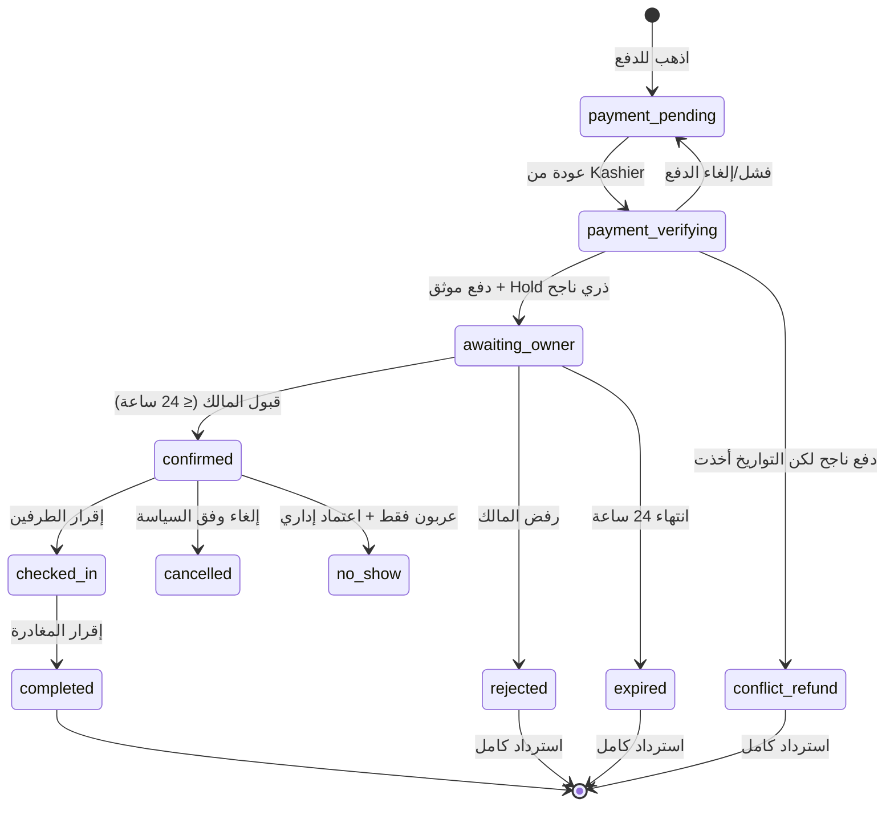
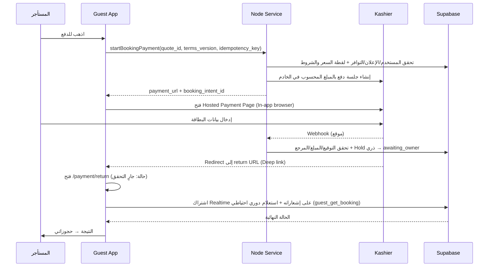

# OnAir — Guest App Plan (تطبيق المستأجر)

> **الوثيقة:** خطة تنفيذ تطبيق المستأجر فقط (Guest Mobile App)
> **المرجع الأعلى:** `docs/OnAir Master Plan.md` (النسخة 1.0 — بعد اعتماد 120/120 قرارًا)
> **مرجع التصميم:** `docs/UI_UX_DESIGN_SYSTEM.md`
> **التقنية:** Flutter + Dart
> **المسؤول:** مطوّر تطبيق المستأجر (واحد من 3 مطورين: المستأجر / المالك والمكتب والموظفين / لوحة الإدارة)
> **تاريخ الإعداد:** 26 أكتوبر 2026
> **آخر تعديل:** 26 أكتوبر 2026 — كل تطبيق مشروع ومستودع مستقل، والربط بين التطبيقات عبر الـ Backend فقط (2.1، 2.2، 2.4، 3.3 وما يتبعها؛ مطابق لـ 13.3 في الـ Master Plan)؛ وقرارات الدخول (مطابقة لـ 2.3 و16.1 في الـ Master Plan): كود بالبريد بدل الروابط، الهاتف غير مطلوب عند التسجيل بالبريد، خروج تلقائي بعد 30 يومًا، أرقام مصر فقط في البداية (1.1، 5.3، 6.2، 11.1)؛ وإدارة حالة تطبيق المستأجر بـ Cubit (3.1، 3.2، 12.4).
> **تعديل 27 أكتوبر 2026:** إضافة قواعد الشغل على الداتابيز المشتركة (2.5) وتنفيذات Remote/Mock لحد ما الجداول تجهز (2.6)
> **تعديل 28 أكتوبر 2026:** العنوان التفصيلي للشقة عام في صفحة التفاصيل بدل «بعد التأكيد» ([D-001](decisions/D-001-public-property-address.md)؛ 6.5، 6.8، 10.1، 18، 19)
> **تعديل 28 أكتوبر 2026 (الـ Backend الموحد):** إلغاء SMS ودخول الهاتف؛ التسجيل بالبريد + كلمة المرور + رقم هاتف مصري + «عليه واتساب؟» أو رقم واتساب اختياري، وتأكيد البريد والهاتف بكود واحد على البريد (1.1، 5.3، 6.2، 6.11، 6.18)؛ ربط التطبيق بجداول Supabase الموحدة وصلاحياته (2.3، **2.7**، 10)؛ إشعارات موحدة مع باقي التطبيقات (9.3). المرجع: [OnAir Backend Master Plan.md](OnAir%20Backend%20Master%20Plan.md).

---

## 0. كيف تُقرأ هذه الوثيقة

### 0.1 أولوية المصادر

1. `OnAir Master Plan.md` هو المرجع النهائي لأي قاعدة عمل. إذا تعارضت هذه الخطة معه، **يُقدَّم الـ Master Plan**.
2. هذه الخطة تحوّل ما يخص المستأجر في الـ Master Plan إلى شاشات وسلوك ومعمارية ومهام تنفيذ.
3. `UI_UX_DESIGN_SYSTEM.md` هو مرجع الألوان والخط. ما لم يُذكر فيه (المسافات، الزوايا، الظلال، الأيقونات) مقترح هنا ومعلَّم بذلك حتى يعتمده التصميم.

### 0.2 التصنيفات المستخدمة (نفس تصنيفات الـ Master Plan)

- **[معتمد]**: قاعدة منتج من القرارات الـ120، لا تُغيَّر من طرف المطوّر.
- **[تطبيق مقترح]**: اختيار هندسي مناسب يمكن مراجعته دون فتح قرار المنتج.
- **[يُحسم أثناء التنفيذ]**: قيمة أو اعتماد خارجي غير محسوم؛ لا يُخترع.

### 0.3 القاعدة الذهبية لتطبيق المستأجر

> **التطبيق واجهة عرض وطلب فقط. الخادم هو صاحب القرار.**
> التطبيق لا يحسب السعر النهائي، ولا يقرر نجاح الدفع، ولا يحسب مبلغ الاسترداد، ولا يقرر الإجراءات المتاحة على الحجز. كل ذلك يأتي من الخادم، والتطبيق يعرضه بوضوح وبالعربية.

---

## 1. نطاق التطبيق

### 1.1 ما يفعله المستأجر في التطبيق [معتمد]

| المجال | الوظائف |
|---|---|
| الحساب | تسجيل/دخول **بالبريد + كلمة المرور** فقط (لا SMS)؛ التسجيل يطلب رقم هاتف مصري + «الرقم عليه واتساب؟» أو رقم واتساب اختياري؛ كود واحد من 6 أرقام على البريد يؤكد البريد والهاتف (إلزامي قبل أول حجز) |
| الاستكشاف | الرئيسية: بحث بارز، مناطق ووجهات، شقق مقترحة |
| البحث | الموقع، تاريخ الوصول/المغادرة، عدد الضيوف، نطاق السعر، الغرف، الحمامات، المرافق، نوع العقار، الترتيب بالسعر أو الأحدث، مع **مراعاة التوافر طوال المدة** |
| تفاصيل الشقة | صور، وصف، مواصفات، مرافق، موقع، سعر الليلة النهائي، شروط الإقامة والضيوف والزوار، التوافر، سياسة العربون والإلغاء، التقييمات المعتمدة، زر «احجز الآن» |
| الحجز | قبول الشروط بالضغط على «احجز الآن» → اختيار التواريخ → ملخص الحجز → الدفع عبر Kashier **أولًا** → انتظار تأكيد المالك (24 ساعة) |
| حجوزاتي | متابعة الحالات، التفاصيل، الـ Timeline، حالة الاسترداد منفصلة عن حالة الحجز |
| الإقامة | سداد المتبقي قبل الوصول، تأكيد دفع نقدي بكود على البريد، «استلمت الشقة»، «غادرت الشقة»، الرد على مطالبة ضرر |
| الإلغاء والاسترداد | طلب إلغاء وفق السياسة المحفوظة، معاينة المبلغ المسترد من الخادم، متابعة الاسترداد |
| المفضلة | إضافة/إزالة شقة |
| التقييم | 1–5 نجوم + تعليق، فقط بعد Check-out موثق، ويظهر بعد مراجعة OnAir |
| الإشعارات | مركز إشعارات داخل التطبيق + Push (+ بريد للأحداث المهمة يرسله الخادم)، ضمن نظام إشعارات موحد مع تطبيق المالك ولوحة الإدارة — **لا SMS** |
| الدعم | التواصل مع خدمة عملاء OnAir فقط (حالات/تذاكر) |
| الإعدادات | البيانات الشخصية، تحقق وسائل التواصل، تفضيلات الإشعارات، اللغة، المظهر (فاتح/داكن)، الأمان والجلسات، حذف الحساب |

### 1.2 خارج النطاق — ممنوع بناؤه [معتمد]

| الممنوع | السبب في الـ Master Plan |
|---|---|
| محادثة أو زر مراسلة مباشر بين المستأجر والمالك | القرار 102 — التواصل عبر خدمة عملاء OnAir فقط |
| الدفع بعد قبول المالك أو مهلة 60 دقيقة للدفع | ملغى؛ المسار المعتمد: الدفع أولًا |
| «ادفع نقدًا عند الاستلام» عند تقديم الطلب | لا يجوز دون قرار منتج جديد (5.5) |
| أسعار حسب أيام الأسبوع أو الموسم | سعر الليلة ثابت (3.4) |
| رسوم خدمة/تنظيف/ضرائب غير مقررة | ممنوع اختراع رسوم (3.4) |
| إثبات هوية حكومي لكل مستأجر | غير مفروض في المسار العادي (2.3) |
| OTP أو صور إلزامية لتوثيق Check-in | ممنوع (6.1) |
| خريطة تفاعلية بمسامير الأسعار | غير مفروضة؛ يمكن إضافتها لاحقًا فقط بقرار |

### 1.3 ملاحظات على ملف التصميم مقابل قرارات المنتج

ملف `UI_UX_DESIGN_SYSTEM.md` يعرّف Tokens لعناصر **لا يوجد لها قرار منتج** في الـ Master Plan:

| Token في التصميم | الوضع في تطبيق المستأجر |
|---|---|
| VIP (Gold, Scaffold, Card, Badge, Image gradient) | تُنقل الـ Tokens إلى الكود لكن **لا تُبنى ميزة VIP** حتى يصدر قرار |
| Offer / Price Before Discount / Price After Discount / Duration Banner | **لا عروض ولا خصومات** في التسعير المعتمد؛ الـ Tokens محفوظة فقط |
| Social Fill (أزرار دخول اجتماعي) | الدخول المعتمد: بريد + كلمة مرور فقط؛ **لا Social Login** |
| Auth Card / Auth Border «معرّف وغير ظاهر» | لا تُستخدم |

---

## 2. حدود المسؤولية مع باقي الفريق

### 2.1 توزيع العمل

| المطوّر | يملك | يعتمد عليه تطبيق المستأجر في |
|---|---|---|
| **مطوّر تطبيق المستأجر** (هذه الخطة) | مستودع تطبيق المستأجر (هذا المشروع) بالكامل، بما فيه الـ Design System والـ Core الخاصة به | — |
| مطوّر تطبيق المالك/المكتب/الموظفين | مستودع تطبيق المالك (مشروع منفصل) | قبول/رفض الطلب، «تم تسليم الشقة»، تأكيد استلام الشقة عند المغادرة، إنشاء مطالبة ضرر، التحصيل النقدي |
| مطوّر لوحة الإدارة (Next.js) | مستودع لوحة الإدارة (مشروع منفصل) | اعتماد العقارات، مراجعة التقييمات، حالات الدعم، تسجيل قرار المالك هاتفيًا، الاستردادات |

الاعتماد على التطبيقات الأخرى في الجدول **اعتماد على نتائج تمر عبر الـ Backend** (حالات وبيانات)، وليس على كود مشترك.

### 2.2 العلاقة مع باقي التطبيقات: عبر الـ Backend فقط [معدّل — مطابق لـ 13.3 في الـ Master Plan]

كل تطبيق في OnAir **مشروع مستقل بمستودع مستقل**. لا توجد حزم كود مشتركة بين المستودعات، ولا يعتمد هذا المستودع على كود أي تطبيق آخر (ولا العكس). نقطة الربط الوحيدة هي الـ Backend (Supabase + خدمات Node) وعقود API التي ينشرها.

الوحدات الأساسية **داخل هذا المستودع**:

| الوحدة | المحتوى | ملاحظات |
|---|---|---|
| `lib/design_system/` | Tokens، Theme، الخط، المكونات الأساسية (أزرار، حقول، Chips الحالة، بطاقات، Bottom Nav، حالات Loading/Empty/Error) | تُبنى من `UI_UX_DESIGN_SYSTEM.md`. تطبيق المالك يبني نسخته من نفس المواصفات في مستودعه |
| `lib/core/` | Supabase client، مصادقة، تخزين آمن، Dio + Interceptors، معالجة الأخطاء، Logging، Env/Flavors، تنسيق المال والتواريخ | البنية التحتية للتطبيق |
| `lib/core/api/` | Models + Clients مولّدة من عقود API التي ينشرها الـ Backend | مولّدة؛ لا تُكتب ولا تُعدَّل يدويًا |

**قواعد:**
- `design_system` و`core` لا يستوردان أي شيء من `features/`؛ الميزات تعتمد عليهما وليس العكس.
- الاتساق مع تطبيق المالك ولوحة الإدارة (أسماء حالات الحجز، أكواد الأخطاء، شكل البيانات) يأتي من **عقود الـ Backend**.
- الاتساق البصري يأتي من **ملف التصميم نفسه**، وليس من حزمة كود مشتركة.

### 2.3 ملكية الـ Backend [محسوم — 28 أكتوبر 2026]

- الـ Backend كله (Supabase migrations + RLS + الدوال + خدمة Node للتكاملات + الإشعارات + المهام الخلفية) متعرّف بالكامل في [`OnAir Backend Master Plan.md`](OnAir%20Backend%20Master%20Plan.md)، وبيتنفذ في مستودع الـ Backend المشترك `onair-backend`.
- الملف ده هو **المرجع الوحيد** لأسماء الجداول والحالات والدوال وأكواد الأخطاء. أي اسم مختلف هنا أو في `contracts/` بتاع المستودع ده، اسم الـ Backend Master Plan هو اللي يمشي.
- مسودات العقود الموجودة في `contracts/` (`supabase-backend.md`، `supabase-discovery.md`، `node-api.openapi.yaml`) لازم تتحدث عشان تطابقه، وأهم الفروق:
  - **مفيش Phone provider ولا Send SMS hook**؛ الدخول بالبريد + كلمة المرور، والهاتف بيتأكد بكود على البريد.
  - `booking_date_locks` + `property_blocks` بقوا جدول واحد `property_calendar_locks`.
  - `complete_guest_profile` اتشالت؛ بيانات التسجيل (الاسم، الهاتف، الواتساب، نسخة الشروط) بتتبعت مع `auth.signUp`، والتعديل بـ `common_update_profile`.
- لحد ما الخدمات الحقيقية تجهز: التطبيق شغال على Mock بنفس العقد (2.5 و2.6).

### 2.4 وضع المستودع الحالي [محسوم]

المشروع الحالي `D:\flutter\on_air` (`pubspec.yaml` باسم `on_air`) **هو مستودع تطبيق المستأجر نفسه**. لا يُحوَّل إلى Monorepo ولا يُنقل لاحقًا؛ تطبيق المالك ولوحة الإدارة والـ Backend في مستودعات منفصلة.

- كود التطبيق يعيش في `lib/` بجذر المستودع (انظر 3.3).
- لا حاجة لـ Dart pub workspaces أو Melos.
- ضمن G0 مع إعداد الـ Flavors: تغيير الـ Application ID / Bundle ID من القيمة الافتراضية `com.example.on_air` إلى معرّف OnAir النهائي (انظر 3.4).

### 2.5 قواعد الشغل على الداتابيز المشتركة [مهم]

**الخطر:** 3 أشخاص، كل واحد معاه Claude، بيعدّلوا في نفس الداتابيز. من غير قواعد، ممكن واحد يمسح أو يغيّر حاجة شغّالة عند التاني من غير ما يعرف، ومحدش هيعرف مين غيّر إيه.

- **كل تعديل في الداتابيز يبقى Migration file**، مش من الـ Dashboard أو الـ SQL Editor مباشرة.
  - الملفات بتبقى في مستودع Git مشترك للـ Backend (`supabase/migrations/`).
  - كده يبقى عندنا تاريخ لكل تغيير، ونقدر نبني Production بنفس الشكل بالظبط.
- **التجربة على Supabase محلي الأول** (`supabase start` على Docker)، وبعد ما الـ Migration تشتغل صح ترتفع على Staging.
- **الرفع على Staging** بعد Pull Request يراجعه واحد تاني، وبعدين `supabase db push`. يفضل يبقى من CI أو من شخص واحد متفقين عليه.
- **Production محدش يلمسه مباشرة.** الرفع عليه بقرار من التلاتة وبعد ما الشغل يتجرب على Staging.
- **التعديلات تبقى إضافة مش تكسير:** ممنوع `DROP` لجدول أو عمود، أو تغيير اسم، أو تغيير نوع عمود مستخدم، من غير اتفاق. لو محتاج تغيّر حاجة، ضيف الجديد الأول، وانقل التطبيقات عليه، وبعدين امسح القديم.
- **قبل ما تكتب Migration جديدة اعمل `git pull`**، عشان ملفاتك تبقى بعد ملفات زمايلك في الترتيب، ومتعملوش نفس التعديل مرتين.

**Claude والأدوات التانية:**

- لو حد ربط Supabase MCP بالـ Claude بتاعه، يبقى **Read-only** على المشروع المشترك، والكتابة عن طريق ملفات Migration بس.
- ممنوع تخلي Claude يشغّل SQL بيمسح أو بيعدّل بيانات على Staging أو Production من غير ما تراجع الأمر بنفسك.
- مفتاح `service_role` ميتحطش في أي تطبيق، ولا في ملف بيترفع على Git.

**قواعد عامة:**

- **RLS على كل جدول من أول يوم.** الجدول الجديد ميترفعش من غير Policies، عشان كل تطبيق يشوف المسموح له بس.
- **الأنواع (Types):** كل تطبيق بيولّد الأنواع بتاعته من الداتابيز أو من العقد (`supabase gen types` أو OpenAPI)، ومحدش يكتبها بإيده.
- **Seed data:** فيه ملف `seed.sql` مشترك فيه بيانات تجربة (مستأجر، مالك، مكتب، موظف، شقق، حجوزات بحالات مختلفة)، عشان كل واحد يجرب على نفس البيانات.

### 2.6 لحد ما الجداول تجهز

- كل Feature في التطبيق ليها **Repository interface** وتنفيذين: **Remote** (الحقيقي) و**Mock** (بيانات وهمية).
- التبديل بينهم بـ **flag في إعدادات البيئة**، فنشتغل على الشاشات من غير ما نستنى الـ Backend.
- الـ Mock لازم يلتزم بنفس شكل العقد المتفق عليه، عشان التبديل يبقى من غير تعديل في الشاشات.

### 2.7 قاعدة البيانات في Supabase — جداول التطبيق وصلاحياته [معتمد — 28 أكتوبر 2026]

> المرجع التفصيلي للأعمدة والقيود: [`OnAir Backend Master Plan.md`](OnAir%20Backend%20Master%20Plan.md) (الأقسام 4–12).

#### 2.7.1 الفكرة
- تطبيق المستأجر بيتصل بـ **نفس مشروع Supabase** اللي بيستخدمه تطبيق المالك ولوحة الإدارة (لكل بيئة: `onair-staging` / `onair-production`). **مفيش جداول خاصة بالمستأجر**؛ المستأجر هو صف في جدول `profiles` الموحد، وحجوزاته صفوف في `bookings` الموحد اللي المالك والإدارة بيشوفوه من ناحيتهم.
- **المستأجر مالوش مفاتيح صلاحيات.** صلاحيته الوحيدة إنه **صاحب الصف** (`guest_user_id = auth.uid()` / `user_id = auth.uid()`)، وده متطبق بـ RLS وجوه كل دالة.
- **الزائر (anon)** بيقدر ينادي دوال الاستكشاف بس.
- **مفيش كتابة مباشرة في أي جدول** ما عدا `favorites`. كل كتابة = دالة `guest_*` أو `common_*` أو مسار في خدمة Node.
- مسموح للتطبيق: Supabase URL + **anon key** فقط.

#### 2.7.2 الجداول اللي التطبيق بيقرا منها أو بيأثر فيها

| الجدول (Supabase) | التطبيق بيقرا إيه | إزاي | الكتابة |
|---|---|---|---|
| `auth.users` (Supabase Auth) | جلسته | `supabase_flutter` | `signUp` / `signInWithPassword` / `verifyOtp` / `resetPasswordForEmail` / `signOut` |
| `profiles` | **صفه بس**: الاسم، البريد، الهاتف وحالة تأكيده، الواتساب، اللغة | `select` مباشر تحت RLS أو `common_get_my_context()` | `common_update_profile`، `common_request_phone_change` + الكود، `common_request_account_deletion` |
| `app_config` | الإصدار الأدنى، رقم/واتساب الدعم، نسخة الشروط وروابطها | `select` مباشر (متاح لـ anon) | — |
| `faq_items` | الأسئلة الشائعة للمستأجر | `common_list_faq('guest')` | — |
| `locations`, `amenities`, `property_types` | القوائم المرجعية | `guest_get_reference_data`, `guest_search_locations` | — |
| `properties`, `property_versions`, `property_media`, `markup_policies`, `booking_policies`, `property_calendar_locks` | **مفيش قراءة مباشرة.** بيوصله الإعلانات المنشورة بس: السعر النهائي لليلة، العنوان النصي، الصور، القواعد، السياسة، والأيام غير المتاحة (من غير سبب) | `guest_home_feed`, `guest_search_properties`, `guest_get_property`, `guest_get_property_unavailable_dates` | — |
| `property_reviews` | التقييمات المعتمدة (باسم مختصر) + تقييمه هو وحالته | `guest_list_property_reviews`, `guest_get_booking` | `guest_submit_review` |
| `favorites` | صفوفه | `select` مباشر | `insert` / `delete` مباشر على صفوفه |
| `booking_quotes` | الـ Quote بتاعه | `guest_quote_booking` | (الدالة بتنشئه) |
| `bookings` | **حجوزاته بس**: الحالة، اللقطات، المهلة، `available_actions`، تعليمات الوصول بعد التأكيد | `guest_list_bookings`, `guest_get_booking` (التحديث اللحظي عبر Realtime على `notifications`) | Node `start-payment` / `remaining-payment`، `guest_cancel_booking`، `guest_confirm_checkin`، `guest_confirm_checkout` |
| `booking_events` | أحداث حجوزاته اللي `visibility = all` | ضمن `guest_get_booking` | — |
| `payments` | مدفوعات حجوزاته (المبلغ، الحالة، الوقت، الوسيلة) | ضمن `guest_get_booking` | `guest_start_cash_confirmation`، `guest_confirm_cash_payment` |
| `refunds` | حالة ومبلغ استرداداته | ضمن `guest_get_booking` | — |
| `replacement_offers` | العروض البديلة على حجوزاته | ضمن `guest_get_booking` | `guest_respond_replacement_offer` |
| `damage_claims` | المطالبات على حجوزاته | ضمن `guest_get_booking` | `guest_respond_damage_claim` |
| `support_cases`, `case_messages` | حالاته ورسائله مع OnAir (مش الملاحظات الداخلية) | `common_list_my_support_cases`, `common_get_support_case` + Realtime | `common_create_support_case`, `common_reply_support_case` |
| `attachments` | مرفقاته ومرفقات الكيانات اللي يخصها | رابط مؤقت من Node `GET /v1/files/{id}/url` | Node `POST /v1/uploads/sign` |
| `notifications` | **إشعاراته بس** (`audience = guest`) | `common_list_notifications` + **Realtime** | `common_mark_notifications_read` |
| `notification_preferences` | تفضيلاته | `common_get_notification_preferences` | `common_set_notification_preferences` |
| `device_tokens` | — | — | `common_register_device(app='guest')` / `common_unregister_device` |

**مش متاحة للتطبيق خالص:** `workspaces`, `workspace_members`, `workspace_invites`, `member_property_assignments`, `verification_documents`, `workspace_payout_methods`, `property_cash_collectors`, `owner_payables`, `settlements`, `cash_handovers`, `kashier_payouts`, `ledger_accounts`, `journal_entries`, `journal_lines`, `staff_tasks`, `staff_task_updates`, `audit_log`, `platform_settings`, `permissions`, `role_presets`, `notification_types` (بيوصله النص من الترجمة)، `notification_deliveries`، وكل جداول `private`.

**بيانات ممنوع توصل للمستأجر حتى جوه الدوال:** السعر الأساسي والهامش، إحداثيات الشقة، أي بيانات تواصل للمالك أو موظفيه، بيانات حجوزات مستأجرين تانيين، الأسماء الكاملة للمقيّمين.

#### 2.7.3 خدمة Node اللي التطبيق بيكلمها

| المسار | الاستخدام |
|---|---|
| `POST /v1/otp/send` | إرسال كود على البريد (تغيير الهاتف، تأكيد النقدي، حذف الحساب) |
| `POST /v1/guest/bookings/start-payment` | بدء الدفع (Kashier) |
| `POST /v1/guest/bookings/{id}/remaining-payment` | سداد المتبقي |
| `POST /v1/uploads/sign` · `GET /v1/files/{id}/url` | رفع وعرض المرفقات الخاصة |

#### 2.7.4 الإشعارات اللي بتوصل المستأجر
القائمة الكاملة في القسم 9.3، ومصدرها مصفوفة Backend Master Plan 9.7. التطبيق **مبيبعتش إشعارات**؛ الخادم بيولّدها مع كل حدث.

---

## 3. المعمارية التقنية للتطبيق

### 3.1 الطبقات [تطبيق مقترح]

بنية **Feature-first** مع فصل الطبقات داخل كل ميزة:

```
Presentation (Widgets + Cubits + immutable states)
        ↓ يستدعي
Application (Use cases بسيطة عند الحاجة فقط)
        ↓ يستدعي
Domain (Entities + Value Objects: Money, DateRange, BookingStatus...)
        ↑ تنفذها
Data (Repositories → Supabase / Node API / Cache)
```

- الـ Widget لا تستدعي Supabase أو Dio مباشرة أبدًا.
- الـ Repository هو المكان الوحيد الذي يعرف مصدر البيانات.
- لا Use case فارغ يمرر الطلب فقط؛ تُضاف طبقة Application فقط عندما يوجد تنسيق حقيقي (مثل رحلة الدفع).

### 3.2 الحزم المقترحة [تطبيق مقترح]

> تُثبَّت أحدث نسخة مستقرة عند بدء المشروع، وتُقفل عبر `pubspec.lock`. لا تُضاف حزمة جديدة دون مراجعة (حجم التطبيق + الصيانة + الأمان).

| الغرض | الحزمة | السبب |
|---|---|---|
| إدارة الحالة | `flutter_bloc` (Cubit) + `bloc_test` للاختبارات | حالات واضحة قابلة للاختبار، حقن الاعتماديات عبر `BlocProvider`، و`BlocSelector` لتقليل إعادة البناء؛ يُغلق الـ Cubit الطلبات والاشتراكات في `close()` |
| التنقل | `go_router` | Deep links، Guards للمصادقة، `StatefulShellRoute` للـ Bottom Nav مع حفظ حالة كل تبويب |
| Supabase | `supabase_flutter` | Auth، قراءة البيانات تحت RLS، Realtime |
| طلبات Node | `dio` | Interceptors للتوكن، Request ID، Retry، Cancel tokens |
| النماذج | `freezed` + `json_serializable` | Immutable models، `copyWith`، Union types للحالات |
| التخزين الآمن | `flutter_secure_storage` | جلسة المستخدم (Keychain / Keystore) |
| تفضيلات غير حساسة | `shared_preferences` | اللغة، المظهر، آخر بحث |
| Cache محلي للقراءة | `drift` (SQLite) أو Cache بسيط في الذاكرة + ملفات | عرض حجوزاتي وآخر بيانات بدون إنترنت؛ يُختار أبسط حل يكفي |
| الصور | `cached_network_image` | Cache على القرص + Placeholder |
| الإشعارات | `firebase_core` + `firebase_messaging` + `flutter_local_notifications` | FCM/APNs [معتمد] |
| الروابط | `app_links` | استقبال Deep links (عودة الدفع، فتح إشعار) |
| فتح صفحة الدفع | `url_launcher` بوضع `LaunchMode.inAppBrowserView` | Chrome Custom Tabs / SFSafariViewController (انظر 8.3) |
| الاتصال | `connectivity_plus` | إظهار شريط «لا يوجد اتصال» فقط؛ لا يُعتمد عليه لتحديد نجاح الطلبات |
| الترجمة | `flutter_localizations` + `intl` + ملفات `.arb` | RTL أصيل وتجهيز للإنجليزية |
| مراقبة الأعطال | `firebase_crashlytics` أو `sentry_flutter` | [يُحسم أثناء التنفيذ] مع الفريق؛ أداة واحدة للتطبيق، ويُفضَّل نفس الأداة في كل تطبيقات OnAir لتوحيد المتابعة |
| الاختبارات | `flutter_test`، `mocktail`، `integration_test` | — |

- يُنشأ Cubit الشاشة عبر `BlocProvider` ويُغلق عند مغادرتها، بينما تبقى Cubits الجلسة والإعدادات في جذر التطبيق. تُمرَّر المستودعات للـ Cubit عبر المُنشئ، وتُختبر انتقالاته بـ `bloc_test`.

### 3.3 هيكل المجلدات [تطبيق مقترح]

```text
on_air/                                # جذر المستودع = تطبيق المستأجر
├── lib/
│   ├── main_staging.dart
│   ├── main_production.dart
│   ├── bootstrap.dart                 # تهيئة Firebase/Supabase/Crash reporting/Env
│   ├── app/
│   │   ├── app.dart                   # MaterialApp.router + Theme + Locale
│   │   ├── router/                    # go_router: routes, guards, deep links
│   │   └── shell/                     # Bottom Navigation shell
│   ├── core/                          # Supabase, Dio, session, errors, Money, dates, logger, env
│   │   └── api/                       # Client/Models مولّدة من عقود الـ Backend (لا تُعدَّل يدويًا)
│   ├── design_system/                 # OnAirColors, OnAirTextStyles, Theme, المكونات (4.7)
│   ├── features/
│   │   ├── auth/                      # login, register, otp, forgot password, verify email
│   │   ├── home/
│   │   ├── search/                    # search form, filters, results
│   │   ├── property/                  # details, gallery, rules, reviews list
│   │   ├── booking_flow/              # dates, summary, payment launch, payment return
│   │   ├── bookings/                  # my bookings, booking details, timeline
│   │   ├── stay/                      # remaining payment, cash otp, check-in/out, damage claims
│   │   ├── cancellation/              # preview + request + refund status
│   │   ├── favorites/
│   │   ├── reviews/                   # write review, my reviews
│   │   ├── notifications/
│   │   ├── support/                   # cases, new case, case details, FAQ
│   │   └── profile/                   # profile, settings, security, delete account
│   │       └── (كل ميزة: data/ domain/ presentation/)
│   ├── l10n/                          # app_ar.arb, app_en.arb
│   └── shared/                        # widgets تستخدمها أكثر من ميزة (غير مكونات design_system)
├── assets/
│   ├── fonts/cairo/                   # الأوزان المستخدمة فقط
│   └── images/
├── contracts/                         # مسودة عقود API (حتى ينشر الـ Backend العقود الرسمية)
├── tools/mock_server/                 # Mock server محلي مبني على العقود
├── test/
├── integration_test/
└── pubspec.yaml
```

### 3.4 البيئات Flavors [معتمد: Staging + Production]

| البند | Staging | Production |
|---|---|---|
| Application ID / Bundle ID | `...guest.staging` | `...guest` |
| اسم التطبيق | OnAir (Staging) | OnAir |
| Supabase URL + anon key | مشروع Staging | مشروع Production |
| Node API base URL | Staging | Production |
| Firebase project | منفصل | منفصل |
| Kashier | وضع الاختبار (المفاتيح في الخادم فقط) | الإنتاج (المفاتيح في الخادم فقط) |

- تمرير الإعدادات عبر `--dart-define-from-file=env/staging.json` (ملفات `env/*.json` خارج Git، وتُحقن في CI من Secrets).
- **ما يُسمح بوجوده في التطبيق:** Supabase URL، Supabase **anon key** فقط، Node API base URL، إعدادات Firebase العامة. **لا** `service_role` ولا أي مفتاح Kashier/Resend/FCM server أبدًا [معتمد 13.4].

---

## 4. تطبيق نظام التصميم UI/UX

### 4.1 تحويل الـ Tokens إلى كود

كل الألوان تعيش في `lib/design_system/` كـ `ThemeExtension` باسم `OnAirColors` بنسختين `light` و`dark`. **ممنوع كتابة أي `Color(0xFF...)` داخل شاشة**؛ الشاشة تقرأ من `context.colors`.

```dart
@immutable
class OnAirColors extends ThemeExtension<OnAirColors> {
  final Color primary, primaryLight, primaryDark, primaryAccent;
  final Color background, surface, detailCard, badgeActive;
  final Color textPrimary, textSecondary, welcome, linkAccent;
  final Color borderSubtle, borderDetail, divider;
  final Color star, favorite;
  final StatusColors status;      // success, warning, info, destructive...
  final BookingChipColors chips;  // pending, completed, rejected, cancelled...
  // ...
  static const light = OnAirColors(primary: Color(0xFF006399), /* ... */);
  static const dark  = OnAirColors(primary: Color(0xFF006399), /* ... */);
}
```

### 4.2 خريطة الـ ColorScheme الأساسية (من ملف التصميم)

| الدور | Light | Dark |
|---|---|---|
| `primary` | `#006399` | `#006399` |
| `onPrimary` | `#FFFFFF` | `#FFFFFF` |
| `surface` (البطاقات/الحقول) | `#FFFFFF` | `#1A2332` |
| `scaffoldBackground` | `#F7F7F3` | `#0F1419` |
| `onSurface` (النص الأساسي) | `#1A1A2E` | `#FFFFFF` |
| `onSurfaceVariant` (النص الثانوي) | `#6B7280` | `#B0BEC5` |
| `outline` (حد الحقل) | `#E8E8E8` | `#2A3544` |
| `outlineVariant` (الفواصل) | `#E5E7EB` | `#2A3544` |
| `error` | `#DC2626` | `#EF9A9A` (انظر 4.8) |
| Secondary container (Badge / Nav Active) | `#D6EBF7` | `#1E3A5F` |
| رابط «عرض الكل» | `#00677D` | `#81D4FA` |
| الترحيب | `#000000` | `#81D4FA` |
| عناوين على الخلفية الفاتحة | `#0A3D62` (Primary Dark) | `#FFFFFF` |

### 4.3 التدرجات وأماكن استخدامها في تطبيق المستأجر

| التدرج | الاستخدام |
|---|---|
| **Splash** (`#004B74` → `#006399` → `#147DBC`، داكن: `#002D47` → `#006399` → `#0A3D62`) | شاشة البداية مع كلمة «OnAir» بحجم 48 / وزن 800 / تباعد 1.2 |
| **Header** (`#147DBC` → `#F7F7F3`، داكن: `#0A3D62` → `#0F1419`) | خلفية رأس الصفحة الرئيسية خلف الترحيب ومربع البحث |
| **Auth Button** (`#004B74` → `#147DBC`، داكن: `#002D47` → `#0A3D62`) + ظل `#006399` بشفافية 25٪ | الأزرار الرئيسية في شاشات الدخول والتسجيل والتحقق |
| **Reviews** (`#E8F4FC` → `#D6EBF7`، داكن: `#1A2332` → `#0F1419`) | قسم التقييمات في تفاصيل الشقة وشاشة كتابة التقييم |
| **FAQ Hero** (`#147DBC` → `#006399`، داكن: `#0A3D62` → `#006399`) | رأس صفحة الدعم والأسئلة الشائعة |

### 4.4 الخط

- العائلة: **Cairo** للعربي والإنجليزي، **مضمّن داخل التطبيق كـ Asset** (وليس تحميل وقت التشغيل) — أسرع، يعمل بلا إنترنت، ولا قفزة في الخط عند الفتح.
- تُضمَّن الأوزان المستخدمة فعلًا فقط: **400, 500, 600, 700, 800**. الأوزان 200/300 غير مستخدمة في الأحجام المعرّفة، و900 مستخدم فقط في شارة VIP (خارج النطاق) → لا تُضمَّن لتقليل حجم التطبيق.
- `TextTheme` يُبنى من «السلم العام» في ملف التصميم (Display → Label).
- أنماط مخصصة في `OnAirTextStyles` من جدول «الأحجام المستخدمة»:

| الاسم في الكود | الحجم / الوزن | الاستخدام |
|---|---|---|
| `authTitle` | 36 / 800، تباعد -0.5، ارتفاع 1.1 (32 للشاشات الأضيق من 360) | عنوان شاشات الدخول |
| `authDescription` | 14 / 400، ارتفاع 1.5 | وصف تحت العنوان |
| `input` / `placeholder` | 15 / 500 — 15 / 400 | الحقول |
| `forgotLink` | 11 / 700، تباعد 0.5 | «نسيت؟» |
| `authButton` | 15 / 600 | الأزرار الرئيسية |
| `homeWelcome` | 15 / 700، ارتفاع 1.15 | «أهلًا» |
| `homeUserName` | 18 / 500، ارتفاع 1.15 | اسم المستخدم |
| `sectionTitle` | 18 / 800 | عناوين الأقسام |
| `seeAll` | 14 / 700 | «عرض الكل» |
| `homeSearch` | 16 / 400 | نص مربع البحث |
| `areaCardTitle` / `areaBadge` | 17 / 800 — 11 / 700 | بطاقة المنطقة/الشارع وشارتها |
| `propertyTitle` | 15 / 800 | عنوان الشقة في البطاقة |
| `price` | 14 / 800 | السعر في البطاقة |
| `navLabel` | 10 / 700 (نشط) — 10 / 500 (غير نشط) | تسميات الـ Bottom Nav |

- **دعم تكبير الخط:** لا يُقفل `textScaler`. يُسمح بالتكبير حتى حد أقصى معقول (مثلًا 1.3) عبر `MediaQuery.withClampedTextScaling` حتى لا تنكسر البطاقات، مع اختبار كل شاشة على أكبر حجم.

### 4.5 المسافات والزوايا والظلال والأيقونات [تطبيق مقترح — غير موجودة في ملف التصميم]

ملف التصميم لا يحدد هذه القيم. المقترح حتى يعتمدها المصمم أو Figma:

| البند | القيم المقترحة |
|---|---|
| Spacing (شبكة 4) | `4, 8, 12, 16, 20, 24, 32, 40, 48` — الهامش الجانبي للشاشة 16 |
| Radius | `8` (Chips)، `12` (حقول وأزرار)، `16` (بطاقات)، `24` (Bottom sheets) |
| Elevation | البطاقات بحد `Border Subtle` بدل ظل قوي؛ ظل خفيف فقط للأزرار الرئيسية (ظل Auth Button) |
| الأيقونات | Material Symbols (Rounded) — مجموعة واحدة للتطبيقين |
| حجم هدف اللمس | 48×48 كحد أدنى |

### 4.6 حالات الحجز ← ألوان الشارات (Chips)

ربط حالات الحجز (5.3 في الـ Master Plan) بـ Tokens ملف التصميم:

| الحالة الداخلية | النص للمستخدم | خلفية Light / نص | خلفية Dark / نص |
|---|---|---|---|
| `payment_pending` | بانتظار إتمام الدفع | Warning Container `#FFCC80` / `#E65100` | `#E65100` / `#FFCC80` |
| `payment_verifying` | جارٍ التحقق من الدفع | Info Container `#81D4FA` / `#01579B` | `#0277BD` / `#E1F5FE` |
| `awaiting_owner` | بانتظار تأكيد المالك | Pending `#006399` / `#FFFFFF` | `#1E3A5F` / `#FFFFFF` |
| `confirmed` | حجز مؤكد | Success Container `#A5D6A7` / `#1B5E20` | `#1B5E20` / `#A5D6A7` |
| `checked_in` | إقامة جارية | Badge `#D6EBF7` / `#006399` | `#1E3A5F` / `#81D4FA` |
| `completed` | إقامة مكتملة | Completed `#E8F5E9` / `#2E7D32` | `#1B3D2F` / `#81C784` |
| `rejected` | رفض المالك | Rejected `#FDECEA` / `#C62828` | `#3D1B1F` / `#EF9A9A` |
| `expired` | انتهت مهلة التأكيد | Rejected `#FDECEA` / `#C62828` | `#3D1B1F` / `#EF9A9A` |
| `cancelled` | ملغي | Cancelled `#F3F4F6` / `#6B7280` | `#2A2A2A` / `#B0BEC5` |
| `no_show` | لم يحضر | Cancelled `#F3F4F6` / `#6B7280` | `#2A2A2A` / `#B0BEC5` |

**شارة الاسترداد (منفصلة دائمًا عن شارة الحجز) [معتمد 4.7]:**

| حالة الاسترداد | النص | اللون |
|---|---|---|
| مطلوب / قيد المراجعة | تم طلب الاسترداد | Warning Container |
| معتمد / قيد التنفيذ | الاسترداد قيد التنفيذ | Info Container |
| تم التحقق من وصوله | تم رد المبلغ | Completed |

> ممنوع الاعتماد على اللون وحده: كل شارة فيها نص، ويُفضَّل أيقونة صغيرة.

### 4.7 المكونات المطلوبة في `lib/design_system/`

| المكون | ملاحظات من ملف التصميم |
|---|---|
| `OnAirPrimaryButton` | خلفية `#006399`، نص أبيض 15/600؛ نسخة Gradient لشاشات Auth |
| `OnAirTextField` | تعبئة `#FFFFFF`/`#1A2332`، حد `#E8E8E8`، تركيز `#006399`، خطأ `#FF8A80` وتركيز خطأ `#FF5252` |
| `OnAirOtpField` | 6 خانات، لصق تلقائي، دعم Autofill |
| `PropertyCard` | صورة + عنوان 15/800 + سعر 14/800 + قلب `#E53935` + نجمة `#FFB300` |
| `AreaCard` | بطاقة منطقة/وجهة 17/800 + شارة 11/700 |
| `BookingStatusChip` / `RefundStatusChip` | حسب 4.6 |
| `SectionHeader` | عنوان 18/800 + «عرض الكل» 14/700 |
| `OnAirBottomNav` | خلفية Surface، حد علوي Nav Border، العنصر النشط بخلفية Badge/Nav Active |
| `SettingsTile` | أيقونة بنبرات Settings Icons (Blue/Teal/Orange/Neutral/Danger) |
| `PriceBreakdown` | سطور المبلغ (من الخادم) بخط واضح |
| `StateViews` | `LoadingView` (Skeleton)، `EmptyView`، `ErrorView` مع زر إعادة المحاولة، `OfflineBanner` |
| `CountdownLabel` | عدّاد مهلة المالك (من `deadline` الخادم) |
| `TimelineView` | أحداث الحجز |

### 4.8 ملاحظات إمكانية الوصول على ملف التصميم (تحتاج قرار المصمم)

1. **نص رسالة الخطأ `#FFCDD2` «للوضعين»:** على خلفية فاتحة (`#F7F7F3` أو `#FFFFFF`) تباينه ضعيف جدًا وغير مقروء. **المقترح:** في Light يُستخدم `#C62828` (Destructive Dark) لنص الخطأ، ويبقى `#FFCDD2` للوضع الداكن فقط.
2. **Text Muted `#374151` «للوضعين»:** على خلفية `#0F1419` الداكنة تباينه ضعيف. **المقترح:** في Dark يُستخدم `#E0E0E0` (Text On Dark Muted).
3. **الأزرار بخلفية `#006399` ونص أبيض:** تباين جيد.
4. التحقق من التباين بأداة آلية في اختبارات الـ Golden قبل اعتماد أي شاشة.

### 4.9 الاتجاه واللغة

- العربية هي اللغة الافتراضية و**RTL أصيل**، مع تجهيز الإنجليزية عبر `.arb` [معتمد 12.2: حسم اللغات غير نهائي، لذلك تجهيز i18n إلزامي من البداية].
- استخدام `EdgeInsetsDirectional` و`AlignmentDirectional` و`start/end` دائمًا، وليس `left/right`.
- الأيقونات الاتجاهية (أسهم الرجوع والتقدم) تنعكس تلقائيًا؛ الأيقونات غير الاتجاهية لا تنعكس.
- الأرقام والمبالغ: تنسيق موحد في `lib/core/` عبر `intl`. اختيار الأرقام الغربية (123) أو العربية الهندية (١٢٣) [يُحسم أثناء التنفيذ مع التصميم]، ويُطبَّق في مكان واحد.
- رسائل المستأجر بالعربية البسيطة، **بدون مصطلحات محاسبية** (لا «قيد»، «ذمة»، «استحقاق») [معتمد 12.2].

---

## 5. التنقل وهيكل الشاشات

### 5.1 الـ Bottom Navigation [معتمد 4.1 و116]

| الترتيب (من اليمين في RTL) | التبويب | المسار |
|---|---|---|
| 1 | الرئيسية | `/home` |
| 2 | البحث | `/search` |
| 3 | حجوزاتي | `/bookings` |
| 4 | المفضلة | `/favorites` |
| 5 | حسابي | `/account` (ويحتوي «المزيد»: الدعم، الإشعارات، الإعدادات، الأسئلة الشائعة، الشروط والخصوصية) |

- كل تبويب يحتفظ بحالته وموضع التمرير (`StatefulShellRoute.indexedStack`).
- جرس الإشعارات في رأس الرئيسية مع عدّاد غير المقروء.

### 5.2 الدخول كزائر [تطبيق مقترح]

الـ Master Plan يسمح بالقراءة العامة للإعلانات المعتمدة (13.4)، لذلك:
- **بدون حساب:** الرئيسية، البحث، تفاصيل الشقة، الأسئلة الشائعة.
- **يتطلب حساب:** المفضلة، «احجز الآن» وكل ما بعده، حجوزاتي، الإشعارات، الدعم، الحساب.
- عند الضغط على إجراء يتطلب حسابًا: تُفتح شاشة الدخول، وبعد النجاح **يعود المستخدم لنفس النقطة** (مثلًا نفس الشقة ونفس التواريخ المختارة).

### 5.3 جدول المسارات

| المسار | الشاشة | يتطلب دخول | Deep link |
|---|---|---|---|
| `/splash` | Splash | لا | — |
| `/auth/login` | الدخول | — | — |
| `/auth/register` | إنشاء حساب | — | — |
| `/auth/otp` | إدخال الكود المرسل على البريد (تأكيد التسجيل، الاستعادة، تغيير الهاتف) | — | — |
| `/auth/forgot-password` | استعادة كلمة المرور (كود بالبريد) | — | — |
| `/auth/verify-email` | تحقق البريد (كود بالبريد) | — | — |
| `/home` | الرئيسية | لا | — |
| `/search` | البحث والفلاتر | لا | — |
| `/search/results` | النتائج | لا | نعم (مشاركة بحث) |
| `/property/:id` | تفاصيل الشقة | لا | نعم (مشاركة شقة) |
| `/property/:id/gallery` | معرض الصور | لا | — |
| `/property/:id/reviews` | كل التقييمات | لا | — |
| `/book/:propertyId/verify-phone` | تحقق الهاتف قبل أول حجز | نعم | — |
| `/book/:propertyId/dates` | اختيار التواريخ | نعم | — |
| `/book/:propertyId/summary` | ملخص الحجز | نعم | — |
| `/payment/return` | العودة من Kashier والتحقق | نعم | **نعم (عودة الدفع)** |
| `/bookings` | حجوزاتي | نعم | — |
| `/bookings/:id` | تفاصيل الحجز | نعم | نعم (من الإشعار) |
| `/bookings/:id/cancel` | الإلغاء | نعم | — |
| `/bookings/:id/remaining-payment` | سداد المتبقي | نعم | نعم |
| `/bookings/:id/cash-confirm` | تأكيد دفع نقدي بكود على البريد | نعم | نعم (من الإشعار) |
| `/bookings/:id/damage-claim/:claimId` | مطالبة الضرر | نعم | نعم |
| `/bookings/:id/review` | كتابة تقييم | نعم | نعم |
| `/favorites` | المفضلة | نعم | — |
| `/notifications` | الإشعارات | نعم | — |
| `/support` | الدعم | نعم | — |
| `/support/new` | حالة جديدة | نعم | — |
| `/support/:caseId` | تفاصيل الحالة | نعم | نعم |
| `/support/faq` | الأسئلة الشائعة | لا | — |
| `/account` | حسابي | نعم | — |
| `/account/profile` | البيانات الشخصية | نعم | — |
| `/account/settings` | الإعدادات | نعم | — |
| `/account/security` | الأمان والجلسات | نعم | — |
| `/account/delete` | حذف الحساب | نعم | — |

**أمان الـ Deep links:** أي معرف قادم من رابط (`:id`) **لا يُعتبر صلاحية**. التطبيق يطلب البيانات من الخادم، وإذا رفضتها RLS تُعرض شاشة «غير متاح» دون كشف وجود الحجز من عدمه.

---

## 6. الشاشات بالتفصيل

> لكل شاشة: الهدف، المحتوى، الحالات (Loading / Empty / Error / Offline)، الإجراءات، مصدر البيانات، القواعد، ومعايير القبول (AC) المرتبطة من الـ Master Plan.

### 6.1 Splash

- **المحتوى:** تدرج Splash + «OnAir» (48 / 800 / تباعد 1.2).
- **العمل في الخلفية:** تهيئة Supabase/Firebase، قراءة الجلسة من التخزين الآمن، تحديث التوكن إذا لزم، تحميل التفضيلات (اللغة/المظهر).
- **الأداء:** لا طلبات شبكة تمنع ظهور الرئيسية سوى تحديث الجلسة. الرئيسية تُحمّل بياناتها بنفسها بـ Skeleton.
- **Native splash** بنفس لون بداية التدرج لتجنب وميض أبيض.
- **فحص الإصدار الأدنى [تطبيق مقترح]:** قراءة `min_supported_version` من إعدادات عامة؛ إذا كان الإصدار أقدم تظهر شاشة «تحديث مطلوب» (مهم عند تغيير عقود الدفع).

### 6.2 المصادقة (Auth) [معدّل 28 أكتوبر 2026 — بدون SMS]

> **تغيير عن G0:** الدخول برقم الهاتف + كود SMS **اتلغى**. الدخول والتسجيل بالبريد + كلمة المرور فقط، وكل الأكواد على البريد (Master Plan 2.3، Backend Master Plan 5.1).

#### 6.2.1 الدخول
- البريد + كلمة المرور + «نسيت؟» (11/700). **مفيش تبويب رقم الهاتف.**
- زر رئيسي بتدرج Auth، عنوان 36/800، وصف 14/400.
- رابط «ليس لديك حساب؟ إنشاء حساب».
- روابط الشروط وسياسة الخصوصية.
- فشل الدخول: رسالة موحدة «البريد أو كلمة المرور غير صحيحة» (من غير كشف وجود الحساب).

#### 6.2.2 إنشاء حساب
| الحقل | القاعدة |
|---|---|
| الاسم | 2–80 حرف |
| البريد | إلزامي |
| كلمة المرور | تلميح قوة كلمة المرور (12 / 400 / ارتفاع 1.4) |
| **رقم الهاتف** | **إلزامي**، مصري فقط (+20) [معتمد 2.3]، تحقق الصيغة محليًا. رقم غير مصري: رسالة إن الأرقام المصرية بس المدعومة حاليًا |
| **«الرقم ده عليه واتساب؟»** | Switch (افتراضي: نعم) |
| **رقم واتساب (اختياري)** | يظهر **بس لو** اختار «لا»؛ مصري فقط |
| الموافقة على الشروط | روابط الشروط وسياسة الخصوصية |

- بيتبعت لـ Supabase: `auth.signUp(email, password, data: {full_name, phone_e164, phone_has_whatsapp, whatsapp_e164, accepted_terms_version, locale})`. الخادم بيرفض الرقم غير المصري (`PHONE_COUNTRY_NOT_SUPPORTED`) أو المستخدم في حساب تاني (`PHONE_ALREADY_USED`).
- بعد التسجيل ← شاشة الكود (6.2.3): **كود واحد على البريد بيأكد البريد ورقم الهاتف مع بعض**.
- **الحساب الشخصي واحد:** إذا كان الشخص مالكًا ويريد الحجز كمستأجر، يدخل بنفس حسابه [معتمد 2.2].

#### 6.2.3 إدخال الكود (على البريد)
- 6 خانات، لصق تلقائي، `AutofillHints.oneTimeCode`.
- نص: «بعتنا كود على {البريد}» + عدّاد لإعادة الإرسال (المدة من الخادم) + «تغيير البريد».
- عند تجاوز الحد (`RATE_LIMITED`): رسالة بالوقت المتبقي وتعطيل الزر.
- **نفس الشاشة** لكل استخدامات الكود: تأكيد التسجيل (البريد + الهاتف)، استعادة كلمة المرور، تغيير رقم الهاتف، تأكيد الدفع النقدي (6.11)، حذف الحساب.

#### 6.2.4 استعادة كلمة المرور [معتمد 2.3]
- **بكود من 6 أرقام** على البريد (Resend). **لا روابط**، فمش محتاجة Deep links.
- إدخال البريد ← رسالة موحدة سواء البريد مسجل أو لأ ← إدخال الكود ← كلمة مرور جديدة.

#### 6.2.5 قواعد مهمة [معتمد 2.3]
- **البريد ورقم الهاتف لازم يبقوا مؤكدين قبل أول طلب حجز** (AC-001). التطبيق بيعرض الحالة، لكن **الخادم هو اللي بيرفض بدء الدفع** (`EMAIL_NOT_VERIFIED` / `PHONE_NOT_VERIFIED`).
- تغيير رقم الهاتف من الحساب ← كود جديد على البريد (`common_request_phone_change` ← `POST /v1/otp/send` ← `common_verify_otp`)، ولحد ما يتأكد يفضل الحجز الجديد متوقف.
- لا يُطلب إثبات هوية حكومي.
- الجلسة تنتهي تلقائيًا بعد 30 يومًا دون فتح التطبيق (انظر 11.1).

### 6.3 الرئيسية (Home / Discover) [القرار 97]

| القسم | المحتوى |
|---|---|
| الرأس | تدرج Header، «أهلًا» (15/700) + اسم المستخدم (18/500)، جرس الإشعارات |
| مربع البحث | 16/400، الضغط يفتح شاشة البحث مع الموقع والتواريخ والضيوف |
| المناطق والوجهات | قائمة أفقية من `AreaCard` (عنوان 17/800 + شارة عدد الشقق 11/700) |
| شقق مقترحة | قائمة من `PropertyCard` (من الإعلانات **المعتمدة فقط**) |
| أحدث الشقق | قائمة أفقية أو عمودية |
| حجز قادم (إن وجد) | بطاقة مختصرة لأقرب حجز مؤكد مع الحالة والتاريخ |

- **الحالات:** Skeleton لكل قسم مستقل (قسم بطيء لا يوقف الباقي)، Empty: «لا توجد شقق متاحة في الوقت الحالي»، Error لكل قسم مع إعادة المحاولة، Pull-to-refresh.
- **الأداء:** طلب واحد مجمّع للرئيسية (View أو RPC `home_feed`) بدل طلبات كثيرة [تطبيق مقترح]، Cache لآخر نتيجة للعرض الفوري ثم التحديث (stale-while-revalidate).
- **المقترح ليس Personalization معقد:** منطق «مقترحة» يحدده الخادم (مثلًا أحدث المعتمد أو ما تختاره الإدارة) [يُحسم أثناء التنفيذ].

### 6.4 البحث والفلاتر والنتائج [القرار 98]

#### 6.4.1 نموذج البحث
| الحقل | التفاصيل |
|---|---|
| الموقع | المحافظة / المدينة / المنطقة — قائمة مع بحث نصي (Autocomplete من الخادم) |
| التواريخ | تاريخ الوصول والمغادرة (Date range picker) — اختياري للبحث لكنه مطلوب للحجز |
| الضيوف | عدد |
| نطاق السعر | Range slider (بالسعر النهائي لليلة) |
| الغرف / الحمامات | عدد أدنى |
| المرافق والمميزات | Chips متعددة الاختيار (القائمة من الخادم) |
| نوع العقار | Chips (القائمة من الخادم) |
| الترتيب | السعر (تصاعدي/تنازلي)، الأحدث |

- الفلاتر في Bottom sheet مع عداد «عرض X نتيجة» وزر «مسح الكل».
- حفظ آخر بحث محليًا لتسهيل التكرار.

#### 6.4.2 النتائج
- قائمة `PropertyCard` مع **Infinite scroll** (Cursor/Keyset pagination، حجم صفحة 20 [تطبيق مقترح]).
- عند وجود تواريخ: الكارت يعرض «إجمالي X ليالي» محسوبًا من الخادم بجانب سعر الليلة.
- Chips للفلاتر النشطة أعلى القائمة مع إمكانية الإزالة السريعة.
- Empty: «لا توجد شقق متاحة بهذه المعايير» + اقتراح تعديل التواريخ أو الفلاتر.

#### 6.4.3 قواعد [معتمد]
- **النتائج تراعي التوافر طوال المدة المطلوبة** — شقة مشغولة أو مغلقة أو عليها Hold لأي ليلة لا تظهر (AC-012). هذا الفلتر يُنفذ **في الخادم** (دالة بحث في Postgres)، وليس بعد استلام النتائج في التطبيق.
- إعلان غير معتمد أو حساب مالك غير معتمد لا يظهر أبدًا (AC-003) — تضمنه RLS/View الإعلانات المنشورة.
- لا خريطة إلزامية في الإصدار الأول.

#### 6.4.4 الأداء
- Debounce للبحث النصي (~350ms) وإلغاء الطلب السابق عند كتابة حرف جديد (`CancelToken` يُدار داخل SearchCubit).
- عدم إعادة الطلب عند الرجوع للنتائج (حفظ الحالة في SearchCubit طوال عمر تبويب البحث).

### 6.5 تفاصيل الشقة [القرار 99]

> الشكل النهائي ينتظر مراجعة Figma؛ القائمة أدناه هي **الحد الوظيفي اللازم** وترتيب مقترح.

| القسم | المحتوى |
|---|---|
| معرض الصور | PageView + مؤشر + فتح Gallery بملء الشاشة مع Zoom؛ زر المفضلة؛ زر مشاركة |
| العنوان والموقع | اسم الشقة، النوع، المنطقة/المدينة، متوسط التقييم وعدد التقييمات (المعتمدة فقط) |
| المواصفات | الغرف، الحمامات، أقصى عدد ضيوف، المساحة |
| الوصف | نص قابل للتوسيع «عرض المزيد» |
| المرافق | Grid أيقونات + أسماء، «عرض الكل» |
| الموقع | المنطقة/المدينة + **العنوان التفصيلي النصي ظاهر للجميع، بما فيهم الزوار** [محسوم — [D-001](decisions/D-001-public-property-address.md)، 28 أكتوبر 2026]؛ نص فقط، بدون خريطة ولا إحداثيات في الإصدار الأول |
| قواعد الإقامة | قواعد الضيوف والزوار وعددهم، أوقات الاستلام والمغادرة، أي شروط أخرى — بشكل مقروء [معتمد 3.3] |
| سياسة العربون والإلغاء | نسبة/قيمة العربون، آخر موعد للإلغاء المجاني، ماذا يحدث بعده — بلغة بسيطة |
| التوافر | تقويم مصغر يوضح الأيام غير المتاحة (بدون كشف السبب) |
| التقييمات | قسم بتدرج Reviews: آخر 3 تقييمات معتمدة + «عرض الكل» |
| الشريط السفلي الثابت | **سعر الليلة النهائي** (14/800 أو أكبر) + زر **«احجز الآن»** |

**قواعد [معتمد]:**
- السعر المعروض = السعر الأساسي + هامش OnAir، **محسوب في الخادم** ويصل كرقم نهائي (AC-010). التطبيق لا يعرف ولا يعرض الهامش منفصلًا.
- الشروط تظهر **قبل** «احجز الآن».
- **الضغط على «احجز الآن» = موافقة على نسخة الشروط المعروضة.** التطبيق يرسل `terms_version_id` (أو الـ hash) الذي عُرض فعلًا؛ والخادم يحفظه مع وقت الموافقة (AC-013). إذا تغيّرت الشروط بين العرض والإرسال، **يرفض الخادم** ويعيد النسخة الجديدة، ويعرضها التطبيق مرة أخرى.
- لا زر «راسل المالك» (AC-047). يوجد فقط «لديك سؤال؟ تواصل مع OnAir» يفتح الدعم مع ربط الشقة.
- بيانات المالك الشخصية (هاتف/بريد) **لا تُعرض** للمستأجر.

**الأداء:**
- الصورة الأولى بجودة مناسبة للشاشة تظهر فورًا (نفس رابط صورة البطاقة من الـ Cache كـ Hero) ثم تُحمّل النسخة الأعلى.
- الأقسام السفلية (التقييمات، التوافر) تُحمّل بشكل كسول عند الاقتراب منها.

### 6.6 رحلة الحجز (Booking Flow) [القرارات 100 و101]

#### الخطوة 0 — التحقق قبل أول حجز
- إذا لم يكن الهاتف محققًا (أو البريد عند التسجيل به): شاشة تحقق قصيرة ثم العودة تلقائيًا للخطوة التالية.

#### الخطوة 1 — اختيار التواريخ (`/book/:id/dates`)
- Date range picker يعرض الأيام غير المتاحة معطّلة (من الخادم).
- عدد الضيوف (لا يتجاوز الحد الأقصى للشقة).
- عرض فوري: عدد الليالي.
- **قواعد التحقق المحلي (لتجربة أفضل فقط):** المغادرة بعد الوصول، الوصول ليس في الماضي، الضيوف ضمن الحد.
- **التحقق الحقيقي في الخادم**: عند «متابعة» يُطلب `getBookingQuote` الذي يتحقق من التوافر والضيوف ويعيد التسعير.

#### الخطوة 2 — ملخص الحجز (`/book/:id/summary`)

| البند | المصدر |
|---|---|
| الشقة (صورة + اسم + منطقة) | الخادم |
| التواريخ وعدد الليالي | الخادم |
| سعر الليلة النهائي | الخادم |
| الإجمالي = الليالي × سعر الليلة | الخادم |
| **المطلوب دفعه الآن** (عربون أو كامل المبلغ) | الخادم حسب سياسة الحجز |
| المتبقي (إن وجد) وموعد سداده (قبل الوصول) | الخادم |
| ملخص الشروط وسياسة الإلغاء (من اللقطة) | الخادم |
| تنبيه واضح: «سيتم إرسال طلبك للمالك بعد الدفع. إذا رفض أو لم يرد خلال 24 ساعة يُرد لك المبلغ بالكامل» | نص ثابت |

- زر **«اذهب للدفع»**.
- **Quote له صلاحية زمنية** (`quote_expires_at` من الخادم). إذا انتهت، يُعاد طلب الـ Quote تلقائيًا ويُعرض أي تغيير بوضوح قبل الدفع.

#### الخطوة 3 — بدء الدفع
انظر القسم 8 (رحلة الدفع بالتفصيل).

#### الخطوة 4 — العودة والتحقق (`/payment/return`)
انظر القسم 8.

### 6.7 حجوزاتي (`/bookings`) [معتمد 4.7]

**التبويبات [تطبيق مقترح]:**

| التبويب | الحالات |
|---|---|
| **الحالية** | `payment_verifying`، `awaiting_owner`، `confirmed`، `checked_in` |
| **السابقة** | `completed` |
| **الملغاة** | `rejected`، `expired`، `cancelled`، `no_show` |

- كل بطاقة: صورة الشقة، الاسم، التواريخ، `BookingStatusChip`، و`RefundStatusChip` إن وجد استرداد.
- `awaiting_owner`: عدّاد «المالك لديه حتى …» من `owner_response_deadline` القادم من الخادم (**لا يُحسب في التطبيق**).
- ترتيب: الأقرب أولًا في الحالية، الأحدث أولًا في السابقة والملغاة.
- Empty لكل تبويب مع زر «ابحث عن شقة».
- **Offline:** تُعرض آخر نسخة محفوظة مع شريط «آخر تحديث منذ …» وتُعطَّل الإجراءات.

### 6.8 تفاصيل الحجز (`/bookings/:id`)

| القسم | المحتوى |
|---|---|
| الرأس | الشقة، رقم الحجز (قابل للنسخ)، شارة الحالة، شارة الاسترداد |
| رسالة الحالة | جملة واحدة تشرح ما يحدث الآن وما المتوقع (انظر 7.2) |
| التواريخ والضيوف | الوصول، المغادرة، الليالي، الضيوف، أوقات الاستلام/المغادرة |
| المدفوعات | الإجمالي، المدفوع ووقته، المتبقي وموعده، وسيلة الدفع — **بدون مصطلحات محاسبية** |
| الاسترداد (إن وجد) | المبلغ، المراحل: «طُلب ← اعتُمد ← قيد التنفيذ ← تم التحقق من وصوله» [معتمد 7.4] |
| العنوان والتعليمات | العنوان التفصيلي (عام أصلًا في صفحة الشقة — D-001)؛ **تعليمات الوصول تظهر بعد التأكيد فقط** |
| الشروط المحفوظة | من **لقطة** الحجز (وليس الشروط الحالية للشقة) [معتمد 3.3] |
| Timeline | أحداث الحجز بالترتيب مع الوقت |
| الإجراءات | **من الخادم** (انظر 6.8.1) |
| الدعم | «تحتاج مساعدة؟ تواصل مع OnAir» مع ربط الحجز تلقائيًا |

#### 6.8.1 الإجراءات من الخادم (Server-driven actions) [تطبيق مقترح — مهم]

بدل أن يكرر التطبيق قواعد الحالة والمهلة والسياسة، يعيد الخادم مع كل حجز قائمة `available_actions`:

```json
{
  "status": "confirmed",
  "refund_status": null,
  "owner_response_deadline": null,
  "available_actions": [
    "pay_remaining",
    "confirm_cash_payment",
    "request_cancellation",
    "contact_support"
  ]
}
```

| الإجراء | النص في الواجهة |
|---|---|
| `pay_remaining` | ادفع المبلغ المتبقي |
| `confirm_cash_payment` | تأكيد دفع نقدي |
| `request_cancellation` | إلغاء الحجز |
| `confirm_checkin` | استلمت الشقة |
| `confirm_checkout` | غادرت الشقة |
| `respond_damage_claim` | الرد على مطالبة |
| `write_review` | قيّم إقامتك |
| `contact_support` | تواصل مع الدعم |

- التطبيق **يعرض فقط** ما في القائمة. حتى لو ظهر زر خطأ، الخادم يرفض الطلب (AC-007).
- هذا يضمن أن تغيير قاعدة في الخادم لا يحتاج تحديث التطبيق.

### 6.9 الإلغاء (`/bookings/:id/cancel`) [معتمد 7.2]

1. يطلب التطبيق **معاينة الإلغاء** من الخادم `previewCancellation`.
2. الخادم يعيد حسب **لقطة السياسة** المحفوظة: المبلغ الذي سيُرد، والمبلغ غير القابل للاسترداد (إن وجد)، والسبب بلغة بسيطة.
3. يعرض التطبيق مثلًا: «سيتم رد 3,600 ج.م. العربون 1,000 ج.م غير قابل للاسترداد لأن موعد الإلغاء المجاني انتهى يوم …».
4. اختيار سبب الإلغاء (اختياري) + تأكيد صريح (زر بلون Destructive).
5. `guest_cancel_booking` مع `expected_refund_minor` اللي ظهر في المعاينة (حتى يُطبَّق نفس الحساب الذي رآه المستخدم، أو يُرفض بـ `CANCELLATION_TERMS_CHANGED` ويُعرض الجديد).

**التطبيق لا يحسب أي مبلغ.** الحالات التي يغطيها الخادم وتظهر للمستخدم: إلغاء مجاني (رد كامل — AC-030)، بعد الإلغاء المجاني (خسارة العربون فقط — AC-031)، بعد 24 ساعة من Check-in المجدول لحجز مدفوع بالكامل (لا رد — AC-032).

### 6.10 سداد المتبقي (`/bookings/:id/remaining-payment`) [معتمد 5.5 و6.1]

- يظهر عندما يكون الحجز بعربون فقط.
- **إلكترونيًا:** نفس رحلة Kashier (القسم 8) بـ `startRemainingPayment`.
- **نقدًا** (فقط إذا كان مسموحًا للعقار، والخادم يحدد ذلك في `available_actions`): ينتقل لشاشة 6.11.
- رسالة: «يجب سداد المتبقي قبل استلام الشقة» (AC-025).

### 6.11 تأكيد دفع نقدي بكود على البريد (`/bookings/:id/cash-confirm`) [معتمد 8.3 — معدّل 28 أكتوبر 2026]

التحصيل النقدي بيتأكد **دايمًا من المستأجر بكود يوصله على بريده** (مفيش SMS). فيه مدخلين بيوصلوا لنفس الشاشة:

**أ) المستأجر هو اللي بيبدأ:**
1. يُدخل **رقم هاتف الشخص اللي استلم منه النقد** والمبلغ.
2. `guest_start_cash_confirmation` ← الخادم يتحقق إن الشخص **مفوض** بالتحصيل للعقار ده (`property_cash_collectors` + صلاحية `cash.collect`)؛ لو مش مفوض ← `COLLECTOR_NOT_AUTHORIZED` برسالة واضحة.
3. التطبيق ينادي `POST /v1/otp/send` ← **كود على بريد المستأجر**.

**ب) المحصّل هو اللي بيبدأ (من تطبيق المالك):**
1. المستأجر يوصله إشعار `cash.confirmation_requested` («أكّد إنك دفعت X ج.م نقدًا لـ …») + الكود على بريده.
2. الإشعار بيفتح نفس الشاشة.

**في الحالتين:**
- المستأجر يُدخل الكود ويضغط إقرار: «أؤكد أنني سلمت مبلغ X ج.م نقدًا إلى …» ← `guest_confirm_cash_payment(payment_id, challenge_id, code)`.
- نجاح ← إيصال داخل التطبيق + تحديث المدفوعات.
- لا يثبت الدفع النقدي بادعاء المحصّل وحده (AC-037). وبعد التأكيد يبقى دفع المستأجر صحيحًا حتى لو تأخر المحصّل في التسليم الداخلي (AC-038) — لا يظهر للمستأجر أي شيء عن العهدة الداخلية.

### 6.12 الاستلام والمغادرة [معتمد 6.1 و6.2]

#### «استلمت الشقة» (Check-in)
- يظهر عندما يرسله الخادم في `available_actions` (حجز مؤكد + المتبقي مسدد + في موعد الوصول).
- Bottom sheet للتأكيد: «هل استلمت الشقة فعلًا؟».
- **لا OTP ولا صور إلزامية.**
- الحالة تصبح «إقامة جارية» فقط بعد إقرار الطرفين (المستأجر + الطرف المخول من تطبيق المالك) أو استثناء موثق (AC-026). حتى ذلك تظهر رسالة: «بانتظار تأكيد التسليم من المالك».

#### «غادرت الشقة» (Check-out)
- نفس الأسلوب. بعد إقرار الطرفين → «إقامة مكتملة» (AC-027).
- إذا تم الاتفاق على ترك المفتاح في مكان آمن: حالة مؤقتة واضحة «بانتظار تأكيد استلام الشقة».
- بعد الاكتمال: دعوة «قيّم إقامتك».

### 6.13 مطالبة الضرر (`/bookings/:id/damage-claim/:claimId`) [معتمد 6.4]

- إشعار للمستأجر عند فتح المالك لمطالبة.
- الشاشة تعرض: الوصف، المبلغ المطالب به، الأدلة (صور عبر **روابط موقعة مؤقتة**).
- خياران: **«أوافق»** أو **«أعترض»** مع سبب نصي (ومرفقات اختيارية).
- الاعتراض يحوّل الأمر لوساطة OnAir، ويظهر رقم الحالة في الدعم.
- رسالة واضحة: «لن يتم خصم أي مبلغ دون موافقتك أو قرار من OnAir» (AC-036).

### 6.14 المفضلة (`/favorites`) [القرار 103]

- Grid أو قائمة `PropertyCard`.
- إضافة/إزالة بقلب `#E53935` من أي مكان مع **Optimistic update** (التغيير يظهر فورًا، ويُعكس مع رسالة إذا فشل الطلب).
- إذا أصبحت الشقة غير منشورة: تظهر بشكل باهت «غير متاحة حاليًا» مع إمكانية الإزالة.
- **أولوية P1** حسب الـ Backlog (17.1).

### 6.15 التقييم (`/bookings/:id/review`) [القرار 103]

- 5 نجوم (`#FFB300`) + تعليق نصي (حد أدنى وأقصى للأحرف [يُحسم أثناء التنفيذ]).
- متاح **فقط** بعد Check-out موثق، وتقييم واحد لكل إقامة (AC-048) — الخادم يفرض ذلك.
- بعد الإرسال: «شكرًا! سيظهر تقييمك بعد المراجعة» (AC-049)، وحالة التقييم تظهر في تفاصيل الحجز: قيد المراجعة / منشور / غير مقبول.
- **أولوية P1**.

### 6.16 الإشعارات (`/notifications`) [القرار 104]

- قائمة مرتبة زمنيًا، غير المقروء بخلفية Badge `#D6EBF7` / `#1E3A5F`.
- الضغط يفتح الشاشة المرتبطة (حجز، استرداد، دعم...) عبر نفس نظام الـ Deep links.
- «تحديد الكل كمقروء».
- Pagination.
- **مصدر الحقيقة هو مركز الإشعارات في قاعدة البيانات**، وليس الـ Push (قد لا يصل).

### 6.17 الدعم (`/support`) [القرار 102 و7.5]

| الشاشة | المحتوى |
|---|---|
| الرئيسية | رأس بتدرج FAQ Hero، «حالاتي» (المفتوحة أولًا)، زر «حالة جديدة»، الأسئلة الشائعة |
| حالة جديدة | النوع (حجز، دفع، استرداد، مشكلة في الشقة، أخرى)، ربط بحجز (اختياري/تلقائي)، وصف، مرفقات اختيارية |
| تفاصيل الحالة | رقم الحالة، الحالة، سجل الرسائل بين المستأجر وخدمة العملاء فقط، إضافة رد/مرفق |
| الأسئلة الشائعة | محتوى من الخادم (قابل للتحديث بدون إصدار جديد) |

- المرفقات تُرفع إلى **التخزين الخاص** عبر رابط رفع موقع مؤقت يصدره الخادم، مع حدود حجم ونوع (صور/PDF) [معتمد 16.2].
- ضغط الصور قبل الرفع.
- زر اتصال هاتفي بخدمة العملاء [يُحسم أثناء التنفيذ: الرقم وساعات العمل].

### 6.18 الحساب والإعدادات (`/account`)

| القسم | المحتوى |
|---|---|
| الملف الشخصي | الاسم، الصورة (اختيارية)، البريد، رقم الهاتف مع حالة التأكيد، **«الرقم عليه واتساب؟»** ورقم الواتساب الاختياري (قابلين للتعديل) |
| تغيير رقم الهاتف | كود جديد **على البريد** (`common_request_phone_change`) |
| الإشعارات | تفضيلات الإشعارات غير الإلزامية؛ **إشعارات المعاملات والحجز الضرورية لا تُغلق** [معتمد 11.2] |
| اللغة | العربية (وتجهيز الإنجليزية) |
| المظهر | فاتح / داكن / حسب النظام |
| الأمان | تغيير كلمة المرور، الجلسات النشطة وتسجيل الخروج من الأجهزة الأخرى |
| قانوني | الشروط، سياسة الخصوصية |
| حذف الحساب | انظر أدناه |
| تسجيل الخروج | — |

- أيقونات الإعدادات بنبرات Settings Icons (Blue / Teal / Orange / Neutral / Danger لحذف الحساب وتسجيل الخروج).

**حذف الحساب:** متطلب لمتاجر Apple وGoogle عندما يسمح التطبيق بإنشاء حساب. لكن السجلات المالية والحجوزات يجب الاحتفاظ بها [معتمد 14.6 — لا حذف لأصل حركة مالية]. لذلك [تطبيق مقترح]:
- طلب حذف من التطبيق مع تأكيد بكود على البريد.
- إذا وُجد حجز نشط أو استرداد معلق: يُمنع الحذف مع شرح السبب.
- الخادم ينفذ **إخفاء هوية (Anonymization)** للبيانات الشخصية، ويحتفظ بالسجلات المالية بدون بيانات شخصية حسب سياسة الاحتفاظ القانونية [يُحسم أثناء التنفيذ مع الاستشارة القانونية].

---

## 7. حالات الحجز من منظور المستأجر

### 7.1 مخطط الحالات



> `conflict_refund` ليست حالة حجز مستقلة بالضرورة؛ هي سيناريو يجب أن يظهر للمستخدم بوضوح (AC-018). الاسم الداخلي يحدده الخادم.

### 7.2 رسالة كل حالة (نصوص مقترحة)

| الحالة | الرسالة في تفاصيل الحجز |
|---|---|
| `payment_pending` | لم يكتمل الدفع بعد. يمكنك إكمال الدفع لإرسال طلبك للمالك. |
| `payment_verifying` | نتحقق من عملية الدفع. قد يستغرق ذلك دقائق، وسنبلغك فور التأكيد. |
| `awaiting_owner` | تم الدفع وأُرسل طلبك للمالك. المالك لديه حتى {الوقت} للرد. التواريخ محجوزة لك حتى ذلك الحين. |
| `confirmed` | تم تأكيد حجزك! {إن وجد متبقٍ: يجب سداد {المبلغ} قبل الاستلام.} |
| `checked_in` | نتمنى لك إقامة سعيدة. |
| `completed` | اكتملت إقامتك. شاركنا رأيك! |
| `rejected` | اعتذر المالك عن قبول الطلب. سيتم رد كامل المبلغ ({المبلغ}). سيتواصل معك فريق OnAir وقد يقترح بديلًا إن رغبت. |
| `expired` | لم يرد المالك خلال 24 ساعة. سيتم رد كامل المبلغ ({المبلغ}). |
| `cancelled` | تم إلغاء الحجز. {تفاصيل الاسترداد إن وجدت} |
| `no_show` | تم تسجيل عدم الحضور. للاستفسار تواصل مع الدعم. |
| تعارض بعد الدفع | تم حجز هذه التواريخ قبل اكتمال دفعتك. سيتم رد المبلغ بالكامل. |

### 7.3 العرض البديل [معتمد 5.1 بند 12]

عند الرفض/الانتهاء قد تقترح خدمة العملاء بديلًا. يظهر في تفاصيل الحجز كـ «عرض بديل من OnAir» مع زرين **«أوافق»** و**«لا، أريد استرداد المبلغ»**. لا يتغير شيء بدون موافقة صريحة، وأي فرق مالي يُعرض بوضوح قبل الموافقة.

---

## 8. رحلة الدفع عبر Kashier بالتفصيل

### 8.1 التسلسل



### 8.2 قواعد غير قابلة للتفاوض [معتمد 5.4 و16.3]

1. **العودة من صفحة الدفع ليست تأكيدًا.** لا تتغير الحالة إلى «تم الدفع» إلا بعد تأكيد الخادم (AC-015).
2. **التطبيق لا يرسل أي مبلغ.** يرسل فقط `quote_id`؛ المبلغ من لقطة الخادم (AC-016).
3. **Idempotency:** التطبيق يولد `idempotency_key` (UUID v4) **مرة واحدة لكل محاولة حجز** ويحفظه حتى انتهاء الرحلة. الضغط مرتين أو إعادة المحاولة بعد انقطاع الشبكة يرسل نفس المفتاح → نفس الجلسة، لا جلسة جديدة ولا دفع مزدوج (AC-023).
4. زر «اذهب للدفع» يتعطل فور الضغط حتى الرد.
5. التطبيق لا يرى ولا يخزن بيانات البطاقة أبدًا.

### 8.3 كيف تُفتح صفحة الدفع [تطبيق مقترح — يُتحقق منه مع Kashier]

| الخيار | المميزات | العيوب |
|---|---|---|
| **In-app browser (Chrome Custom Tabs / SFSafariViewController)** — موصى به | شريط العنوان ظاهر (ثقة ومكافحة تصيد)، التطبيق لا يستطيع قراءة ما يُكتب، يدعم 3-D Secure وتطبيقات البنوك بشكل طبيعي | العودة تعتمد على Deep link |
| WebView داخل التطبيق | تحكم كامل في اكتشاف URL العودة | التطبيق تقنيًا يستطيع الوصول للمحتوى، بعض البنوك/المحافظ تمنع WebView، شريط العنوان مخفي |

- **العودة:** `return_url` يشير إلى **App Link / Universal Link** موثق على نطاق OnAir (مثل `https://<domain>/payment/return?intent=...`) [النطاق يُحسم أثناء التنفيذ]. يفضّل على Custom scheme (`onair://`) لأن أي تطبيق آخر يمكنه تسجيل نفس الـ scheme.
- إذا لم يُفتح التطبيق تلقائيًا (المستخدم أغلق المتصفح): عند عودة التطبيق للواجهة (`AppLifecycleState.resumed`) أثناء وجود Intent مفتوح، يذهب تلقائيًا لشاشة التحقق.

### 8.4 شاشة التحقق (`/payment/return`)

- حالة أولى: «جارٍ التحقق من الدفع…» (Info) مع Loader.
- الاشتراك في **Supabase Realtime** على `notifications` الخاصة بالمستخدم (RLS)؛ وصول إشعار للحجز ده (`booking.request_received` / `booking.payment_conflict` / `payment.failed`) ← إعادة طلب `guest_get_booking`. (مفيش select مباشر على `bookings` عشان أعمدة الهامش.)
- **احتياطي:** استعلام دوري بـ Backoff متزايد (مثلًا 2s، 4s، 8s… حتى دقيقتين تقريبًا) [تطبيق مقترح].
- بعد انتهاء المهلة دون نتيجة: «لم نتلقَّ تأكيد الدفع بعد. لا تقلق، لا تدفع مرة أخرى. سنبلغك فور التأكيد.» + زر «اذهب لحجوزاتي». الحجز يظهر في حجوزاتي بحالة `payment_verifying`.
- **لا يُعرض زر «ادفع مرة أخرى» أثناء `payment_verifying`** لمنع الدفع المزدوج.

| النتيجة | ما يراه المستخدم |
|---|---|
| نجاح + Hold | ✓ «تم الدفع وأُرسل طلبك للمالك» + عدّاد المهلة + زر «عرض الحجز» + (هنا مناسب طلب إذن الإشعارات) |
| فشل/إلغاء | «لم تكتمل عملية الدفع ولم يُخصم أي مبلغ» + «حاول مرة أخرى» (Intent جديد) |
| نجاح لكن التواريخ أُخذت | «تم حجز هذه التواريخ قبل اكتمال دفعتك. سيتم رد المبلغ بالكامل» + «ابحث عن تواريخ أخرى» |

### 8.5 حالات الحافة

| الحالة | المعالجة |
|---|---|
| التطبيق أُغلق أثناء الدفع | عند الفتح التالي: فحص أي Intent مفتوح للمستخدم من الخادم → إذا وُجد يُعرض شريط في الرئيسية/حجوزاتي |
| انقطاع الشبكة عند الضغط على «اذهب للدفع» | إعادة المحاولة بنفس `idempotency_key` |
| انتهاء صلاحية الـ Quote أثناء الملخص | إعادة طلب Quote وعرض أي تغيير قبل الدفع |
| تغيّر الشروط بين العرض والدفع | الخادم يرفض → عرض الشروط الجديدة → موافقة جديدة |
| المستخدم ضغط «رجوع» داخل صفحة Kashier | يعود للتطبيق → شاشة التحقق → غالبًا «لم يكتمل الدفع» |
| Webhook متأخر | الحالة تبقى `payment_verifying` مع إشعار عند التأكيد |

---

## 9. الإشعارات Push

### 9.1 التسجيل [تطبيق مقترح]

- طلب الإذن **في لحظة ذات معنى** (بعد أول دفع ناجح: «فعّل الإشعارات لتعرف فور رد المالك»)، وليس عند أول فتح.
- Android 13+: إذن `POST_NOTIFICATIONS`. iOS: طلب الإذن + APNs عبر FCM.
- تسجيل `device_token` في الخادم مرتبطًا بالمستخدم والجهاز والمنصة واللغة؛ تحديثه عند `onTokenRefresh`؛ **حذفه عند تسجيل الخروج**.

### 9.2 محتوى الإشعار

- **لا بيانات حساسة في نص الـ Push** (لا مبالغ تفصيلية، لا عناوين، لا أسماء الملاك). مثال: «تم تأكيد حجزك ✓ اضغط للتفاصيل».
- الـ Payload يحتوي فقط: `type` و`target_id`. التطبيق يجلب التفاصيل بعد الفتح (تحت RLS).

### 9.3 الأحداث التي تصل المستأجر [معتمد 11 — معدّل 28 أكتوبر 2026، بدون SMS]

> الخادم بيولّد الإشعار مع الحدث نفسه (Backend Master Plan 9). نفس الحدث بيوصل في نفس اللحظة للمالك/المكتب ومساعديه المسؤولين ولوحة الإدارة بالقنوات المناسبة ليهم. التطبيق بيعرض بس إشعارات `audience = guest`. **IA** = مركز الإشعارات، **PU** = Push، **EM** = بريد.

| النوع (`type_key`) | الحدث | القنوات | يفتح |
|---|---|---|---|
| `booking.request_received` | تم الدفع وأُرسل الطلب للمالك | IA + PU | تفاصيل الحجز |
| `booking.confirmed` | قبول الحجز | IA + PU + EM | تفاصيل الحجز |
| `booking.rejected` | رفض المالك (+ استرداد كامل) | IA + PU + EM | تفاصيل الحجز |
| `booking.expired` | انتهاء المهلة (+ استرداد كامل) | IA + PU + EM | تفاصيل الحجز |
| `booking.payment_conflict` | التواريخ اتاخدت قبل اكتمال الدفع (+ استرداد كامل) | IA + PU + EM | تفاصيل الحجز |
| `booking.cancelled_by_guest` | تأكيد إلغاء المستأجر | IA + EM | تفاصيل الحجز |
| `booking.cancelled_by_platform` | إلغاء من OnAir | IA + PU + EM | تفاصيل الحجز |
| `booking.replacement_offered` | عرض بديل | IA + PU + EM | تفاصيل الحجز (العرض) |
| `booking.no_show_recorded` / `booking.reopened` | عدم حضور / إعادة فتح | IA + PU + EM | تفاصيل الحجز |
| `payment.failed` | فشل/إلغاء الدفع | IA | تفاصيل الحجز |
| `payment.remaining_due` | تذكير سداد المتبقي | IA + PU + EM | سداد المتبقي |
| `payment.remaining_paid` | تم سداد المتبقي | IA | تفاصيل الحجز |
| `cash.confirmation_requested` | محصّل سجل تحصيل نقدي ← أكد بالكود | IA + PU (الكود على البريد) | تأكيد النقدي |
| `cash.payment_confirmed` | إيصال التحصيل النقدي | IA | تفاصيل الحجز |
| `stay.checkin_reminder` / `stay.checkout_reminder` | تذكير بموعد الوصول/المغادرة | IA + PU | تفاصيل الحجز |
| `stay.host_handover_confirmed` | المالك أكد تسليم الشقة ← أكد استلامك | IA + PU | تفاصيل الحجز |
| `stay.checked_in` / `stay.completed` | بدأت/اكتملت الإقامة (+ دعوة التقييم) | IA (+ PU للاكتمال) | تفاصيل الحجز |
| `damage.claim_opened` | مطالبة ضرر | IA + PU + EM | المطالبة |
| `damage.resolved` | قرار الوساطة | IA + PU + EM | المطالبة |
| `refund.requested` | تم طلب الاسترداد | IA + PU | تفاصيل الحجز |
| `refund.executed` | الاسترداد قيد التنفيذ | IA + PU | تفاصيل الحجز |
| `refund.verified` | تم رد المبلغ | IA + PU + EM | تفاصيل الحجز |
| `support.staff_replied` | رد من خدمة العملاء | IA + PU (+ EM لو مفتحهوش 24 ساعة) | الحالة |
| `support.case_resolved` | حل الحالة | IA + PU | الحالة |
| `review.approved` / `review.rejected` | نشر/رفض التقييم | IA | تفاصيل الحجز |
| `account.phone_changed` / `account.password_changed` | تغيير بيانات الأمان | IA + EM | الأمان |

- الأنواع اللي بتجيب حجز أو فلوس **إلزامية** (المستخدم ميقدرش يقفل الـ Push بتاعها)؛ الباقي ليه تفضيلات حسب الفئة (6.18).
- النص بيتترجم في التطبيق بمفاتيح `notif_<type>_title/body` و`params`؛ نوع مجهول ← نص عام «عندك تحديث جديد» يفتح حجوزاتي.

### 9.4 التعامل في التطبيق

- **التطبيق مفتوح (Foreground):** Banner داخل التطبيق + تحديث الـ Cubits المرتبطة (مثلًا تحديث تفاصيل الحجز المفتوح).
- **الضغط على الإشعار (Background / Terminated):** التوجيه عبر الـ Router لنفس مسار الـ Deep link، مع التأكد من الدخول أولًا.

---

## 10. عقود البيانات المطلوبة من الخادم

> هذه قائمة احتياجات تطبيق المستأجر، تُكتب كمسودة في `contracts/` بهذا المستودع وتُسلَّم لمالك الـ Backend ليعتمدها وينشرها كعقود رسمية. الأسماء مفاهيمية (15.1 من الـ Master Plan: لا يلزم تثبيت URLs).

### 10.1 قراءات (دوال الاستكشاف + صفوف المستخدم تحت RLS)

> الأسماء النهائية من Backend Master Plan 12. الجداول اللي وراها في 2.7.

| الدالة / المصدر | ملاحظات أمان |
|---|---|
| `guest_home_feed(locale)` | مجمّع الرئيسية؛ متاح لـ anon |
| `guest_search_properties(...)` | بحث مع فلتر التوافر الكامل للمدة على `property_calendar_locks` |
| `guest_get_property(id, locale)` | الإعلان المنشور بالنسخة المعتمدة؛ السعر النهائي فقط، **والعنوان النصي** (D-001)، بدون الإحداثيات ولا بيانات المالك ولا السعر الأساسي ولا الهامش؛ فيه `terms_hash` |
| `guest_get_property_unavailable_dates(id, from, to)` | الأيام غير المتاحة **دون** سبب ودون بيانات حجوزات الآخرين |
| `guest_search_locations(query, limit)` · `guest_get_reference_data(locale)` | قوائم مرجعية (Cache طويل بـ `version`) |
| `guest_list_property_reviews(id, cursor)` | المعتمدة فقط، باسم مختصر للمقيم (مثل «أحمد م.») |
| `favorites` (select مباشر) + `guest_list_favorites` | صفوف المستخدم فقط |
| `guest_list_bookings(tab, cursor)` / `guest_get_booking(id)` | صفوف المستخدم فقط + `available_actions` + اللقطات + المدفوعات + الاسترداد + الـ Timeline |
| `common_list_notifications` · `common_unread_count` | صفوف المستخدم فقط |
| `common_list_my_support_cases` · `common_get_support_case` | صفوف المستخدم فقط |
| `common_list_faq('guest')` · `app_config` | عامة |
| `common_get_my_context()` | الملف وحالة تأكيد البريد والهاتف |

### 10.2 أوامر (RPC أو خدمة Node)

| الأمر | المدخلات من التطبيق | فحوص الخادم | المخرجات |
|---|---|---|---|
| `guest_quote_booking` | property_id، التواريخ، الضيوف، terms_hash | إعلان منشور، توافر، ضيوف، سياسة | quote_id، الليالي، سعر الليلة، الإجمالي، المطلوب الآن، المتبقي، ملخص السياسة، terms_hash، expires_at |
| Node `POST /v1/guest/bookings/start-payment` (← `guest_start_booking`) | quote_id، terms_hash، idempotency_key | **البريد والهاتف مؤكدين**، صلاحية Quote، تطابق الشروط، Rate limit | booking_id، payment_url |
| Realtime على `notifications` + `guest_get_booking` | booking_id | ملكية المستخدم | الحالة |
| Node `POST /v1/guest/bookings/{id}/remaining-payment` | idempotency_key | الحالة والمتبقي | payment_url |
| `guest_start_cash_confirmation` | booking_id، collector_phone، amount_minor | تفويض المحصّل، السماح بالنقد | payment_id + challenge_id (ثم `POST /v1/otp/send`) |
| `guest_confirm_cash_payment` | payment_id، challenge_id، code | صحة الكود، المحاولات | إيصال |
| `guest_preview_cancellation` | booking_id | اللقطة والوقت الحالي | المسترد، غير المسترد، السبب |
| `guest_cancel_booking` | booking_id، expected_refund_minor، reason | تطابق المبلغ مع الحساب الحالي (وإلا `CANCELLATION_TERMS_CHANGED`)، الحالة | الحالة الجديدة + حالة الاسترداد |
| `guest_confirm_checkin` | booking_id | الحالة، المتبقي مسدد، التوقيت | الحالة |
| `guest_confirm_checkout` | booking_id | الحالة | الحالة |
| `guest_respond_damage_claim` | claim_id، decision، note، attachment_ids | طرف في المطالبة | الحالة |
| `guest_respond_replacement_offer` | offer_id، accept | صاحب الحجز | الحالة |
| `guest_submit_review` | booking_id، rating، comment | Checkout موثق، تقييم واحد | الحالة (قيد المراجعة) |
| `favorites` insert/delete | property_id | RLS | — |
| `common_create_support_case` / `common_reply_support_case` | النوع، booking_id، النص، attachment_ids | ملكية الحجز | case_id |
| Node `POST /v1/uploads/sign` | الغرض، الكيان، نوع الملف، الحجم | حدود النوع والحجم + صلاحية الكيان | رابط رفع موقع مؤقت + attachment_id |
| `common_register_device` / `common_unregister_device` | token، platform، locale، app=`guest` | — | — |
| `common_mark_notifications_read` | ids أو all | — | — |
| `common_set_notification_preferences` | الفئات والقنوات | الأنواع الإلزامية متتقفلش | — |
| `common_update_profile` | الاسم، الواتساب، اللغة، الصورة | الصيغة المصرية للواتساب | الملف |
| `common_request_phone_change` ← `POST /v1/otp/send` ← `common_verify_otp` | الرقم الجديد + الواتساب، ثم الكود | رقم مصري غير مستخدم | الملف |
| `common_request_account_deletion` ← الكود ← `common_confirm_account_deletion` | الكود | لا حجوزات/استردادات نشطة | — |

### 10.3 شكل الخطأ الموحد [تطبيق مقترح]

```json
{
  "error": {
    "code": "DATES_UNAVAILABLE",
    "message_key": "booking.dates_unavailable",
    "request_id": "req_...",
    "details": {}
  }
}
```

- التطبيق يربط `code` برسالة عربية من ملفات الترجمة (ولا يعرض نص الخادم الخام).
- `request_id` يظهر للمستخدم في رسائل الخطأ غير المتوقعة («رقم المرجع: …») لتسهيل الدعم.
- أكواد يجب أن يعرفها التطبيق: `UNAUTHENTICATED`، `PHONE_NOT_VERIFIED`، `EMAIL_NOT_VERIFIED`، `DATES_UNAVAILABLE`، `GUESTS_EXCEEDED`، `QUOTE_EXPIRED`، `TERMS_CHANGED`، `PROPERTY_NOT_AVAILABLE`، `ACTION_NOT_ALLOWED`، `RATE_LIMITED`، `OTP_INVALID`، `OTP_EXPIRED`، `COLLECTOR_NOT_AUTHORIZED`، `CASH_NOT_ALLOWED`، `PHONE_COUNTRY_NOT_SUPPORTED`، `PHONE_ALREADY_USED`، `CANCELLATION_TERMS_CHANGED`، `REMAINING_NOT_PAID`، `REVIEW_NOT_ALLOWED`، `NOT_FOUND`، `VALIDATION_FAILED`، `APP_VERSION_UNSUPPORTED`، `INTERNAL` (القائمة الكاملة في Backend Master Plan 11).

### 10.4 المال والتواريخ في العقود

- **المبالغ أعداد صحيحة بأصغر وحدة (قرش)** مع رمز العملة (`EGP`). ممنوع `double` للمال في التطبيق. Value object اسمه `Money` في `lib/core/`.
- **تواريخ الوصول والمغادرة من نوع `DATE`** (بدون وقت ولا منطقة زمنية) — يمنع أخطاء منتصف الليل في حساب الليالي [معتمد 14.6 بند 7].
- **الأوقات (المهلات، الأحداث) UTC بصيغة ISO-8601**، والتطبيق يعرضها بتوقيت مصر `Africa/Cairo` بغض النظر عن توقيت الجهاز [تطبيق مقترح]، لأن الحجز والمهلة مرتبطان بمكان الشقة.

---

## 11. الأمان (Security)

### 11.1 الجلسة والمصادقة

| البند | التنفيذ |
|---|---|
| تخزين الجلسة | `flutter_secure_storage` (iOS Keychain بخيار `first_unlock_this_device`، Android Keystore) عبر `LocalStorage` مخصص لـ Supabase بدل التخزين الافتراضي |
| تحديث التوكن | تلقائي عبر Supabase؛ Interceptor في Dio يضيف التوكن الحالي ويعيد المحاولة مرة واحدة بعد التحديث عند 401 |
| تسجيل الخروج | حذف الجلسة، حذف device token من الخادم، مسح الـ Cache المحلي (حجوزات، إشعارات)، وإعادة تعيين Cubits الجلسة والبيانات الشخصية |
| فشل التحديث | خروج آمن مع رسالة «انتهت الجلسة» والعودة لنفس الشاشة بعد الدخول |
| انتهاء الجلسة | تلقائيًا بعد **30 يومًا دون فتح التطبيق**، يُفرض من الخادم، والخادم يستطيع إنهاء أي جلسة في أي وقت [معتمد 16.1] |
| الجلسات النشطة | عرض وإلغاء الجلسات من الإعدادات |
| Rate limiting | يُطبَّق في الخادم على OTP والدخول والدفع [معتمد 16.1]؛ التطبيق يعرض الوقت المتبقي ويعطل الأزرار |

### 11.2 حدود الثقة

- **التطبيق غير موثوق دائمًا.** كل ما يرسله يمكن تعديله. لذلك:
  - لا سعر، لا مبلغ، لا حالة، لا صلاحية تُرسل من التطبيق ويُعتمد عليها.
  - إخفاء زر ليس أمانًا؛ الخادم يرفض أي طلب غير مخوّل (AC-007).
  - RLS على كل جدول يقرأه التطبيق، واختبارات تثبت أن مستخدمًا لا يرى حجز مستخدم آخر حتى مع تعديل الطلب يدويًا.
- **المفاتيح:** anon key فقط. لا `service_role` ولا أسرار مزودين. (فحص آلي في CI يبحث عن أنماط المفاتيح الممنوعة في الكود والـ build.)

### 11.3 الشبكة

- HTTPS فقط. Android: `network_security_config` يمنع cleartext. iOS: ATS مفعّل بدون استثناءات.
- **Certificate pinning [قرار مؤجل]:** يزيد الحماية لكنه خطر تشغيلي (تجديد الشهادات قد يوقف التطبيق للجميع، خصوصًا مع Supabase وCloudflare المُدارة). المقترح: عدم تفعيله في الـ Pilot، وإعادة تقييمه لاحقًا مع pinning على المفتاح العام وخطة دوران.
- `request_id` لكل طلب (Header) للربط مع سجلات الخادم.

### 11.4 Deep links والـ Payment return

- App Links (Android) مع `assetlinks.json` و Universal Links (iOS) مع `apple-app-site-association` على نطاق OnAir.
- **أي Deep link لا يغير حالة.** شاشة `/payment/return` تقرأ الحالة من الخادم فقط؛ معاملات الرابط (`intent`, `status`) تُستخدم كمؤشر للتنقل فقط ولا يُثق بها.
- التحقق من أن المعرفات في الرابط بالصيغة الصحيحة (UUID) قبل استخدامها.

### 11.5 حماية البيانات على الجهاز

- لا تُخزن بيانات حساسة في `shared_preferences` (فقط اللغة/المظهر/آخر بحث).
- الـ Cache المحلي للحجوزات يحتوي فقط ما يلزم للعرض بدون إنترنت، ويُحذف عند الخروج.
- عدم كتابة بيانات شخصية أو توكنات في الـ Logs. في Release: تعطيل `debugPrint`، وتنقية تقارير الأعطال من البيانات الشخصية (هاتف، بريد، أسماء).
- **حماية لقطة الشاشة [تطبيق مقترح]:** إخفاء محتوى التطبيق في شاشة التطبيقات الأخيرة فقط لشاشات OTP (اختياري، بلا مبالغة).
- الحافظة: لا نسخ تلقائي لأي OTP.

### 11.6 الملفات والوسائط

- صور الإعلانات: روابط CDN عامة (منشورة فقط).
- مرفقات الدعم والأضرار: تخزين خاص، الرفع عبر رابط موقع مؤقت، العرض عبر رابط موقع مؤقت (لا تُحفظ الروابط في الـ Cache الدائم) [معتمد 16.2].
- فحص النوع والحجم في التطبيق قبل الرفع (لتجربة أفضل)، **والفحص الحقيقي في الخادم**.
- إزالة بيانات EXIF (خاصة الموقع الجغرافي) من الصور قبل الرفع.

### 11.7 حماية البناء (Build hardening)

- Release builds بـ `--obfuscate --split-debug-info=<dir>` مع حفظ ملفات الرموز في CI لقراءة الأعطال.
- R8/ProGuard مفعّل في Android.
- `android:allowBackup="false"` (أو قواعد backup تستثني التخزين الآمن).
- تعطيل `android:debuggable` في Release، وإزالة أي شاشات/أدوات Debug.
- كشف Root/Jailbreak: **غير مطلوب كمانع** (يسبب رفض مستخدمين حقيقيين)؛ الأمان الحقيقي في الخادم.

### 11.8 الخصوصية

- **لا طلب إذن الموقع الجغرافي في الإصدار الأول** (البحث بالمنطقة نصيًا). إذا أُضيف «بالقرب مني» لاحقًا: إذن «أثناء الاستخدام» فقط وبعد ضغط المستخدم.
- لا تتبع إعلاني. أي Analytics بموافقة وبدون بيانات شخصية [يُحسم مع الفريق].
- Privacy manifest لـ iOS ونموذج Data safety لـ Google Play مطابق للحقيقة.

---

## 12. الأداء (Performance)

### 12.1 أهداف هندسية مبدئية [تطبيق مقترح]

> الـ Master Plan يمنع تثبيت أرقام اعتباطية كالتزام منتج (22). هذه أهداف داخلية للفريق تُقاس على جهاز Android متوسط/منخفض وتُراجع بعد الـ Pilot.

| المؤشر | الهدف المبدئي |
|---|---|
| فتح التطبيق (Cold start) حتى ظهور الرئيسية بالـ Skeleton | أقل من ~2.5 ثانية |
| سلاسة التمرير في القوائم | 60fps بدون Jank ملحوظ في Profile mode |
| حجم التطبيق (Android لكل ABI) | تحت ~30MB ومتابعة أي زيادة في كل إصدار |
| ظهور أول صورة في تفاصيل الشقة | فوري من الـ Cache (Hero) |

### 12.2 الصور (أكبر عامل أداء في هذا التطبيق)

- Cloudflare يقدّم **نسخًا بأحجام مختلفة** (Thumbnail للبطاقات، متوسط للتفاصيل، كبير للمعرض) بصيغة حديثة (WebP/AVIF) [يُحسم مع إعداد Cloudflare].
- التطبيق يطلب الحجم المناسب حسب `width × devicePixelRatio` — لا تحميل صورة 4000px في بطاقة 160px.
- `memCacheWidth`/`cacheWidth` لتقليل استهلاك الذاكرة عند فك الصور.
- Placeholder بلون Detail Card (`#EBEBE7` / `#151C26`) أو BlurHash إن وفّره الخادم.
- Precache للصورة التالية في المعرض فقط، وليس كل الصور.

### 12.3 البيانات والشبكة

- **Pagination بالـ Cursor** في كل القوائم (بحث، تقييمات، حجوزات، إشعارات).
- **Stale-while-revalidate:** عرض الـ Cache فورًا ثم التحديث في الخلفية (الرئيسية، القوائم المرجعية، حجوزاتي).
- Cache طويل للقوائم المرجعية (المناطق، المرافق، الأنواع) مع إصدار من الخادم.
- اختيار الأعمدة المطلوبة فقط في الاستعلامات (`select` محدد، لا `*`).
- إلغاء الطلبات عند مغادرة الشاشة (`Cubit.close()` + `CancelToken`).
- Debounce للبحث وتجميع الفلاتر.
- Realtime على `notifications` فقط (اشتراك واحد للمستخدم يحدّث العداد وشاشة التحقق من الدفع وتفاصيل الحجز المفتوح)، ويُغلق الاشتراك عند المغادرة.
- تحليل JSON كبير في Isolate (`compute`) عند الحاجة فقط.

### 12.4 الواجهة

- `const` constructors في كل مكان ممكن (تفرضه قواعد الـ Lint).
- `ListView.builder` / `SliverList` دائمًا للقوائم؛ لا `Column` داخل `SingleChildScrollView` لقوائم طويلة.
- `BlocSelector` أو `buildWhen` لتقليل إعادة البناء، و`BlocListener` للآثار الجانبية كالتنقل والرسائل.
- تقسيم الشاشات لـ Widgets صغيرة بدل دوال `_buildX()` (لعزل إعادة البناء).
- `RepaintBoundary` حول العناصر المتحركة (المعرض، العدّاد).
- تجنب `Opacity` و`ClipPath` الثقيلة في القوائم؛ تجنب `saveLayer` غير الضروري.
- العدّاد التنازلي يعيد بناء نصه فقط وليس الشاشة.

### 12.5 حجم التطبيق

- الخط: الأوزان المستخدمة فقط (5 أوزان).
- `--split-per-abi` لـ APK و App Bundle للمتجر.
- Tree shaking للأيقونات (افتراضي في Release).
- صور الـ Assets بصيغة مضغوطة؛ لا صور كبيرة داخل التطبيق.
- مراجعة كل حزمة جديدة لأثرها على الحجم.

### 12.6 القياس

- قياس في **Profile mode** على جهاز حقيقي متوسط، وليس المحاكي ولا Debug.
- Flutter DevTools (Performance + Memory) قبل كل إصدار رئيسي.
- مراقبة الأعطال و ANRs في الإنتاج عبر أداة مراقبة الأعطال.
- اختبار Integration يقيس زمن التمرير في النتائج (`traceAction`) ويُتابع في CI.

---

## 13. الحالات العامة وتجربة الأخطاء

| الحالة | السلوك |
|---|---|
| Loading | Skeleton بنفس شكل المحتوى (ليس Spinner في منتصف الشاشة) |
| Empty | أيقونة + جملة واضحة + إجراء (مثل «ابحث عن شقة») |
| Error | رسالة مفهومة + «إعادة المحاولة» + رقم المرجع للأخطاء غير المتوقعة |
| Offline | شريط علوي «لا يوجد اتصال بالإنترنت»، عرض الـ Cache، تعطيل الإجراءات التي تحتاج الخادم |
| إجراء جارٍ | تعطيل الزر + Loader داخل الزر (منع الضغط المزدوج) |
| نجاح | SnackBar قصير أو شاشة نجاح للرحلات المهمة (الدفع) |
| تحديث مطلوب | شاشة كاملة تمنع الاستخدام حتى التحديث |

**إمكانية الوصول [معتمد 12.2]:**
- `Semantics` labels لكل أيقونة بدون نص (القلب، المشاركة، الإغلاق).
- أخطاء الحقول تُقرأ لقارئ الشاشة وتظهر نصيًا تحت الحقل.
- ترتيب التركيز منطقي في RTL.
- اختبار مع TalkBack و VoiceOver على الرحلة الأساسية (بحث ← تفاصيل ← حجز ← دفع).

---

## 14. الاختبارات

### 14.1 الأنواع

| النوع | يغطي |
|---|---|
| Unit | Value objects (Money، DateRange، حساب الليالي للعرض)، Repositories بـ Mock، تحويل أكواد الأخطاء لرسائل، منطق الـ Router guards |
| Widget | كل شاشة بحالاتها: Loading / Empty / Error / Success / Offline |
| Golden | المكونات الأساسية والشاشات الرئيسية بـ **Light + Dark** و **RTL** وتكبير الخط |
| Integration (E2E) | الرحلات الكاملة على Staging مع حساب اختبار Kashier |
| أمان | محاولة قراءة حجز مستخدم آخر بمعرفه (يجب الرفض)، Deep link بحالة مزورة (لا يغير شيئًا)، تكرار الضغط على الدفع (جلسة واحدة) |
| أداء | Scroll performance للنتائج، Cold start |

### 14.2 ربط معايير القبول بتطبيق المستأجر

| AC | ما يُختبر في التطبيق |
|---|---|
| AC-001 | لا يمكن بدء الدفع قبل تأكيد البريد والهاتف بكود البريد؛ التسجيل يرفض رقمًا غير مصري أو مستخدمًا |
| AC-003 | إعلان غير معتمد لا يظهر في البحث ولا يفتح بالرابط |
| AC-007 | إجراء غير موجود في `available_actions` يُرفض من الخادم حتى لو أُرسل يدويًا |
| AC-012 | البحث بتواريخ لا يعرض شقة مشغولة/مغلقة لأي ليلة |
| AC-013 | الضغط على «احجز الآن» يرسل نسخة الشروط المعروضة؛ تغيّرها يعيد العرض |
| AC-014 | الرحلة: شروط ← تواريخ ← ملخص (ليالٍ + إجمالي) ← Kashier قبل موافقة المالك |
| AC-015 | العودة من Kashier بدون تأكيد الخادم تُبقي الحالة «جارٍ التحقق» |
| AC-016 | التطبيق لا يرسل أي مبلغ؛ تعديل الطلب لا يغير السعر |
| AC-018 | سيناريو التعارض يظهر للمستخدم برسالة الرد الكامل |
| AC-019/020/021 | عرض القبول/الرفض/الانتهاء مع الإشعار ورسالة الاسترداد الكامل |
| AC-023 | ضغط مزدوج / إعادة محاولة = جلسة دفع واحدة |
| AC-024 | وصول إشعار In-App + Push (+ بريد) عند التأكيد/الرفض/الانتهاء وفتحه للحجز الصحيح |
| AC-025 | زر «استلمت الشقة» لا يظهر قبل سداد المتبقي |
| AC-026/027 | إقرار المستأجر وحده لا يغير الحالة؛ تظهر رسالة انتظار الطرف الآخر |
| AC-030/031/032 | معاينة الإلغاء تعرض ما يعيده الخادم لكل حالة |
| AC-033 | لا يظهر «لم يحضر» تلقائيًا لحجز مدفوع بالكامل متأخر |
| AC-036 | لا خصم تلقائي يظهر في مطالبة ضرر معترض عليها |
| AC-037/038 | تأكيد النقد يتطلب كودًا على بريد المستأجر ومحصّلًا مفوضًا |
| AC-042 | «تم رد المبلغ» لا يظهر إلا بعد تحقق نهائي من الخادم |
| AC-047 | لا يوجد أي مسار تواصل مباشر مع المالك |
| AC-048/049 | التقييم متاح فقط بعد Checkout، ويظهر «قيد المراجعة» |

### 14.3 بيانات الاختبار

- Seed على Staging: شقق معتمدة وغير معتمدة، شقة بعربون وشقة بدفع كامل، شقة تسمح بالنقد، حسابات مستأجرين بحالات تحقق مختلفة.
- **Mock server محلي** بنفس العقود (مسودة `contracts/` ثم العقود الرسمية من الـ Backend) لتطوير الواجهات قبل جاهزية الخادم وللـ Widget tests.

---

## 15. المراقبة والتشخيص

- أداة أعطال واحدة لكل تطبيقات Flutter [يُحسم أثناء التنفيذ: Crashlytics أو Sentry].
- إرفاق `request_id` و`booking_id` (معرّف فقط) مع الأعطال المرتبطة بالحجز، **بدون بيانات شخصية**.
- أحداث تشخيص أساسية بدون PII: `payment_started`، `payment_return_received`، `payment_verified`، `payment_verification_timeout`، `booking_cancel_requested`. تساعد على اكتشاف مشكلات Webhook أو التأخير.
- Logger داخلي بمستويات؛ Release يرسل `warning` و`error` فقط.

---

## 16. CI/CD والإصدار

| المرحلة | المحتوى |
|---|---|
| كل PR | `dart format --set-exit-if-changed`، `flutter analyze` (lints صارمة)، Unit + Widget + Golden tests، فحص الأسرار الممنوعة، فحص `build_runner` محدث |
| Merge إلى main | Build Staging (Android + iOS) وتوزيع داخلي (Firebase App Distribution / TestFlight) |
| إصدار | Build Production موقّع، رفع ملفات الرموز (obfuscation symbols)، رفع للمتاجر عبر Tracks تجريبية أولًا |

- مفاتيح التوقيع وملفات `env` في Secrets الخاصة بالـ CI فقط.
- رقم الإصدار والبناء يتزايد تلقائيًا.
- **تجهيز المتاجر:** أيقونات، لقطات شاشة بالعربية، وصف، سياسة الخصوصية، Data safety، Privacy manifest، حساب اختبار للمراجعين (Apple تطلب حساب دخول للمراجعة).

---

## 17. مراحل التنفيذ لتطبيق المستأجر

> مرتبطة بمراحل الـ Master Plan (القرار 120) وأولويات الـ Backlog (17.1).

### G0 — الأساس (ضمن المرحلة 1: Foundation)

- [x] تجهيز المستودع الحالي كتطبيق المستأجر: هيكل `lib/` حسب 3.3، وتغيير الـ Application ID / Bundle ID.
- [x] Flavors (Staging/Production) + `dart-define-from-file` + Firebase لكل بيئة.
- [x] `lib/design_system/`: Tokens (الألوان Light/Dark، الخط Cairo، المسافات المقترحة)، Theme، المكونات الأساسية.
- [x] `lib/core/`: Supabase init، تخزين آمن للجلسة، Dio + Interceptors، معالجة الأخطاء، Money، تنسيق التواريخ بتوقيت القاهرة، Logger.
- [x] Router + Bottom Nav Shell + Guards + Deep links (App Links/Universal Links).
- [x] Auth كامل: هاتف + OTP، بريد + كلمة مرور، تحقق، استعادة، خروج.
- [ ] **إعادة عمل بعد قرار 28 أكتوبر 2026:** إزالة الدخول بالهاتف + كود SMS، وإضافة الهاتف المصري + «عليه واتساب؟» + رقم واتساب اختياري لشاشة التسجيل، وتأكيدهم بكود البريد (6.2)، وتغيير الرقم من الحساب بكود البريد.
- [x] الترجمة (`.arb`) و RTL.
- [x] CI الأساسي.
- [x] كتابة مسودة عقود API التي يحتاجها التطبيق في `contracts/` وتسليمها لمالك الـ Backend + Mock server.

**معيار الانتهاء:** مستأجر يسجل ويدخل ويخرج على Staging، والثيم الفاتح والداكن يعملان، واختبار يثبت أن المستأجر لا يقرأ بيانات غيره.

> **حالة G0 (2026-10-28):** كامل بنود G0 مُنفّذة في الكود على `feature/001-guest-app-foundation`
> (اختبارات الوحدة/الودجت/Golden خضراء). معيار الانتهاء النهائي (التسجيل والدخول والخروج على
> Staging + اختبار العزل الحي) معلّق على تهيئة مشروع Staging Supabase حسب `contracts/supabase-backend.md`.
> نقاط مفتوحة بلا قرار نهائي: معرّفات التطبيق المؤقتة `com.onair.guest(.staging)` (R14)، نطاق
> الروابط الموثوقة (R15، قابل للضبط عبر `LINK_DOMAIN`)، وأداة مراقبة الأعطال (R19، حاليًا
> واجهة `CrashReporter` مع `NoopCrashReporter`).

### G1 — الاستكشاف (ضمن المرحلة 2: Core — P0)

- [ ] الرئيسية (Home feed + Cache).
- [ ] البحث والفلاتر والنتائج مع فلتر التوافر الكامل.
- [ ] تفاصيل الشقة الكاملة + المعرض + القواعد والسياسات + التقويم المصغر.
- [ ] الدخول كزائر والعودة لنفس النقطة بعد الدخول.

**يعتمد على:** نشر عقارات معتمدة (تطبيق المالك + لوحة الإدارة) أو Seed على Staging.

### G2 — الحجز والدفع (ضمن المرحلة 2 — P0 الأهم)

- [ ] اختيار التواريخ + Quote.
- [ ] ملخص الحجز.
- [ ] تكامل Kashier: بدء الدفع، In-app browser، العودة، شاشة التحقق (Realtime + Polling)، كل حالات الحافة.
- [ ] حجوزاتي + تفاصيل الحجز + Timeline + `available_actions`.
- [ ] عرض القبول/الرفض/الانتهاء والاسترداد الكامل.
- [ ] Push + مركز الإشعارات + التوجيه من الإشعار.

**يعتمد على:** Webhook و Hold الذري ومهلة 24 ساعة في الخادم؛ قبول/رفض من تطبيق المالك؛ تسجيل القرار الهاتفي من لوحة الإدارة.
**معيار الانتهاء:** AC-014 إلى AC-024 تنجح E2E على Staging.

### G3 — الإقامة والإلغاء (P0 — قبل أول إقامة مدفوعة)

- [ ] سداد المتبقي إلكترونيًا.
- [ ] تأكيد الدفع النقدي بكود على البريد (المدخلين: المستأجر أو المحصّل).
- [ ] «استلمت الشقة» و«غادرت الشقة».
- [ ] الإلغاء مع المعاينة + حالة الاسترداد بمراحلها.
- [ ] مطالبة الضرر (موافقة/اعتراض).
- [ ] العرض البديل (موافقة/رفض).

**يعتمد على:** «تم تسليم الشقة» و«استلام الشقة» والتحصيل النقدي في تطبيق المالك؛ إدارة الاستردادات في لوحة الإدارة.
**معيار الانتهاء:** AC-025 إلى AC-038 و AC-042 (جانب المستأجر) تنجح.

### G4 — الدعم والحساب (P0 للدعم الأساسي)

- [ ] الدعم: الحالات، حالة جديدة بمرفقات، الردود، الأسئلة الشائعة.
- [ ] الحساب والإعدادات والأمان والجلسات.
- [ ] حذف الحساب.

### G5 — المفضلة والتقييمات (P1)

- [ ] المفضلة.
- [ ] كتابة التقييم وحالة المراجعة، وعرض التقييمات المعتمدة في التفاصيل.

### G6 — التجهيز للـ Pilot (المرحلة 3)

- [ ] مراجعة أمان شاملة (القسم 11) + اختبارات العزل.
- [ ] قياس الأداء وإصلاح الـ Jank (القسم 12).
- [ ] مراجعة إمكانية الوصول (TalkBack/VoiceOver).
- [ ] تطبيق تصميم Figma النهائي إن توفر (خصوصًا تفاصيل الشقة).
- [ ] تجهيز المتاجر وسياسة الخصوصية.
- [ ] Obfuscation + رفع الرموز + مراقبة الأعطال في الإنتاج.

---

## 18. نقاط التنسيق مع الفريق (Checklist)

| مع | النقطة |
|---|---|
| الجميع | ~~حسم ملكية الـ Backend~~ **اتحسم 28 أكتوبر 2026:** Backend Master Plan هو المرجع، وتحديث مسودات `contracts/` لتطابقه (2.3) |
| مالك الـ Backend | مكان نشر عقود API الرسمية، طريقة إصدارها، وتوليد الـ Client منها |
| مالك الـ Backend + مطوّر المالك | إضافة العنوان التفصيلي النصي للبيانات العامة للشقة، وتنبيه المالك وقت إدخال العنوان إنه هيظهر للعامة ([D-001](decisions/D-001-public-property-address.md)) |
| مالك الـ Backend + مطوّر المالك | أسماء حالات الحجز الداخلية الموحدة ومعنى كل واحدة (تُثبَّت في عقود الـ Backend) |
| مطوّر المالك | تزامن إقرارات Check-in/Check-out بين التطبيقين |
| مطوّر المالك | رحلة التحصيل النقدي (المحصّل يسجل أو المستأجر يبدأ ← المستأجر يؤكد بكود على بريده) |
| مطوّر لوحة الإدارة | مراجعة التقييمات، حالات الدعم وأنواعها، العرض البديل، مراحل الاسترداد التي يراها المستأجر |
| مطوّر لوحة الإدارة | محتوى الأسئلة الشائعة و `app_config` (رقم الدعم، الإصدار الأدنى) |
| الجميع | أداة مراقبة الأعطال الموحدة |
| الجميع | نطاق OnAir للـ App Links / Universal Links (عودة الدفع وفتح الإشعارات والمشاركة؛ التحقق من البريد بالكود لا يحتاجه) |
| صاحب المشروع / المصمم | ملاحظات التباين (4.8)، المسافات والزوايا (4.5)، الأرقام عربية أم غربية، Figma لصفحة الشقة |

---

## 19. نقاط مفتوحة [يُحسم أثناء التنفيذ]

1. قدرات حساب Kashier الحقيقية: صيغة الـ Return URL، دعم Custom Tabs، المحافظ المتاحة، بيئة الاختبار.
2. نطاق OnAir للـ Deep links.
3. منطق «الشقق المقترحة» في الرئيسية.
4. حدود التعليق في التقييم، وحدود حجم ونوع المرفقات.
5. رقم وساعات خدمة العملاء.
6. اللغة الإنجليزية: تفعيلها في الإطلاق أم لاحقًا (البنية جاهزة في الحالتين).
7. سياسة الاحتفاظ بالبيانات بعد حذف الحساب (قانونية).
8. ~~عرض العنوان التفصيلي قبل/بعد التأكيد~~ — **محسوم 28 أكتوبر 2026:** عام في صفحة الشقة للجميع ([D-001](decisions/D-001-public-property-address.md)).
9. Figma النهائي لتفاصيل الشقة وباقي الشاشات — **لا يوقف التنفيذ الوظيفي** [معتمد 22].

---

## 20. Definition of Done لأي ميزة في تطبيق المستأجر

- [ ] مطابقة للـ Master Plan؛ لا قاعدة عمل مخترعة.
- [ ] كل الحالات: Loading / Empty / Error / Offline / Success.
- [ ] Light + Dark + RTL + تكبير الخط تعمل بدون كسر.
- [ ] لا ألوان أو أحجام خط مكتوبة يدويًا خارج `lib/design_system/`.
- [ ] كل نص في ملفات الترجمة، لا نصوص ثابتة في الكود.
- [ ] لا مبلغ أو حالة أو صلاحية تُحسب أو تُقرر في التطبيق.
- [ ] الإجراءات الحساسة بـ Idempotency وتعطيل الضغط المزدوج.
- [ ] لا بيانات شخصية في الـ Logs أو تقارير الأعطال.
- [ ] Unit + Widget (+ Golden للمكونات) ناجحة، و AC المرتبطة مختبرة.
- [ ] Semantics لعناصر التفاعل.
- [ ] لا Jank ملحوظ في Profile mode على جهاز متوسط.
- [ ] مراجعة PR من مطوّر آخر، وموافقة مالك الـ Backend على أي عقد API جديد أو متغير قبل الاعتماد عليه.
- [ ] تحديث هذه الوثيقة أو تسجيل قرار هندسي عند حسم أي نقطة مفتوحة.
