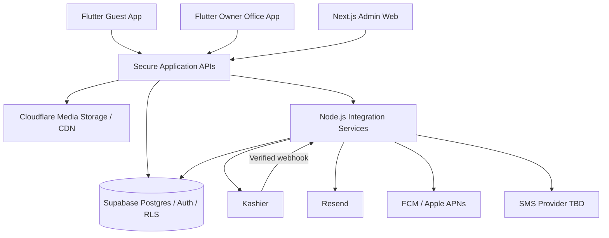

# OnAir — Master Project Plan

> **الوثيقة الرئيسية لمتطلبات المنتج والهندسة والتنفيذ**  
> **النسخة:** 1.0 — بعد اعتماد القرار 120/120  
> **تاريخ التثبيت:** 21 أكتوبر 2026  
> **آخر تعديل:** 26 أكتوبر 2026 — تصحيح هيكل المستودعات: مشروع ومستودع مستقل لكل تطبيق، والربط بينها عبر الـ Backend فقط (13.1، 13.3، 17، القرار 117)  
> **نوع المشروع:** منصة تأجير شقق متكاملة؛ تطبيق مستأجر + تطبيق مالك/مكتب/مساعد + لوحة إدارة داخلية Web  
> **الهدف من الوثيقة:** مرجع موحد للفريق ولـ GitHub Spec Kit عند كتابة المواصفات والمهام والتطوير والاختبار.

---

## 0. حالة الوثيقة وكيف تُقرأ

### 0.1 مصدر القرارات وأولويتها

هذه الوثيقة تجمع **المتطلبات المعتمدة خلال ورشة اتخاذ 120 قرارًا**. القرارات الأحدث التي غيّرت سلوكًا سابقًا هي المرجع النهائي، ولا يجوز لفريق التطوير تنفيذ السلوك السابق لمجرد وجوده في مسودة أو كود أقدم.

**قواعد أولوية المصادر:**

1. أحدث قرار صريح وافق عليه صاحب المشروع في جلسة التخطيط.
2. القواعد السابقة التي لم يُلغها قرار لاحق.
3. تفاصيل تنفيذ هندسية مذكورة هنا بوضوح على أنها «توصية تنفيذية»، لا كسياسة تجارية مُعتمدة.
4. إذا تعارض تصميم Figma أو أي مشروع/Blueprint أقدم مع هذا المستند، تُقدَّم متطلبات هذا المستند؛ ويُستخدم التصميم كمرجع واجهات بعد مراجعته.

**تغييران حاسمان لا يصح تجاهلهما:**

- **رحلة الحجز النهائية:** المستأجر **يدفع أولًا عبر Kashier** (عربونًا أو كامل السعر حسب سياسة الحجز)، وبعد **التحقق السيرفري** من الدفع يُنشأ/يُفعَّل طلب الحجز المنتظر لموافقة المالك/المكتب. **لم يعد الدفع بعد قبول المالك هو المسار الأساسي.** تُعلَّق التواريخ لأول طلب ثبت نجاح دفعه خلال مهلة رد المالك، وتُرد المبالغ المدفوعة بالكامل إذا رُفض الطلب أو انتهت المهلة دون قبول. قاعدة «60 دقيقة للدفع بعد قبول المالك» من المسار السابق **ملغاة لهذا المسار**.
- **البنية الخلفية النهائية:** **Supabase** للبيانات والجداول وخدماتها المناسبة؛ **Cloudflare** للصور/الوسائط؛ **Node.js** للتكاملات والخدمات المخصصة؛ **Kashier** للدفع؛ **Resend** للبريد؛ **Firebase Cloud Messaging + Apple APNs** للإشعارات؛ استضافة Managed Cloud. اقتراح NestJS + PostgreSQL مستقل + Redis كحزمة Backend أساسية لم يُعتمد؛ لا يُنفَّذ افتراضيًا.

### 0.2 ما الذي يُعد قرارًا مقابل تفاصيل هندسية؟

- **[معتمد]**: متطلب منتج أو قاعدة عمل صريحة من القرارات الـ120.
- **[تطبيق مقترح]**: آلية فنية مناسبة لتحقيق المتطلب، يمكن مراجعتها قبل البرمجة من دون إعادة فتح قرار المنتج.
- **[يُحسم أثناء التنفيذ]**: قيمة تشغيلية/اعتماد خارجي/تفصيل تقني لم يُحسم في الورشة. لا تُخترَع قيمته ولا توقف إعداد مواصفات الوحدات المستقلة.

### 0.3 النطاق ومبدأ البساطة

OnAir منتج مهني قابل للتوسع، **وليس** مشروعًا لتكرار كل شاشات ومزايا مزود الدفع أو لإنشاء عمليات ميدانية بالغة التعقيد. المطلوب أن تكون التجربة بسيطة للمستأجر والمالك، والبيانات المالية دقيقة وقابلة للتدقيق، والصلاحيات مطبقة في الخادم لا في إخفاء الأزرار فقط.

---

## 1. الرؤية والقيمة والمنتجات

### 1.1 الرؤية

منصة تربط المستأجرين بملاك الشقق والمكاتب العقارية، مع تأجير بحسب الليلة وتوافر محدد بالتواريخ، ودفع إلكتروني آمن، وتأكيد من المالك، ودعم عملاء مركزي، وإدارة مالية وتشغيلية متكاملة لجميع الأطراف.

### 1.2 مبادئ أساسية

1. **ثقة المستأجر:** إعلان معتمد، شروط واضحة، مبلغ واضح، حالة دفع وحجز واضحة، استرداد موثق عند الرفض.
2. **سيطرة المالك على عرضه:** يدير شققه وتوافرها وسعر الليلة الأساسي، ويؤكد أو يرفض الطلبات.
3. **OnAir مشرف على الجودة والتسوية:** يعتمد الحسابات والإعلانات المهمة، ويدير الشكاوى والاستثناءات والاستردادات.
4. **صلاحيات مفصّلة:** كل شخص يرى بيانات وإجراءات العمل المحددة له فقط.
5. **دقة محاسبية قابلة للمراجعة:** دفتر مزدوج، أحداث موثقة، فصل الاستحقاق عن التحصيل والدفع، وعدم تزوير حالة إقامة لتكوين إيراد.
6. **لا تعقيد تشغيلي غير لازم:** لا GPS للموظفين، ولا صور حضور إلزامية، ولا حضور OnAir لكل Check-in أو Check-out.
7. **تنفيذ مرحلي:** Core Booking/Payments/Operations صحيح أولًا، ثم توسع في التقارير والتحسينات.

### 1.3 المنتجات الثلاثة

| المنتج | التقنية المعتمدة | المستخدمون | الغرض |
|---|---|---|---|
| **Guest Mobile App** | Flutter + Dart | المستأجر | استكشاف، بحث، تفاصيل، حجز، دفع، متابعة، مفضلة، تقييم، دعم |
| **Owner & Office Mobile App** | Flutter + Dart | مالك فردي، مدير مكتب، مساعدين | شقق، تقويم، طلبات، إقامات، فريق، مالية وتقارير |
| **OnAir Admin Web** | Next.js + React + TypeScript | الإدارة، خدمة العملاء، العمليات الميدانية، المالية | تشغيل المنصة، الموافقات، مراقبة الحجوزات، الشكاوى، المحاسبة والتسوية، الإعدادات |

**مبدأ ثابت:** المالك الفردي وصاحب/مدير المكتب **نفس الواجهة ونفس الوظائف**؛ الاختلاف في هوية الكيان والاسم والمستندات وطبيعة أعضاء الفريق، لا في نسخة تطبيق مستقلة. ويبقى للمساعد تجربة رئيسية مخصصة داخل تطبيقهما نفسه.

---

## 2. المستخدمون والحسابات والصلاحيات

### 2.1 جدول الأدوار

| الدور | نطاق البيانات | أمثلة للإجراءات |
|---|---|---|
| **Guest** | حسابه الشخصي وحجوزاته | البحث، الدفع، الإلغاء ضمن السياسة، تأكيد استلام/مغادرة الشقة، المفضلة والتقييم والدعم |
| **Individual Owner** | شققه وفريقه ومالياته | إضافة/تعديل شقة، إدارة التوافر والسعر، قبول/رفض، إدارة الموظفين، التقارير |
| **Office Principal / Manager** | كل شقق المكتب وفريقه | الوظائف نفسها تمامًا للمالك الفردي مع هوية مكتب |
| **Owner / Office Assistant** | كيان العمل والشقق المخصصة وصلاحياته | إجراءات محددة ومنع غير المصرح به؛ قد يرتبط بأكثر من جهة عمل |
| **OnAir Customer Service** | الحالات والحجوزات المصرح بها | التواصل مع الطرفين، تسجيل رد المالك عبر الهاتف، متابعة البدائل والشكاوى والاسترداد |
| **OnAir Internal / Field Staff** | المهام والسجلات المخوّلة | مراجعة، زيارة اختيارية، دعم، متابعة مهام وملاحظات مختصرة |
| **OnAir Finance Staff** | العمليات والسجلات المصرح بها | تحقق التحصيل، تسويات، استردادات، قيود، تقارير وفق فصل الصلاحيات |
| **OnAir Admin / Super Admin** | حسب مستوى التفويض | اعتماد شركاء وعقارات، إعدادات منصة، تفويض وصلاحيات ومراقبة |

### 2.2 حساب الشخص مقابل حساب العمل [معتمد]

- الشخص قد يكون **مستأجرًا ومالكًا فرديًا** بالهوية الشخصية نفسها؛ لا يُكرَّر سجله الشخصي لمجرد اختلاف الاستخدام.
- **حساب العمل** مستقل ومنسوب إلى مالك/مكتب، مرتبط بمستخدم فعلي، وصلاحياته محصورة في سياق هذا الكيان.
- موظف واحد قد يتلقى دعوات من **أكثر من مالك أو مكتب**؛ يختار جهة العمل الحالية في التطبيق، ويُمنع انتقال البيانات والصلاحيات بين الجهات.
- مالك المكتب يرى نشاط موظفيه داخل حساب العمل فقط، وليس أنشطة الموظف الشخصية أو أعماله مع جهة أخرى.

### 2.3 تسجيل ودخول المستخدمين [معتمد]

**الحساب الشخصي:** التسجيل/الدخول برقم هاتف مع OTP **أو** بريد إلكتروني وكلمة مرور. يجب التحقق من هاتف المستأجر بـOTP قبل أول طلب حجز؛ وإذا سُجل بالبريد فيُتحقق من البريد كذلك. لا يُفرض إثبات هوية حكومي على كل مستأجر في المسار العادي.

**المالك الفردي:** بيانات تواصل موثقة + بطاقة هوية/جواز + إثبات ملكية أو تفويض صالح بالتأجير؛ تخضع المستندات لاعتماد OnAir قبل نشر العقارات.

**المكتب:** اسم المكتب وموقعه وبياناته، وهوية المدير، وسجل تجاري **أو** إثبات نشاط مناسب، وتفويض عند تمثيل طرف آخر، واعتماد OnAir.

**أثناء انتظار اعتماد حساب المالك/المكتب:** يمكنه فتح تطبيق المالك وإعداد ملفه وإنشاء مسودات عقارات، لكن لا يُنشر إعلان ولا يتلقى حجوزات حتى اعتماد الحساب **والعقار كل على حدة**.

### 2.4 دعوات الموظفين [معتمد]

- يرسل المالك/المكتب دعوة عبر البريد أو الهاتف.
- الموظف ينشئ حسابه وكلمة مروره وبياناته عند أول تسجيل إذا لم يملك حسابًا.
- قوالب صلاحيات جاهزة قابلة للتخصيص بدقة، مع السماح بكل العقارات أو عقارات محددة.
- المالك يستطيع إيقاف الموظف مؤقتًا وإعادة تنشيطه أو إنهاء انتسابه فورًا؛ تبقى سجلاته التاريخية، ولا تتأثر علاقاته بجهات العمل الأخرى.
- يمكن عرض حالة Online/Offline وآخر وصول للتطبيق وأفعال الموظف في سياق المكتب؛ **لا GPS أو تتبع جغرافي**.

### 2.5 حسابات الإدارة الداخلية [معتمد]

- دعوة لموظف داخلي عبر هاتف/بريد، مع إنشاء ملفه وكلمة مرور وتحقق.
- كل تسجيل دخول داخلي: **كلمة مرور + OTP**.
- Super Admin أو مفوَّض محدود يمكنه إنشاء/تعديل/إيقاف/تعطيل الموظفين ضمن سقف تفويضه.
- عند الإيقاف/التعطيل تُلغى الجلسات النشطة بسرعة، مع حفظ سجل تدقيق غير قابل للتلاعب.
- القاعدة العامة: **منح أقل صلاحية ممكنة**، والتفويض لا يسمح بتجاوز صلاحية المفوِّض.

### 2.6 تنفيذ الصلاحيات [تطبيق مقترح]

- Supabase Auth كطبقة هوية مناسبة، وPostgres **Row Level Security (RLS)** لعزل البيانات الشخصية وبيانات كيانات العمل.
- جداول `workspaces`, `memberships`, `role_presets`, `permission_grants`, `property_assignments`، ونطاق عمل فعال `active_workspace` لا يثق الخادم بقيمته من العميل دون إثبات انتساب.
- إجراءات الحساسية المالية والإدارية عبر Node.js/وظائف خدمة موثوقة تتحقق من RBAC **قبل** الكتابة؛ لا تعتمد على UI لتطبيق الصلاحيات.
- التدقيق يسجل actor, workspace, action, target, before/after في حدود الخصوصية، الوقت، والسبب.

---

## 3. العقارات والإعلانات والتوافر والأسعار

### 3.1 دورة حياة العقار [معتمد]

`Draft → Submitted for Review → Approved & Published` أو `Rejected for Correction`، مع إمكانية `Paused/Temporarily Disabled` وإعادة التفعيل.

- إدارة OnAir **تعتمد كل شقة** قبل ظهورها للعموم.
- تعديل جوهري في الوصف/الصور/الموقع/مواصفات الشقة يمر **بمراجعة نسخة جديدة**؛ تبقى النسخة العامة المعتمدة السابقة منشورة حتى القرار.
- تغيير **السعر الأساسي الليلي والتوافر** ينعكس فورًا، دون انتظار اعتماد النسخة الوصفية.
- المالك/المكتب يمكنه إيقاف الإعلان مؤقتًا عند الطوارئ وفتحه ثانية مباشرة مع تسجيل سبب وإشعار الإدارة؛ **الحجوزات المؤكدة لا تُلغى تلقائيًا**.

### 3.2 رحلة إضافة شقة [القرار 106]

**Wizard متعدد الخطوات** مع Back/Next وSave Draft واستكمال لاحق ومعاينة نهائية:

1. اسم العقار ونوعه والمحافظة/المدينة/المنطقة والعنوان والموقع.
2. المواصفات: عدد الغرف والحمامات والضيوف، المساحة والمرافق والمميزات.
3. صور الشقة والوصف والتفاصيل.
4. السعر الأساسي الثابت لليلة والتوافر.
5. قواعد الإقامة وشروط المالك/المكتب، بما فيها قواعد الزائرين وعددهم وأي شروط أخرى.
6. Preview ومراجعة صحة البيانات ثم Submit for Approval.

ربط إثبات الملكية/حق التأجير بملف الاعتماد؛ لا تكرار إلزامي لرفع مستند صالح سبق تقديمه وارتبط بالعقار/الشريك.

### 3.3 شروط الإقامة والموافقة [معتمد]

- تظهر شروط الشقة **قبل** الضغط على «احجز الآن».
- **الضغط على «احجز الآن» هو موافقة المستأجر على نسخة الشروط المعروضة**؛ تُحفظ النسخة/التجزئة (hash) وتوقيتها مع طلب الحجز لأغراض الإثبات.
- لا يجوز تعديل الشروط بأثر رجعي على حجوزات سبق إنشاؤها؛ يجب الاحتفاظ بلقطة الشروط وقت الطلب.
- ينبغي عرض قواعد الضيوف/الزوار وعدد الأشخاص المسموح وأوقات الاستلام والإلغاء بشكل مقروء.

### 3.4 نموذج التسعير [معتمد]

- **سعر المالك الأساسي لليلة ثابت**؛ لا أسعار مختلفة حسب أيام الأسبوع أو الموسم في الإصدار المعتمد.
- إدارة OnAir تضيف **هامش المنصة الليلي** بإحدى طريقتين: قيمة ثابتة لكل ليلة، أو نسبة من السعر الأساسي مع حد أدنى وحد أقصى للجنيه/ليلة عندما تُستخدم النسبة.
- السعر الظاهر للمستأجر في الليلة = `Owner Base Nightly Price + Effective OnAir Markup Per Night`.
- إجمالي الحجز = `عدد الليالي × السعر النهائي لكل ليلة`، ما لم تُعتمد لاحقًا رسوم نظامية إضافية؛ **لا تُختَرع رسوم خدمة أو تنظيف أو ضرائب غير مقررة في السياسة الحالية**.
- يحتفظ كل طلب عند الإنشاء بلقطة كاملة للسعر الأساسي والهامش الفعلي وطريقة احتسابه وسعر الليلة والإجمالي وسياسة العربون والإلغاء والتواريخ والشروط؛ لا تتغير اللقطة لاحقًا عندما يغيّر المالك الأسعار.

**معادلة توضيحية:** إذا كان السعر الأساسي 1,000 جنيه والهامش الفعلي 150 جنيه/ليلة والإقامة 4 ليالٍ، فالإجمالي 4,600 جنيه؛ استحقاق المالك المرجعي للإقامة المكتملة 4,000 جنيه وهامش OnAir المرجعي 600 جنيه. **المثال توضيحي فقط وليس سعرًا ثابتًا في النظام.**

### 3.5 التقويم والتوافر [القرار 107]

- **تقويم شامل** لكل شقق المالك/المكتب، **وتقويم مستقل** لكل شقة.
- حالات واضحة: متاح، مغلق يدويًا، طلب مدفوع ينتظر تأكيد المالك، حجز مؤكد، إقامة جارية، وإجراءات استثنائية عند الحاجة.
- المالك يستطيع فتح/غلق فترات متاحة وإدارة سعر الليلة الثابت، ولكن لا يمكنه إتاحة فترة متعارضة مع حجز مؤكَّد أو Hold نشط.
- لا تُغيّر الأسعار/التوافر الجديدة لقطة أو حق مستأجر قائم.

### 3.6 قواعد الحجز المتداخل [القرار 101]

**أول طلب ثبت نجاح دفعه يحجز التواريخ مؤقتًا** حتى قرار المالك/المكتب خلال المهلة. لا يقبل النظام حجزًا جديدًا مدفوعًا لنفس التواريخ أثناء الـHold؛ عند رفض الطلب أو انتهاء 24 ساعة تُحرَّر التواريخ ويبدأ استرداد ما دفعه المستأجر بالكامل.

**تفصيل هندسي ضروري:** يجب فحص تعارض النطاقات **بعملية ذرية في قاعدة البيانات**. وجود جلستَي دفع متزامنتين قد يؤدي إلى نجاح دفعتين خارجيًا؛ تُمنح أولوية الـHold لأول عملية تحقق موثقة تنجح في حجز نطاق التواريخ ذريًا، ولا يُنشأ طلب انتظار موازٍ مدفوع للفترة نفسها؛ أي دفعة لاحقة متعارضة تُسوّى برد كامل، وتظهر للمستخدم بوضوح. لا يجوز إبقاء المبلغ بلا متابعة.

---

## 4. تطبيق المستأجر — الوظائف والشاشات

### 4.1 الهيكل العام [القرارات 97–104 و116]

**Bottom Navigation** للأقسام الجوهرية مثل الرئيسية/البحث/حجوزاتي/المفضلة/الحساب، مع «المزيد» للوظائف الفرعية حيث يلزم. يُحافظ على Design System موحد لا يلزم أن يطابق Masyaf.

**الشاشات الأساسية:** Splash، التسجيل/الدخول والتحقق، Home/Discover، Search/Filters/Results، Property Details، Booking Dates، Booking Summary، Kashier Hosted Payment، Payment Verification/Return، My Bookings، Booking Details، Favorites، Reviews، Notifications، Profile & Settings، Customer Support، Cancellation/Refund Status.

### 4.2 Home & Discovery [القرار 97]

- مربع بحث واضح بالموقع والتواريخ.
- استكشاف مناطق ووجهات وشقق مقترحة، مع صور وأسعار أساسية مفهومة.
- بطاقات العقارات تقود إلى صفحة تفاصيل الإعلان المعتمد فقط.

### 4.3 البحث والفلاتر [القرار 98]

بحث متقدم باستخدام: الموقع، تاريخ الوصول/المغادرة، عدد الضيوف، نطاق السعر، الغرف، الحمامات، المرافق/المميزات، ونوع العقار؛ مع الترتيب حسب السعر أو الأحدث. **النتائج يجب أن تراعي توافر الشقة طوال المدة المطلوبة، وليس مجرد وجودها في المنطقة**. خريطة تفاعلية بمسامير الأسعار **غير مفروضة** بالقرار.

### 4.4 تفاصيل الشقة [القرار 99]

مرجع الشكل هو **تصميم Figma الخاص بالمستخدم بعد الاطلاع عليه لاحقًا**، مع هوية OnAir المستقلة؛ لا تُفترض تفاصيل بصرية غير مؤكدة. **الحد الوظيفي اللازم:** صور/وصف/مواصفات/مرافق/موقع بالقدر المعتمد، سعر الليلة النهائي، شروط الإقامة والضيوف والزوار، التوافر، سياسة العربون والإلغاء، وزر «احجز الآن». الموافقة على الشروط تتم عند الضغط وفق النسخة المعروضة.

### 4.5 المفضلة والتقييمات [القرار 103]

- حفظ/إزالة شقة في قائمة Favorites شخصية.
- تقييم **1–5 نجوم + تعليق نصي**، فقط من مستأجر لديه إقامة فعلية و**Check-out مؤكد**.
- مراجعة OnAir للتقييم قبل نشره؛ يحتفظ النظام بمنشئه وحجزه وقرار المراجع.
- منع التقييمات المتكررة/التلاعب وفق قاعدة «تقييم واحد لكل إقامة» كتوصية تنفيذية قابلة للتحديث.

### 4.6 التواصل [القرار 102]

**المستأجر يتواصل مع خدمة عملاء OnAir فقط.** خدمة العملاء تتواصل نيابة عنه مع المالك/المكتب عند الحاجة. لا تُبنى محادثة مباشرة أو زر مراسلة مباشر مستأجر ↔ مالك في المنتج المعتمد.

### 4.7 «حجوزاتي»

عرض حسب الحالات: في انتظار التحقق من الدفع عند الحاجة؛ في انتظار تأكيد المالك؛ مؤكد؛ إقامة جارية؛ مكتمل؛ مرفوض/ملغي؛ استرداد قيد التنفيذ/مكتمل؛ مع صفحة لكل حجز تتضمن التفاصيل ولحظات الدفع وقواعد الحجز المقتطعة من اللقطة، وإجراءات إلغاء/دعم حسب الحالة والصلاحية. يجب التمييز **بين حالة الحجز وحالة المبلغ المسترد**؛ إلغاء الطلب لا يعني أن التحويل المالي عاد فعليًا.

---

## 5. رحلة الحجز النهائية — من العميل إلى المالك

### 5.1 الرحلة الرسمية [القرارات 100 و101]

1. العميل يفتح إعلانًا **معتمدًا**، يقرأ التفاصيل والقواعد والضيوف/الزوار وسياسة الحجز.
2. يضغط **«احجز الآن»**؛ وبذلك يقبل الشروط المعروضة. إذا كانت هذه أول مرة يحجز، يجب استكمال تحقق الهاتف وما ينطبق من تحقق البريد.
3. يختار **تاريخ بداية الإقامة وتاريخ نهايتها**؛ يتحقق النظام من منطق التواريخ وتوافر الشقة وعدد الأشخاص، ويحسب عدد الليالي.
4. تعرض صفحة تالية **ملخص الحجز**: الشقة، التواريخ، الليالي، السعر الليلي النهائي، إجمالي السعر، مقدار المطلوب دفعه الآن (عربون أو كامل المبلغ)، والباقي إن وُجد، والشروط/الإلغاء.
5. يضغط **«اذهب للدفع»**؛ ينشئ الخادم جلسة Kashier بمعرف موحد وقيمة محسوبة في الخادم، ويفتح Hosted Payment Web Page.
6. عند العودة التلقائية من بوابة الدفع يُوجَّه المستخدم إلى **«حجوزاتي»**، لكن تُعرض نتيجة الدفع بناءً على **Webhook موثوق/استعلام سيرفري موثق** فقط، وليس بمجرد العودة من الصفحة.
7. عندما يتأكد نجاح الدفع بالفعل، يُفعَّل طلب حجز بحالة **«بانتظار تأكيد المالك»** وتُحجز التواريخ مؤقتًا لنفس الطلب. يبدأ عدّ **24 ساعة** من تثبيت نجاح الدفع/تفعيل الطلب، وليس من مجرد فتح صفحة الدفع.
8. تتلقى OnAir الطلب في لوحة الإدارة، ويُرسل إلى المالك/المكتب **Push** ورسالة **SMS** للأحداث المهمة.
9. للمالك/المكتب قرار **قبول أو رفض** خلال المهلة. عند تعذر فتح التطبيق، تتصل خدمة العملاء بالمالك/المكتب هاتفيًا وتسجل **قراره الحقيقي** داخل النظام بهوية الموظف ووقت المكالمة وملخص التوثيق؛ لا تقرر نيابة عنه من دون موافقته.
10. **عند القبول:** يتحول الحجز إلى مؤكد، ويُخطر المستأجر Push/SMS وفق سياسة الإشعارات. تبقى التواريخ مشغولة حتى نهاية الاستحقاق وفق حالة الحجز.
11. **عند الرفض أو انقضاء 24 ساعة:** يُلغى الطلب، تتحرر التواريخ، ويصبح **كامل ما دفعه المستأجر مستحق الاسترداد**، ويُبلّغ بالإشعار وتتواصل معه خدمة العملاء لتسوية الاسترداد أو عرض بديل **برضاه**.
12. إذا وافق المستأجر على بديل، تُدار إعادة الحجز والفروق المالية بوضوح وبموافقة صريحة؛ لا تُفرض عليه رسوم زائدة أو تغيير سكن تلقائي.

### 5.2 سياسة مهلة رد المالك

- مهلة المالك/المكتب: **24 ساعة** من تفعيل الطلب بعد التحقق من الدفع.
- يمكن لخدمة العملاء المتابعة قبل انتهاء المهلة هاتفيًا.
- عند انتهاء المهلة دون رد موثق: **انتهاء تلقائي للطلب واسترداد كامل**، ولا يجوز إبقاء حجز مؤقت إلى أجل غير معلوم.
- النظام يمنع قبولًا متأخرًا بعد انتهاء الطلب إلا عبر مسار جديد صحيح وموافقة المستأجر عند اللزوم.

### 5.3 حالات الحجز المعيارية [نموذج تنفيذي مقترح]

| الحالة الداخلية المقترحة | ظاهر للمستخدم | الدخول/الخروج |
|---|---|---|
| `payment_pending` | بانتظار إتمام الدفع | بدأ طلبًا ولم تثبت الدفعة بعد |
| `payment_verifying` | جارٍ التحقق من الدفع | عاد من Kashier أو وصله حدث جارٍ التحقق منه |
| `awaiting_owner` | بانتظار تأكيد المالك | دفع موثق + Hold نشط، مع مهلة 24 ساعة |
| `confirmed` | حجز مؤكد | قبول المالك أو رد موثق عبر خدمة العملاء |
| `checked_in` | إقامة جارية | تأكيد تسليم واستلام وفق سياسة Check-in |
| `checked_out` / `completed` | إقامة مكتملة | تأكيد مغادرة واستلام مفاتيح/شقة |
| `rejected` | رفض المالك | رُفض الطلب وبدأ مسار الاسترداد الكامل |
| `expired` | انتهت مهلة التأكيد | انتهت 24 ساعة وبدأ الاسترداد الكامل |
| `cancelled` | ملغي | إلغاء صحيح بموجب السياسة |
| `no_show` | لم يحضر | فقط بشروط الـNo-show المعتمدة، مع استثناء الدفع الكامل |

**مهم:** حالة `refund_pending/refund_processing/refunded` تُدار أيضًا كحالة **معاملة استرداد منفصلة**، ولا تُستخدم كبديل عن حالة الحجز. هذه أسماء تقنية مقترحة لا تفرضها القرارات بنصها.

### 5.4 الدفع الناجح بعد عودة المستخدم

- عودة التطبيق أو نجاح الرسالة البصرية داخل Kashier لا تكفي لتأكيد الدفع.
- حدث Webhook يجب التحقق من توقيعه ومرجعه وقيمته وعملته وحالة المعاملة ومنع إعادة تشغيله مرتين.
- الاستعلام المباشر إلى بوابة الدفع من الخادم fallback عند انقطاع Webhook.
- حالة الدفع المعلّقة تظهر للمستخدم بوضوح ويجري تحديثها عند وصول الإثبات.
- يُمنع اعتماد سعر/عمولة/قيمة مدفوعة أرسلها تطبيق Flutter؛ المصدر هو اللقطة المحسوبة في الخادم.

### 5.5 الدفع الإلكتروني والنقدي

**الرحلة الأساسية المعتمدة للطلب الجديد تبدأ بدفع إلكتروني عبر Kashier قبل انتظار رد المالك.** كانت قواعد السماح النقدي المعتمدة سابقًا تتعلق بالتحصيل المصرح به والسداد عند الوصول والمبالغ الداخلية. لا يجوز تغيير رحلة تقديم الطلب إلى «دفع نقدي عند الاستلام» دون قرار منتج جديد.

بعد تأكيد الحجز، عند وجود **عربون فقط**، يجب سداد **الرصيد المتبقي قبل Check-in الفعلي** عبر قناة إلكترونية موثقة أو نقدًا إذا كان مسموحًا للعقار والشخص المحصّل، مع تحقق OTP من استلام النقد.

---

## 6. الإقامة الفعلية، الوصول والمغادرة

### 6.1 Check-in [معتمد]

- الصلاحية لمن يؤكد تسليم الشقة تُحدد **لكل عقار**: المالك، مدير المكتب، موظف مفوض، أو موظف OnAir مخول عند الاستثناء؛ **حضور OnAir ليس إلزاميًا**.
- الممثل المخول يضغط «تم تسليم الشقة»، والمستأجر يضغط مستقلًا «استلمت الشقة».
- الاستثناءات تُحل عبر مسؤول OnAir مفوض بعد توثيق سبب وتحقق مستقل.
- **لا OTP ولا صور إلزامية لتوثيق Check-in.**
- إذا كان هناك باقي مبلغ بعد العربون، يجب سداده والتحقق منه **قبل** اعتماد الدخول.
- **استحقاق صاحب الشقة للصرف يتولد بعد Check-in موثق**، وليس عند دفع المستأجر أو مجرد قبول الحجز.

### 6.2 Check-out [معتمد]

- المستأجر يضغط «غادرت الشقة»؛ والطرف المخول يؤكد استلام الشقة والمفاتيح.
- إذا اتفق الطرفان على ترك المفتاح في مكان آمن، يمكن للمسؤول التحقق لاحقًا؛ حالة مؤقتة واضحة حتى اكتمال الإقرارين أو قرار استثنائي موثق.
- **هامش OnAir على الإقامة الطبيعية يصبح إيرادًا مكتسبًا بعد Check-out حقيقي موثق**.
- الضرر أو النزاع لا يزوّر حالة الإقامة ولا يمنع إتمام Check-out الحقيقي عند تحقق شروطه.

### 6.3 عدم الحضور No-show [معتمد]

- لا يجوز إلغاء حجز **مدفوع بالكامل** آليًا لمجرد تأخر المستأجر؛ إذا كان ينوي الوصول تبقى مدة الحجز محفوظة.
- حالة عربون فقط وعدم حضور: بعد الموعد والتواصل والمهلات التشغيلية المناسبة، يمكن للإدارة المخولة اعتماد No-show وفق القواعد، مع الاحتفاظ بالعربون وتحرير **التواريخ المستقبلية** المسموح تحريرها.
- إذا حضر العميل في **اليوم نفسه** الذي ألغي فيه حجز عربون بسبب No-show، وكانت الشقة لا تزال متاحة، يستطيع طرف مخول إعادة فتح **الحجز الأصلي دون عربون ثانٍ**، ويُدفع الباقي وتُعكس قيود المصادرة السابقة بالشكل الصحيح.

### 6.4 المطالبة بالأضرار [معتمد]

- المالك يرفع مطالبة بضرر وأدلة اختيارية؛ يوافق المستأجر أو يعترض.
- الاتفاق يُوثق، والنزاع يُحال إلى OnAir للوساطة والتسوية.
- **لا خصم تلقائي** من أموال المستأجر أو المستحقات دون اتفاق/قرار مخول وقاعدة واضحة.
- نزاع الأضرار لا يحبس انتهاء إقامة فعلية صحيحة.

---

## 7. قواعد الإلغاء والاسترداد والمسؤولية

### 7.1 ترتيب سياسات العربون والإلغاء [معتمد]

- توجد إعدادات افتراضية في OnAir، ويمكن للمكتب/المالك والعقار تخصيصها ضمن الصلاحيات.
- أولوية النسبة/السياسة عندما يُسمح بالتخصيص: **العقار > المكتب/الشريك > الإعداد الافتراضي للمنصة**.
- لقطة السياسة الفعلية تُحفظ على الحجز وقت الإنشاء.

### 7.2 جدول الإلغاء

| الحدث | أثره على المستأجر | توزيع المبالغ |
|---|---|---|
| **رفض المالك أو انتهاء مهلة 24 ساعة** بعد الدفع | **رد 100% من المبلغ المدفوع**؛ العرض البديل اختياري | لا احتفاظ بعربون كعقوبة على المستأجر |
| إلغاء طوعي **قبل آخر موعد للإلغاء المجاني** | رد كامل وفق السياسة المحفوظة | قيود استرداد، دون إثبات إقامة كاذبة |
| إلغاء طوعي قبل الإقامة **بعد انتهاء الإلغاء المجاني** | **خسارة العربون فقط**، حتى لو دُفع كامل السعر؛ يُرد ما زاد عن قيمة العربون | توزيع العربون المصادَر بين OnAir والمالك بنسب السعر الأساسية الفعلية |
| حجز مدفوع بالكامل، إلغاء طوعي **بعد 24 ساعة من وقت Check-in المجدول** | **كامل قيمة الحجز غير قابل للاسترداد** | OnAir تحصل الهامش الأصلي المجمّد والمالك يحصل الإيجار الأساسي الأصلي، كإيراد/استحقاق **إلغاء** لا إقامة مكتملة |
| مالك يطلب إلغاء حجز مؤكد | لا يملك حسمه منفردًا؛ يعتمد OnAir الإلغاء مع بديل مقبول أو رد كامل عند استحقاقه | تحديد مسؤولية التعويض إن وُجد بإدارة OnAir المخولة؛ دون زيادة مفروضة على الضيف |
| No-show وفق شروط العربون فقط | مصادرة العربون بعد الإجراءات المخولة؛ مع إعادة فتح محتملة في اليوم نفسه إذا ما زالت الشقة متاحة | قيود قابلة للعكس عند إعادة الفتح |

**تفسير مهم:** حالة الإلغاء الطوعي للحجز المدفوع بالكامل **قبل** مرور 24 ساعة من Check-in المجدول ترجع إلى قاعدة الإلغاء المناسبة المحفوظة؛ لا يُطبَّق احتفاظ كامل المبلغ قبل بلوغ ذلك الحد بمجرد تأخر الضيف.

### 7.3 حساب حصص العربون المصادَر [القرار 56]

عندما يصادر النظام **العربون فقط**، تُحسب حصة المنصة من العربون بناءً على **نسبة الهامش الليلي الفعلي إلى سعر المالك الأساسي الليلي**، حسب القرار السابق، لا نسبة التسعير النظرية غير المحددة بعد السقف/الأرضية.

- `OnAir share of forfeited deposit = forfeited deposit × (effective nightly markup / owner base nightly rate)`.
- `Owner share of forfeited deposit = forfeited deposit - OnAir share`.

**ضابط تنفيذي:** إجراء فحوص الحدود والحالات الاستثنائية عند سعر أساس صفر أو نسبة تتجاوز 100% والاحتفاظ بالمدخلات والقرارات الموثقة، دون اختراع سياسة تجارية بديلة من طرف المطور. أي تعارض حسابي مع مبالغ مصادرة صغيرة يجب تسويته بشفافية وبالأرصدة الصحيحة.

### 7.4 إدارة الاستردادات [معتمد]

- **فصل الأدوار:** طلب/اعتماد الاسترداد، تنفيذه، والتحقق المستقل من اكتماله؛ المفوض بالتنفيذ قد يختلف عن محصّل النقد الأصلي.
- استرداد إلكتروني: لا يُعلَن `refunded` إلا بعد تأكيد موثق من Kashier/البنك/المحفظة حسب القناة.
- استرداد نقدي: تسليم موثق بإقرار مزدوج/OTP وإيصال.
- منع الاسترداد المزدوج لنفس أصل المبلغ بمعرفات فريدة وسجل كامل.
- مدد المراجعة والتنفيذ والتحقق والتنبيهات قابلة للإعداد من الإدارة. يرى المستأجر «طُلب/اعتُمد/قيد التنفيذ/تم التحقق من وصوله» بصورة مفهومة.
- المنازعات الداخلية بين OnAir والمالك/المحصّل **لا تؤخر استردادًا صحيحًا مستحقًا للمستأجر**.

### 7.5 الشكاوى والنزاعات [معتمد]

لكل قضية رقم، أطراف، سبب، أدلة/مرفقات اختيارية، تعليقات، مسؤول/مالك حالة، مواعيد قابلة للإعداد، سجل قرارات، ومسار استئناف مستقل. عادةً يُعلّق **فقط المال محل النزاع**، ويمكن تعليق نطاق أوسع عند سبب مبرر وإعادة مراجعة دورية، مع استمرار تسوية الأموال غير المتنازع عليها.

---

## 8. التحصيل والذمم والتسويات والمحاسبة

### 8.1 قواعد لا يجب الخلط بينها

1. **Verified Payment**: مستأجر دفع وثبتت العملية.
2. **Cash Custody**: نقد في عهدة شخص جمعه ولم يسلِّمه بعد.
3. **Owner Payable Eligibility**: أهلية استحقاق قيمة المالك تبدأ بعد Check-in حقيقي موثق في إقامة عادية.
4. **OnAir Earned Margin**: الهامش الخاص بإقامة عادية يُكتسب بعد Check-out فعلي موثق، وليس عند الدفع أو تأكيد الطلب.
5. **Actual Settlement**: الأموال صُرفت/وصلت فعليًا إلى طرفها وجرى التحقق من ذلك.
6. **Cancellation Earnings**: عند الإلغاء المدفوع بالكامل بعد 24 ساعة من الموعد المجدول، تُوزّع قيمة الحجز حسب اللقطة **بوصفه حدث إلغاء** منفصلًا عن الإقامة المكتملة.

### 8.2 التحصيل الإلكتروني Kashier [القرارات 94–96]

- **حساب تاجر Kashier واحد مركزي باسم OnAir** لتجميع مدفوعات المستأجرين الإلكترونيّة.
- مبلغ التحصيل الإلكتروني يُعتبر ناجحًا عند تحقق المزود server-to-server، لا بعد وصول المبلغ إلى بنك OnAir.
- Kashier يصدر دفعات تسوية `batches` تشمل الإجمالي والرسوم والصافي؛ تتم المزامنة آليًا عبر API **حيث تسمح صلاحيات حساب التاجر**.
- مسؤول مالي مخوَّل يتأكد **بشكل مستقل من وصول الصافي للبنك/الحساب الفعلي** بأدلة خارجية؛ لا يُشترط Bank API.
- في صفحة **Collections & Payments** الحالية، تبويب واحد اسمه **Kashier Settlements** يوضح Gross / Fees / Net وحالة الوصول الفعلي والروابط للعمليات؛ **لا إنشاء بوابة دفع موازية أو صفحات مالية مكررة**.
- استرداد الدفع الإلكتروني حسب آليات المزود المسموحة، مع تحقق الحالة النهائية.
- **دفعات مستحقات الملاك والمكاتب لا تستخدم Kashier Payouts**؛ تتم عبر آليات التسوية المعتمدة خارج Kashier.

### 8.3 التحصيل النقدي المصرح به [معتمد]

- OnAir تحدد **لكل عقار** إتاحة التحصيل النقدي من عدمه والأشخاص المخولين.
- المالك/المكتب أو موظف مفوّض أو موظف OnAir مخوَّل يمكنه استلام نقد مسموح به؛ لا تُسمح العملية لشخص بلا تفويض ساري.
- المستأجر يُدخل هاتف المحصّل، ويتحقق النظام من سلطة المحصّل على الحجز/العقار.
- المستأجر يؤكد الاستلام الحقيقي للنقد من جانبه باستخدام **OTP مستقل** وإقرار؛ لا يثبت الدفع بمجرد ادعاء المحصّل.
- إذا تحقق دفع المستأجر الصحيح، **يظل دفعه صحيحًا** حتى لو تأخر المحصّل في تسليم النقد داخليًا.
- عهدة المحصّل مستمرة حتى تسليم موثق؛ يسمح بتسليم **جزئي**، مع سجل كل عملية، وتسليم بإقرار مزدوج وOTP وإيصالات.
- **لا حد أقصى رقمي مفروض على عهدة المحصّل** وفق القرار الحالي.
- مدير المكتب يحدد مواعيد تسليم موظفيه ضمن حدود المنصة؛ إدارة OnAir تضبط جداول تسليم موظفي OnAir.
- عند جمع مالك/مكتب المبلغ قد تنشأ عليه ذمة لهامش OnAir؛ وعند جمع OnAir المبلغ قد تنشأ عليها ذمة لإيجار المالك. ينبغي تمثيل الالتزامات المقابلة لا دمجها في رصيد غير واضح.

### 8.4 تسويات الملاك والمكاتب [معتمد]

- تبدأ أهلية قيمة الإيجار الأساسي بعد Check-in موثق للحجز الطبيعي.
- جدول تسوية افتراضي تحدده الإدارة (أسبوعي، كل أسبوعين، شهري، يدوي)، ويجوز تخصيصه على مستوى المالك/المكتب وفق السياسة.
- وسائل التسوية المخولة حسب الشريك: حوالة بنكية مثبتة، محفظة إلكترونية موثقة، تسليم نقد بإقرار مزدوج/OTP، أو **تسوية بالمقاصة Ledger Offset/Netting**.
- توثيق المستحقات المؤهلة والمبالغ المدفوعة وغير المدفوعة، أرقام المراجع، حالة التحقق، ومستند الإثبات.
- لا يُعتبر طلب تحويل أو صورة شاشة وحدهما إثباتًا لوصول المبلغ.

### 8.5 دفتر محاسبي احترافي دون تعقيد الواجهة

**الأساس المحاسبي المطلوب [معتمد]:**

- **Chart of Accounts** شجري جاهز وقابل للتوسيع بإذن، مع حماية الحسابات المستخدمة من التغييرات المفسدة والتدقيق على التعديلات.
- **Journal Entries** ذات قيد مزدوج متوازن، تُنشأ تلقائيًا من الأحداث التجارية الموثقة.
- القيود اليدوية والتسويات التصحيحية تحتاج موافقة مالية مستقلة قبل الترحيل، والقيود المرحلة لا تُعدّل مباشرة؛ التصحيح بقيد عكسي/تسوية موثقة.
- **General Ledger + Trial Balance** وتقارير الكشوف والقوائم متاحة في البنية المحاسبية، من دون إلزام الفريق بواجهات كثيرة ومعقدة تكرر الوظائف.
- دفاتر تحليلية فرعية للمالك/المكتب، المحصّل، الحجز، الدفعات والاسترداد عند الحاجة، مع مطابقة الإجماليات بالدفتر العام.
- حسابات قياسية ملائمة مثل البنك/المحفظة، عهد النقد، مبالغ تحت التسوية/التزام للعملاء، ذمم الملاك، مستحقات OnAir، الإيراد المكتسب، المصروفات، رسوم بوابة الدفع، وحسابات استرداد/تعويض؛ **التصنيف المحاسبي النهائي يراجعه محاسب مختص**.
- لا تُحسب أرقام Dashboard المالي من تجميع غير موثوق لعمليات الدفع مع تجاهل الاستردادات والذمم.

### 8.6 واجهة الإدارة المالية [القرارات 83–96]

**Finance & Accounting** في Web Admin تحتوي:

1. **Financial Overview:** الإيراد المكتسب، المصروفات، الربح/الخسارة، رصيد البنك/المحفظة، ذمم الملاك، عهد النقد، التحصيلات المتحققة، الاستردادات المستحقة؛ رسوم ثلاث: الإيراد مقابل المصروف، اتجاه الأرباح، التدفق النقدي الداخل والخارج. فلاتر فترات ومقارنات وDrilldown.
2. **Financial Operations:** صفحات `Collections & Payments`، `Cash Custody`، `Owner Settlements`، `Refund Management`، `Financial Transactions`.
3. **General Accounting:** دليل الحسابات، القيود، دفتر الأستاذ، ميزان المراجعة، بالمستوى الضروري للعمل الاحترافي.
4. **Financial Statements / Reports**: قوائم وملخصات وتقارير مبنية على قيود موثقة.
5. **Analytics**: مؤشرات الإيرادات والتكاليف والمخاطر والتسويات.
6. **Invoices / Exports**: فواتير وكشوف وتصدير مقنن PDF/Excel.

**تفصيل صفحات العمليات:**

- Collections & Payments: عمليات التحصيل أونلاين ونقدًا مع البحث والفلترة وحالات الدفع والإثبات وروابط الدفتر، و**تبويب Kashier Settlements داخلها**.
- Cash Custody: قائمة المحصلين والأرصدة والعهدة والتسليم الجزئي والتاريخ.
- Owner Settlements: نظرة مستحقات، جدول الشركاء، صفحة شريك، السجل، الفصل بين eligible وpaid.
- Refund Management: قوائم الحالات والاعتماد والتنفيذ والتحقق المستقل والأدلة.
- Financial Transactions: سجل نقدي موحد مرشح مرتبط بمصدر كل معاملة وقيدها المحاسبي.

### 8.7 ماليات المالك والمكتب [القرار 109]

تطبيقهما يحتوي **Financial Hub موحد** مع ملخصات ورسوم بيانية وتبويبات للمستحقات والتسويات، الإيرادات والمصروفات، كشوف الحساب، التقارير والفواتير والتصدير إلى PDF/Excel. لا تُعرض بيانات شركاء آخرين. يتم توضيح الفرق بين إجمالي الحجوزات والمبالغ المحصلة والحقوق المؤهلة والمدفوعة وصافي الإيراد/الربح.

---

## 9. تطبيق المالك والمكتب والمساعد

### 9.1 Home Dashboard [القرار 105]

Dashboard متوازنة تجمع: طلبات الحجز الجديدة، الحجوزات القادمة والجارية، عدد/حالة الشقق، المستحقات والتحصيلات والملخص المالي، روابط مهمة (إضافة شقة، التقويم، الموظفون، التقارير)، مع قسم مستقل للتقارير المالية المفصلة.

### 9.2 Bookings [القرار 108]

**قائمة موحدة بتبويبات الحالة** (طلبات جديدة، مؤكدة، جارية، مكتملة، ملغاة وغيرها) مع بحث وفلاتر وصفحة تفاصيل لكل حجز. إجراءات قبول/رفض الطلب والمتابعة مقيدة بالصلاحيات وحالة الحجز والمهلة؛ يعرض النظام حالة دفع متحققة ووقت الرد المتبقي، دون إظهار أزرار تنفيذ لا يسمح بها Backend.

### 9.3 Properties & Calendar

- Wizard إضافة شقة قابل للحفظ والمعاينة والإرسال للمراجعة.
- إدارة النسخ المقترحة للتعديل الوصفي وانتظار الموافقة، مع ظهور النسخة العامة الحالية.
- تقويم شامل وآخر مستقل لكل شقة، تمييز حجوزات `awaiting_owner` كـHold نشط، وتعديل التوافر والسعر الأساسي الثابت.

### 9.4 الموظفون [القرار 110]

**مركز إدارة موظفين:** قائمة، حالة الحساب، آخر دخول، دعوات، تعديل صلاحيات، الشقق المخصصة، سجل النشاط، إيقاف/إعادة تفعيل/إنهاء الانتساب. يعرض فقط النشاط المتعلق بجهة العمل هذه، ولا تتبع للموقع.

### 9.5 واجهة المساعد [القرار 111]

داخل **نفس تطبيق المالك/المكتب**؛ صفحة رئيسية موظف مخصصة للمهام والحجوزات والإشعارات والإجراءات المسموحة، والقوائم الأخرى بحسب الصلاحيات. يمكن التبديل بين جهات العمل المرتبط بها الموظف مع عزل البيانات بالكامل.

---

## 10. لوحة OnAir الداخلية — أقسام وتجربة المستخدم

### 10.1 القاعدة المشتركة [القرارات 59 و74 و116]

**موقع Web Admin واحد**، Sidebar حسب الوظائف والصلاحيات. لا تطبيق منفصل لخدمة العملاء أو العمليات الميدانية. `Super Admin`, `Admin`, `Customer Support`, `Finance`, `Internal/Field Staff` يملكون عرضًا مخصصًا فوق الخدمات والبيانات نفسها؛ عزل الصلاحيات في الخادم.

### 10.2 Dashboard التشغيلية [القرارات 75–76]

**6 KPIs تشغيلية:** حجوزات مؤكدة، طلبات قيد الانتظار، إقامات جارية، إعلانات منشورة، عقارات بانتظار مراجعة، شكاوى مفتوحة.

**6 KPIs مالية:** القيمة الإجمالية للحجوزات المؤكدة، التحصيلات الفعلية، الهامش **المكتسب** لـOnAir، مبالغ الملاك غير المدفوعة، استردادات مستحقة، عهد النقد لدى المحصلين.

**رسوم وتفصيل:** اتجاه الحجوزات والهامش المكتسب وتوزيع الحالات، فلاتر زمنية، مقارنة مدد، قوائم «تحتاج إجراء» مع الوصول إلى السجل الأصلي.

### 10.3 Booking Management [القرارات 77–78]

قائمة بحث وفلترة موحدة وتبويبات حالات وصفحة تفاصيل **أربعة أقسام**:

1. Booking Information: الحجز والمستأجر/الشقة/المالك والتواريخ والشروط المحفوظة.
2. Payments & Financial Details: المدفوعات والمتبقي والهامش الأصلي وأهلية الذمم والاستردادات.
3. Timeline: كل تحوّل حالة أو فعل ومَن نفذه والوقت والدليل.
4. Actions & Support: الإجراءات المخولة، الدعم، الحالات الاستثنائية.

### 10.4 Property Management [القرارات 79–80]

قائمة موحدة بالعقارات والتبويبات والفلاتر. تفاصيل العقار: بيانات وصور، مالك، تسعير، توافر، مراجعات وتاريخ. عند طلب تعديل جوهري يظهر **Compare: Approved Public Version vs Pending Proposed Version**، مع قبول/رفض موثق.

### 10.5 Users & Partners [القرارات 81–82]

قسم واحد بثلاثة تبويبات: **Guests / Individual Owners / Offices**، بحث وفلاتر، وصفحات أفراد/شركاء مختلفة حسب النوع مع الاحتفاظ بهوية الشخص الموحدة. صفحة التفاصيل **5 تبويبات**: Profile؛ Verification & Documents؛ Related Records؛ Financial Summary؛ History & Actions. حقول وثائق الهوية والإجراءات الحساسة لا تُعرض إلا للمخول.

### 10.6 Customer Support Workspace [القرار 112]

مركز عمل واحد يعرض الطلبات العاجلة والحالات، **قائمة موحدة ببحث وفلاتر وتبويبات** حسب النوع والحالة. صفحة الحالة: بيانات العميل والحجز، سجل الاتصالات والملاحظات، نتيجة تواصل هاتفي مع المالك، الإجراءات المتاحة، الشكوى/البديل/الاسترداد والـSLA. التواصل بين المستأجر والمالك يمر عبر خدمة عملاء OnAir؛ لا Chat مباشر بينهما.

### 10.7 Internal & Field Staff Workspace [القرار 113]

**My Tasks** موحدة للمهام المسندة، الأولوية والموعد والحالة؛ صفحة التفاصيل لتحديث الحالة وملاحظة مختصرة. أعمال مثل مراجعة عقار، زيارة دعم، تدريب مكتب، تدقيق بسيط. ليست منصة حضور جغرافي؛ لا GPS أو إثبات صور إلزامي. بقية Sidebar تظهر حسب صلاحية الموظف.

### 10.8 Admin Settings [القرار 114]

**مركز إعدادات حسب المجالات** مع بحث وصفحات تعديل مستقلة، تأكيد للتغييرات الحساسة، وسجل `who/when/what`. يشمل الإعدادات العامة، العقارات، الحجوزات والسياسات المعتمدة، القنوات المالية، الإشعارات، المستخدمين/الصلاحيات، التكاملات، وسجل الإصدارات/التغييرات. **وجود القسم لا يمنح مستخدمًا غير مفوض حق تعديله.**

---

## 11. الإشعارات والاتصالات والتقييمات

### 11.1 Notifications [القرار 104]

- **In-App Notification Center** محفوظ داخل التطبيقات.
- **Push Notifications** عبر Google Firebase Cloud Messaging، بما يلزم من تكامل **Apple APNs** لأجهزة iOS.
- **SMS إضافية للأحداث المهمة** مثل طلب مالك جديد، قبول أو رفض طلب حجز. مزود SMS التجاري النهائي لم يُسمَّ بعد ويظل خيار تكامل، لكن إرسال الرسائل المهمة **متطلب معتمد**.
- **Resend** للبريد الإلكتروني الرسمي/التحقق/الإشعارات المناسبة.
- تختلف الرسائل والقنوات بحسب دور المستلم وتصريحاته، ولا تُسرَّب بيانات شريك إلى آخر.

### 11.2 جدول أحداث أساسي

| الحدث | لمن؟ | القنوات المقترحة |
|---|---|---|
| نجاح دفع الطلب والتحقق منه | مستأجر، عمليات OnAir | In-App + Push؛ رسالة مناسبة عند الحاجة |
| طلب حجز جديد ينتظر المالك | مالك/مكتب؛ خدمة العملاء | In-App + Push + SMS للمالك |
| تذكير قرب انتهاء مهلة 24 ساعة | مالك/مكتب وخدمة العملاء | Push + إشعار داخلي؛ SMS حسب سياسة التنبيه |
| قبول/رفض/انتهاء مهلة | مستأجر | In-App + Push + SMS مهم |
| بدء/اكتمال استرداد موثق | مستأجر، موظفو المالية المخولون | In-App + Push والبريد حسب النوع |
| موعد وصول/مغادرة | مستأجر والجهة المخولة | In-App + Push |
| مطالبة ضرر/شكوى | أطراف القضية المخولون | In-App + Push |
| مهام الموظفين والتسويات | الموظف/الشريك المعني | حسب الدور والقناة |

**التوصية التنفيذية:** قوالب مترجمة، تفضيلات إشعارات غير إلزامية مع استثناء إشعارات السلامة/المعاملات الضرورية، وطابور إرسال مع Retry وحفظ حالة التسليم دون اعتبار الإرسال دليلًا على قراءة المستلم.

---

## 12. الهوية البصرية والتصميم وإمكانية الوصول

### 12.1 القرار 115

- تصميم **Brand Identity + Design System مستقلين لـOnAir**.
- ملف Figma المعروف باسم **Masyaf** مرجع **محتمل للشاشات وتجربة المستخدم** عند استيراده/تحليله؛ ليس مصدر ألوان وخطوط ملزمًا، ولم تُحسم تفاصيل كل Frame منه في القرار 99.
- تطبيق المستأجر والمالك/المكتب والويب يتشاركون مبادئ اللون والطباعة والأيقونات والمسافات والنماذج والحالات والتفاعلات، مع اختلاف كثافة المعلومات المناسبة لكل واجهة.

### 12.2 القرار 116

- تطبيقات الموبايل: Bottom Navigation للأقسام الأساسية، مع قائمة «المزيد» للوظائف الثانوية.
- Web: Sidebar مرنة وصلاحيات واعية بالسياق.
- دعم العربية واتجاه RTL بشكل أصيل؛ يُستحسن تجهيز i18n قابل لإضافة الإنجليزية. **قصر اللغة على لغة بعينها لم يُحسم في قرار الـ120**.
- تصميمات Mobile متجاوبة، حالات Loading/Empty/Error/Offline، ورسائل واضحة بالعربية لا تستخدم مصطلحات محاسبية معقدة مع المستأجر.
- قابلية وصول أساسية: تباين جيد، أحجام نص قابلة للتكيف، أهداف لمس مناسبة، قارئ شاشة، وإيضاح أخطاء الإدخال.

---

## 13. المعمارية التقنية النهائية

### 13.1 التقنيات المعتمدة [القرارات 117–119]

| المكون | التقنية | ملاحظات |
|---|---|---|
| Guest App | **Flutter / Dart** | تطبيق مستقل |
| Owner/Office App | **Flutter / Dart** | تطبيق مستقل يشمل مساعديه |
| Admin Web | **Next.js / React / TypeScript** | واجهة موحدة للأدوار الداخلية |
| Repository | **مستودع مستقل لكل تطبيق** | كل تطبيق مشروع منفصل بمستودعه؛ لا كود مشترك بين التطبيقات، والربط الوحيد عبر الـ Backend وعقود API التي ينشرها |
| Data Platform | **Supabase** | PostgreSQL، هوية وخدمات مناسبة، RLS، بيانات النظام |
| Visual Media | **Cloudflare** | الصور والوسائط؛ **Cloudflare R2 + CDN** اختيار هندسي مقترح يحقق القرار، وليس تسمية منتج جرى التصويت عليها |
| Custom Integrations | **Node.js** | عمليات سرية، Webhooks، حالات التحقق، اتصالات خارجية، مهام خلفية |
| Payments | **Kashier** | Hosted Payment + تحقق خلفي + Refund/Settlements حيث تسمح الصلاحيات |
| Email | **Resend** | رسائل بريد رسمية |
| Push | **FCM + APNs** | Android وiOS وفق مسارات Google/Apple الرسمية |
| Hosting | **Managed Cloud** | خدمات Node مُدارة؛ اسم المزود النهائي غير محدد |
| Environments | **Staging + Production** | بيانات ومفاتيح ومسارات دفع منفصلة |

### 13.2 رسم المكونات



**تفسير:** لا ضرورة لبناء NestJS كامل كشرط للمنصة. يمكن استخدام Supabase DB/Auth وواجهات/دوال خدمة مصممة جيدًا، مع خدمات Node.js مُدارة للمنطق الحساس والتكاملات. أي استخدام مباشر من Flutter/Next.js لعمليات CRUD المسموحة ينبغي أن يخضع لـRLS؛ **جميع الحالات الحرجة للحجز والمال وتغيير الصلاحيات تمر عبر عملية موثوقة ذات تحقق ذرّي**.

### 13.3 هيكل المستودعات [معدّل 26 أكتوبر 2026 — غير ملزم بتسمية المسارات]

كل تطبيق **مشروع مستقل بمستودع مستقل**، ولا يعتمد أي تطبيق على كود تطبيق آخر:

| المشروع | التقنية | يحتوي |
|---|---|---|
| تطبيق المستأجر (Guest App) | Flutter / Dart | الشاشات + Design System + Core (شبكة، جلسة، أخطاء، Money، تواريخ) الخاصة به + Client مولّد من عقود API |
| تطبيق المالك/المكتب/الموظفين (Owner App) | Flutter / Dart | نفس الفكرة: Design System وCore وClient خاصة به |
| لوحة الإدارة (Admin Web) | Next.js / React / TypeScript | الواجهة + Types/Client مولّدة من عقود API |
| الـ Backend | Supabase + Node.js | `migrations` و`policies` (RLS) و`seed`، خدمات Node (Kashier، Resend، FCM/APNs، SMS، المهام الخلفية)، و**عقود API** (OpenAPI/JSON Schema) |

هيكل مقترح داخل كل مستودع تطبيق:

```text
<app-repo>/
├── lib/ أو src/        # كود التطبيق (features + design system + core)
├── docs/               # Master Plan + خطة التطبيق + القرارات
├── specs/              # GitHub Spec Kit feature specs الخاصة بالتطبيق
└── tests/              # unit / widget / integration / security
```

**مهم:**
- **الـ Backend هو نقطة الربط الوحيدة** بين التطبيقات. أسماء حالات الحجز، أكواد الأخطاء، وأشكال البيانات تأتي من عقود الـ Backend، فتبقى التطبيقات متسقة دون مشاركة كود.
- كل تطبيق يولّد الـ Client/Types الخاصة به من عقود API المنشورة؛ الكود المولّد لا يُعدَّل يدويًا.
- أي تغيير في عقد يؤثر على أكثر من تطبيق يُتفق عليه مع مالك الـ Backend قبل اعتماده، مع مراعاة التوافق مع الإصدارات الأقدم المنشورة من التطبيقات.
- **الاتساق البصري** (12.1) يتحقق بتطبيق نفس مواصفات الـ OnAir Design System في كل مستودع، وليس بحزمة كود مشتركة.

### 13.4 مبدأ الـBackend وحدود الثقة

- القراءة العامة: إعلانات منشورة معتمدة فقط، حسب RLS وسياسة العرض.
- عمل مستخدم موثق: بياناته أو نطاق عضويته فقط عبر RLS.
- كتابة حساسة: أمر ذري server-side يشمل التحقق من هوية المستدعي والمالك والصلاحيات والحالة والتواريخ والقيمة قبل تعديل قاعدة البيانات.
- Webhooks: تحقق توقيع/مرجع/مبلغ + Idempotency + تخزين حدث خام آمن لفحص النزاعات.
- لا توضع `service_role` أو أسرار Kashier أو Resend أو مفاتيح Push في تطبيقات Flutter أو JavaScript المتاح للمتصفح.

---

## 14. النموذج المفاهيمي للبيانات — Supabase/Postgres

> **هذا مخطط نطاقات بيانات مرجعي وليس SQL Migration نهائيًا.** يتعين على GitHub Spec Kit إنتاج الـschema والأعمدة والقيود والـRLS بحسب قصص المستخدم وقواعد المحاسبة، مع مراعاة القيود الذرية وحفظ البيانات التاريخية.

### 14.1 الأشخاص والشركاء والصلاحيات

| مجموعة الجداول المقترحة | الغرض |
|---|---|
| `profiles`, `contact_verifications` | هوية الأشخاص وبيانات الاتصال والتحققات |
| `workspaces`, `workspace_members`, `workspace_invites` | المالك الفردي والمكتب والموظفون وعلاقاتهم |
| `permission_presets`, `member_permissions`, `property_assignments` | القوالب والتخصيص وحدود العقارات |
| `partner_verifications`, `verification_documents`, `review_decisions` | وثائق التحقق والاعتماد |
| `admin_staff`, `admin_permission_grants`, `admin_sessions` | أدوار الإدارة الداخلية والجلسات |
| `audit_events` | التوثيق التاريخي للتغييرات الحساسة |

### 14.2 العقارات

| مجموعة الجداول | الغرض |
|---|---|
| `properties`, `property_versions`, `property_review_requests` | أصل العقار ونسخة عامة معتمدة ونسخة تعديل معلقة |
| `property_media`, `property_amenities`, `property_rules` | الصور والمرافق وشروط الإقامة المتغيرة بالإصدارات |
| `property_availability_blocks`, `availability_change_log` | الفترات المغلقة والتغييرات |
| `property_rates`, `markup_policies`, `deposit_policies`, `cancellation_policies` | السعر الأساسي وسياسات المنصة/الجهة/العقار مع تواريخ سريان |
| `property_actor_permissions` | من يجوز له Check-in/out أو تحصيل نقد في العقار |

### 14.3 الحجوزات والإقامات

| مجموعة الجداول | الغرض |
|---|---|
| `booking_intents` | بدء الرحلة قبل إثبات الدفع، مع مرجع ثابت قابل لإعادة المحاولة |
| `bookings`, `booking_price_snapshots`, `booking_policy_snapshots` | الطلب/الحجز، تفاصيل السعر والشروط المحفوظة |
| `booking_calendar_holds` | Hold نشط للتواريخ من أول دفع مثبت |
| `booking_state_events` | Timeline وانتقالات الحالة وسببها والفاعل |
| `checkin_events`, `checkout_events`, `stay_exceptions` | إقرارات الوصول والمغادرة والاستثناءات |
| `cancellation_requests`, `no_show_cases`, `replacement_offers` | طلبات الإلغاء وعدم الحضور والبدائل المقبولة |

### 14.4 المال

| مجموعة الجداول | الغرض |
|---|---|
| `payment_intents`, `payment_attempts`, `provider_webhook_events` | جلسات الدفع ومحاولاتها وإثباتات مزود الدفع |
| `verified_collections`, `cash_collection_receipts` | التحصيل الإلكتروني/النقدي المتحقق |
| `cash_custody_balances`, `cash_handovers`, `cash_handover_items` | عهدة المحصلين والتسليم الجزئي/الموثق |
| `refund_cases`, `refund_approvals`, `refund_executions`, `refund_verifications` | الفصل بين الموافقة والتنفيذ والتحقق |
| `owner_payables`, `settlement_batches`, `settlement_items`, `settlement_proofs` | أهلية الصرف وتسوياته |
| `kashier_settlement_batches`, `bank_receipt_verifications` | الصافي بعد الرسوم والتحقق من وصوله الفعلي |
| `financial_transactions`, `journal_entries`, `journal_lines` | الأحداث المالية والقيود المزدوجة |
| `accounts`, `subledger_references`, `trial_balance_snapshots` | دليل الحسابات والدفاتر الفرعية والتقارير |

### 14.5 الدعم والتقييم والتشغيل

| مجموعة الجداول | الغرض |
|---|---|
| `support_cases`, `support_interactions`, `dispute_cases`, `dispute_evidence` | الدعم والشكاوى والتواصل والأدلة |
| `staff_tasks`, `task_updates` | المهام الإدارية والميدانية |
| `favorites`, `property_reviews`, `review_moderation` | المفضلة وتقييمات المستأجرين المعتمدة |
| `notifications`, `notification_deliveries`, `device_tokens` | مركز الإشعارات وقنوات التسليم |
| `settings_versions`, `settings_change_approvals` | إعدادات المنصة وتاريخ التعديل |

### 14.6 قيود قاعدة البيانات الهامة

1. تمييز معرفات المستخدم والحساب الشخصي وWorkspace بوضوح، وكل جدول تجاري متعدد الجهات يحمل مفاتيح عزل مناسبة.
2. **منع تداخل النطاقات الزمنية** لحجز مؤكد أو Hold مدفوع نشط للعقار نفسه بقيد فعال في Postgres/معاملة ذرية. التعارض لا يحل بمجرد فحص Flutter قبل فتح صفحة الدفع.
3. فريدة `provider_event_id`, `payment_provider_reference`, `refund_idempotency_key`, `journal_source_event_id` بالمستويات اللازمة لمنع المكرر.
4. قيود سعر/مبالغ غير سالبة ومنطق تاريخ مغادرة بعد تاريخ وصول، ومبالغ دفتر مدين = دائن قبل ترحيل القيد.
5. النسخ المعتمدة من الشروط والأسعار **immutable snapshot** للحجوزات؛ لا تستخدم JOIN إلى سياسة حالية لحساب إلغاء حجز قديم.
6. الحذف المنطقي أو الأرشفة للسجلات التي تستلزم تاريخًا محاسبيًا أو رقابيًا؛ لا `DELETE` يمحو أصل حركة مكتسبة.
7. تخزين الأوقات داخليًا UTC مع عرضها محليًا بحسب مصر/التوقيت الصحيح، ومنع أخطاء منتصف الليل عند حساب الليالي والتوافر.
8. العزل والأمان يشمل Storage references والوسائط الخاصة، لا الجداول وحدها.

---

## 15. عقود الأوامر وواجهات التكامل

### 15.1 المبادئ

لا يلزم تثبيت URL أو أسماء REST endpoints هنا؛ الأهم عقود أوامر واضحة وفصل قراءة البيانات عن الأفعال الحساسة. يمكن إنشاء OpenAPI specification للـNode services وRPC/database functions للحالات الآمنة.

### 15.2 أوامر مهمة

| الأمر/العملية المفاهيمية | فحوص إلزامية | الأثر |
|---|---|---|
| `startBookingPayment` | مستخدم محقق، إعلان معتمد، أهلية تواريخ، سعر وشروط Snapshot، مفتاح idempotency | إنشاء intent وجلسة Kashier فقط |
| `verifyPaymentAndHoldDates` | توقيع/حالة ومبلغ ومراجع مزود، انتفاء تعارض ذري | Verified collection ثم `awaiting_owner` + Hold + 24h |
| `respondToBooking` | عضوية/صلاحية المالك، حجز awaiting، صلاحية المهلة | قبول/رفض وتثبيت/تحرير التواريخ والأحداث |
| `recordOwnerPhoneDecision` | موظف دعم مخول، قرار فعلي موثق، حالة صالحة | قبول/رفض نيابة عن تسجيل قرار المالك، لا إنشاء قرار غير موجود |
| `expireOwnerRequest` | مهلة 24h انتهت، الطلب لا يزال awaiting | expired + تحرير Hold + طلب رد كامل |
| `recordCashCollection` | نقد مسموح للعقار، محصّل مخول، OTP الضيف مثبت | إيصال محقق + عهدة مالية |
| `confirmCheckin` | اكتمال الرصيد، هوية طرفي الإقرار أو استثناء موثق | Check-in مثبت + أهلية ذمة المالك |
| `confirmCheckout` | إقرار الضيف والطرف المخول/استثناء | Check-out مثبت + إيراد هامش OnAir الطبيعي |
| `requestCancellation` | صلاحية وسياسة Snapshot ونوع الطلب | تقييم المبلغ المسترد/المصادَر وفق الأحداث |
| `approveExecuteVerifyRefund` | فصل الأدوار + منع مكرر + إثبات نهائي | سجل استرداد معتمد/منفذ/متحقق |
| `executeSettlement` | استحقاق مؤهل، عدم مضاعفة، طريقة شريك مسموحة | أمر تسوية + إثبات + ترحيل |
| `publishPropertyRevision` | موافقة إدارية وتوثيق فروق النسخ | تحويل النسخة المعتمدة للنشر |

### 15.3 أحداث داخلية مقترحة

`PaymentVerified`, `BookingHoldCreated`, `OwnerResponseRecorded`, `BookingConfirmed`, `BookingRejected`, `BookingExpired`, `RefundRequested`, `RefundVerified`, `CheckinVerified`, `CheckoutVerified`, `OwnerPayableEligible`, `OnAirMarginEarned`, `CashCollected`, `CashHandedOver`, `SettlementVerified`, `DamageClaimOpened`, `ReviewApproved`.

**الغاية:** حصر مصدر الحقيقة وتوليد السجلات المالية والإشعارات والتقارير من الحدث نفسه عبر **Outbox/Inbox + Idempotency** بدل نسخ المنطق إلى Flutter أو أكثر من شاشة.

---

## 16. الأمن والخصوصية والتشغيل والاستضافة [القرار 119]

### 16.1 أمن الهوية والصلاحيات

- تشفير الاتصال HTTPS، ومفاتيح وخدمات محفوظة في أسرار Managed Cloud لا في المستودع.
- RLS بعزل الأدوار والـWorkspaces والشقق وتطبيق صلاحيات الإجراءات الخادمية.
- مصادقة قوية للموظفين الداخليين **password + OTP في كل دخول**؛ إلغاء الجلسات عند تعطيل الحساب.
- Rate limiting لمحاولات تسجيل الدخول وOTP والدفع وواجهات عامة حساسة.
- لا تعرض مستندات الهوية والإثباتات المالية إلا عبر صلاحية وروابط مؤقتة وسجلات وصول عند الحاجة.

### 16.2 التخزين والوسائط

- Cloudflare للصور/الوسائط، مع تمييز **Public Published Property Media** عن **Private Identity, Evidence, Refund, Damage Documents**.
- الروابط الخاصة مؤقتة/موقعة مع سياسة صلاحيات، ولا تُتاح مستندات الهوية في CDN عام.
- تحقق من نوع الملف والحجم وحدود الرفع وفحص سلامة المحتوى بحسب قدرات الاستضافة، مع إعداد صور مناسبة للموبايل.
- النسخ الاحتياطية والاستعادة والاحتفاظ/الحذف وفق سياسة خصوصية وقواعد قانونية تُراجع قبل الإطلاق، من غير فرض عدد أيام غير متفق عليه.

### 16.3 الدفع

- Kashier Hosted Page؛ لا يخزن OnAir بيانات البطاقات الحساسة ولا يحاول معالجة البطاقة داخليًا.
- Webhook signature verification وIdempotency وإثبات provider transaction واستعلام مصالحة عند الانقطاع.
- `return_url` أو Deep Link ليس تأكيد نجاح.
- مفاتيح Staging منفصلة عن Production، ومراجعة permissions لخدمة الاسترداد والتقارير حسب حساب التاجر الحقيقي.

### 16.4 تشغيل Managed Cloud

- بيئتان **Staging / Production** منفصلتان للبيانات/المفاتيح/التكاملات.
- مراقبة API latency والأخطاء وWebhooks المتأخرة والأحداث الفاشلة وعمليات التحويل والاسترداد والمطابقة والعهدة.
- تشخيص Structured Logs مع `request_id`, `booking_id`, `payment_id`, `actor_id` وإخفاء أسرار/هوية غير لازمة.
- خطة Recovery ونسخ احتياطية واستعادة مجرّبة، وتنبيهات للحالات المالية المعلّقة.
- جدولة المهام الخلفية: انتهاء مهلة 24h، إشعارات تذكير، مزامنة دفعات Kashier، التحقق من التحويلات، إعادة محاولة الإشعارات، مراجعة القضايا.

### 16.5 متطلبات يجب ضبطها عمليًا قبل Production

الأسعار التشغيلية لخدمات Cloudflare/Supabase/Node، نطاقات الخدمات، مزود SMS المعتمد، إعدادات DNS والبريد، اعتماد متجر Apple/Google، مدة الاحتفاظ بالمعلومات، وسياسة الخصوصية والضرائب/الفواتير القانونية المحلية؛ **لم يحدد القرار الـ120 أرقامًا أو مزودًا نهائيًا لهذه البنود**. تُسجّل كمهمات تجهيز وتشغيل، لا تُستبدل بافتراضات تعاقدية.

---

## 17. مراحل التنفيذ النهائية — القرار 120

### المرحلة 1: الأساس التقني — Foundation

**المخرجات:** مستودع مستقل لكل تطبيق وللـ Backend، تطبيقان Flutter أوليان، Admin Next.js أولي، Supabase مشروع Staging وProduction، هيكل الجداول وترحيلاتها، الهوية والدعوات وRBAC/RLS، تخزين Cloudflare، Node integration service، Design System أولي، عقود APIs، CI وفحوص أساسية.

**معيار انتهاء:** يتمكن مستأجر ومالك ومكتب وموظف وموظف إدارة من تسجيل الدخول ضمن دور صحيح، ويُثبت اختبار أمني أن بيانات جهة عمل لا تظهر للجهات الأخرى.

### المرحلة 2: الحجز والعمليات الأساسية — Core

**المخرجات:** اعتماد شركاء وعقارات، إضافة شقة، Home/Search/Details، أسعار وشروط، تقويم وعزل تاريخي، Booking Intent، Kashier hosted + verified webhook، أول دفع ناجح يمسك Hold، مهلة 24h، قبول/رفض، إشعارات Push/SMS، My Bookings، دعم عملاء، إلغاء/رد كامل عند الرفض/الانتهاء، المتبقي عند الوصول، Check-in/Checkout، دفتر مالي أساسي وتسوية موثقة.

**معيار انتهاء:** سيناريو حجز صحيح كامل، من دفع المستأجر إلى رد المالك والتواريخ والحضور والخروج والاستحقاقات، يعمل End-to-End؛ وسيناريوهات الفشل والاسترداد تُعالج دون ازدواج دفع أو حجز.

### المرحلة 3: MVP تجريبي — Controlled Pilot

**النطاق:** عدد محدود من الشقق والشركاء الحقيقيين، مع تفعيل القنوات والمراقبة والتقارير التشغيلية الضرورية ومراجعة التسويات.

**شرط دخول المرحلة:** جاهزية أمان Production، تحقق تسوية Kashier، نجاح اختبارات Checkout/Refund/No-show والحجوزات المتعارضة، أدوات خدمة العملاء والمالية للتدخل البشري المخول، وخطة دعم للأخطاء والتراجع.

**معيار الانتهاء:** إتمام دورات حجوزات ومدفوعات واستردادات وتسويات حقيقية مع مطابقة دفاترها وحل الحوادث دون فقد سجل أو تسرب أموال؛ مقاييس النجاح الكمية تحددها الإدارة ضمن خطة تجربة فعلية وليس بقيم مخترعة هنا.

### المرحلة 4: التوسع — Advanced Features & Scale

استكمال المحاسبة المتقدمة والقوائم والتقارير والتحليلات والتصدير، إدارة الموظفين بصورة أعمق، تحسينات الأداء والبحث، مراجعات الجودة، التوسع الجغرافي والتشغيلي، التشغيل المعتمد للميزات الإضافية **دون تجاوز السياسة الأساسية**.

**تنبيه:** وضع بعض الميزات في Phase 4 يعني **تأجيل موعد تنفيذها** وليس إلغاءها؛ جميع القرارات تظل ضمن الـMaster Plan.

### 17.1 Backlog أولويات موصى بها

| أولوية | وحدات | التبعية |
|---|---|---|
| P0 — قبل أي Pilot | Auth/RLS/Workspaces، نشر العقار، pricing snapshots، التوافر الذري، Kashier verified payment، hold/owner response/expiry، refund correctness، إشعارات حرجة، دعم أساسي، تسجيل أحداث وقيود مالية صحيحة | الاعتماد على منصة البيانات والخادم الموثوق |
| P0 — قبل أول إقامة مدفوعة | المتبقي من العربون، توثيق Cash عند السماح، Check-in/Checkout، Owner payable، OnAir earned margin، دعم الاستثناءات، التسوية التشغيلية | P0 booking والدفتر |
| P1 — أثناء Pilot أو بعد استقرار Core | تجربة المفضلة والتقييمات والإدارة الأفضل، التقويم الشامل، إدارة الموظفين، أدوات Customer Support المتقدمة، فواتير/Exports الأساسية | بيانات تشغيل صحيحة |
| P2 — توسع | Financial Analytics العميقة، قوائم محاسبية متقدمة، تحسينات واجهة وأداء وإدارة أعمال متعددة عالية الحجم | تراكم بيانات وسجلات موثقة |

---

## 18. سيناريوهات القبول والاختبار — Product Acceptance

> تُحوَّل هذه الحالات إلى قصص GitHub Spec Kit واختبارات API/E2E. ينبغي أن يوجد دليل اختبار على كل معيار قبل اعتماد الميزة المعنية.

### 18.1 هوية وصلاحيات

- **AC-001:** مستأجر جديد بالبريد وكلمة المرور لا يقدم أول حجز قبل تأكيد الهاتف، وكذلك البريد عند التسجيل به.
- **AC-002:** حساب مالك «Pending Approval» ينشئ Draft لكنه لا ينشر إعلانًا أو يقبل حجوزات.
- **AC-003:** الإعلان لا يظهر في البحث قبل موافقة حساب المالك وموافقة العقار.
- **AC-004:** موظف مكتب A لا يمكنه قراءة شقق أو بيانات مكتب B، حتى مع تبديل سياق العمل أو تعديل طلب API يدويًا.
- **AC-005:** إيقاف موظف يُلغي قدرته على التصرف فورًا ويحفظ سجل الأفعال السابقة، ولا يوقف عمله مع جهة أخرى.
- **AC-006:** موظف داخلي لا يستطيع الدخول بكلمة المرور فقط دون OTP.
- **AC-007:** إخفاء زر إجراء من الواجهة لا يكفي؛ طلب API غير المخوّل يرفضه الخادم.

### 18.2 العقارات والتسعير

- **AC-008:** تغيير وصف/صور منشور يعرض النسخة القديمة للعميل حتى اعتماد النسخة الجديدة.
- **AC-009:** تغيير سعر الليلة أو التوافر يطبّق مباشرة على الطلبات الجديدة فقط، مع الحفاظ على سعر حجز قائم.
- **AC-010:** سعر المنصة النهائي يساوي الأساسي + الهامش الفعلي ضمن سياسة الحساب الثابت/النسبي والحدود.
- **AC-011:** إعلان مغلق طارئًا لا يُلغي تلقائيًا الحجوزات المؤكدة القائمة.
- **AC-012:** البحث بتاريخ محدد لا يظهر شقة مشغولة أو مغلقة لأي ليلة مطلوبة.
- **AC-013:** شاشة الشقة تعرض قواعد الإقامة ويُحفظ إثبات نسخة الشروط المقبولة عند الضغط «احجز الآن».

### 18.3 الحجز والدفع والتعارض

- **AC-014:** العميل يختار الشقة والشروط والتواريخ، ويرى عدد الليالي والإجمالي ثم يذهب إلى Kashier، **قبل** موافقة المالك.
- **AC-015:** الرجوع من Kashier دون Webhook صالح أو Server-side verify لا يغيّر الحجز إلى «تم الدفع».
- **AC-016:** مبلغ دفع صادر عن تطبيق غير موثوق لا يغيّر السعر المحسوب على الخادم.
- **AC-017:** أول دفعة مثبتة تنشئ Hold فقط إذا كانت التواريخ غير متعارضة ذريًا.
- **AC-018:** محاولتا دفع متزامنتان لنفس التواريخ لا تنتجان حجزين مدفوعين ينتظران القبول؛ يُتابَع رد المبلغ المتعارض إن حدث تحصيل خارجي.
- **AC-019:** قبول المالك خلال 24h يؤكد الحجز ويُرسل إشعارًا للمستأجر.
- **AC-020:** رفض المالك يحرر Hold فورًا ويفتح **رد كامل ما دُفع** ويُبلّغ المستأجر.
- **AC-021:** انتهاء 24h دون قبول يغلق الطلب ويحرر التواريخ ويفتح **استردادًا كاملًا**.
- **AC-022:** موظف خدمة العملاء يستطيع تسجيل قرار المالك في اتصال موثق فقط بوجود صلاحية، ولا يقرّر بدلًا منه.
- **AC-023:** Webhook مكرر أو إعادة محاولة ضغط زر الدفع لا تكرر التحصيل المحاسبي أو الحجز.
- **AC-024:** رسائل SMS وPush تصل للمالك عند طلب مدفوع جديد، وتصل للمستأجر عند تأكيد/رفض وفق سياسة الإشعارات.

### 18.4 الإقامة والإلغاء

- **AC-025:** حجز عربون لا يدخل Checked-in حتى التحقق من سداد الباقي.
- **AC-026:** تأكيد تسليم من جانب واحد لا يكفي وحده لـCheck-in الاعتيادي؛ يلزم تأكيد المستأجر أو استثناء مخوّل موثق.
- **AC-027:** تأكيد مغادرة المستأجر وحده لا يثبت Checkout الاعتيادي قبل تحقق الطرف المخول أو استثناء موثق.
- **AC-028:** استحقاق المالك العادي لا يبدأ بمجرد الدفع أو قبول الطلب؛ يبدأ عند Check-in الحقيقي.
- **AC-029:** الهامش المكتسب للإقامة العادية لا يسجل قبل Checkout الحقيقي.
- **AC-030:** دفع كامل وإلغاء مجاني ضمن المهلة يؤديان إلى رد كامل.
- **AC-031:** دفع كامل وإلغاء طوعي بعد المهلة المجانية **وقبل 24h بعد Check-in المجدول** يؤدي إلى خسارة العربون فقط ورد الزائد.
- **AC-032:** دفع كامل وإلغاء طوعي بعد 24h من Check-in المجدول يؤدي إلى عدم رد كامل السعر وتوزيع اللقطة كحدث **إلغاء** لا إقامة مكتملة.
- **AC-033:** تأخر مستأجر دفع كامل السعر لا يولد No-show تلقائيًا.
- **AC-034:** عربون فقط مع No-show مفوّض وحضور في يوم الإلغاء والشقة متاحة يسمح بإعادة فتح الحجز دون عربون جديد مع عكس قيود المصادرة.
- **AC-035:** المالك لا يستطيع إلغاء حجز مؤكد بمفرده؛ OnAir مخولة تعتمد بعد إجراءاتها.
- **AC-036:** مطالبة ضرر متنازع عليها لا تخصم تلقائيًا ولا تمنع Checkout الفعلي.

### 18.5 المالية

- **AC-037:** دفع نقدي متاح فقط للعقار والمحصل المخوّل، ويتطلب إثبات المستأجر عبر OTP مستقل.
- **AC-038:** تحصيل نقدي صحيح يبقى دفعًا ناجحًا للمستأجر رغم تأخر تسليم العهدة.
- **AC-039:** تسليم عهدة جزئي يحدّث رصيد كل محصّل ولا يمحو أصله وتاريخه.
- **AC-040:** التسوية تتبع أهلية المالك وحالة الدفع الفعلي الموثقة كحالتين مختلفتين.
- **AC-041:** Kashier charge ناجحة ليست إثبات وصول تسوية صافي الدفعة إلى البنك؛ الموظف المالي يؤكد الوصول بصورة مستقلة.
- **AC-042:** استرداد إلكتروني لا يظهر `refunded` إلا بعد تحقق نهائي، مع منع تنفيذ مكرر.
- **AC-043:** قيد آلي مالي متوازن مدين/دائن وقابل للربط بمصدر الحدث ولا يُعدّل بعد ترحيله.
- **AC-044:** تعديل قيد يدوي يحتاج اعتمادًا مستقلًا عن منشئه حسب صلاحيات المالية.
- **AC-045:** فصل محاسبي بين هامش مكتسب طبيعيًا بعد Checkout وحصة ناتجة عن إلغاء غير قابل للاسترداد.
- **AC-046:** يستمر رد حق المستأجر المستحق رغم نزاع عهدة داخلية مع مالك أو محصّل.

### 18.6 دعم وتقييم وتشغيل

- **AC-047:** المستأجر لا يجد وسيلة تواصل مباشرة مع المالك في التطبيق؛ الدعم عبر OnAir.
- **AC-048:** التقييم/التعليق يُرفض إذا لم يكن صاحبه مستأجر إقامة منتهية بـCheckout موثق.
- **AC-049:** تقييم مستأجر صحيح لا يظهر علنًا إلا بعد موافقة المراجع.
- **AC-050:** الموظف الميداني يستطيع تسجيل تحديث مهمة وملاحظة مختصرة دون GPS أو صور إلزامية.
- **AC-051:** تعديل إعداد حساس يظهر في سجل من غيّره ومتى والقيمة/الإصدار السابق وفق الخصوصية.
- **AC-052:** Dashboard الماليات يفصل التحصيل الفعلي عن الهامش المكتسب وعن العهدة وعن الذمم.

---

## 19. سجل المخاطر وخطط معالجتها

| الخطر | لماذا مهم؟ | الضبط |
|---|---|---|
| الدفع قبل موافقة المالك | احتمالية استردادات أكثر وتأخير استلام الأموال | 24h حد أقصى + متابعة دعم + رد كامل مؤتمت عند الرفض/الانتهاء + شفافية للمستأجر |
| تعارض دفعات متزامنة | قد يدفع عميلان للفترة نفسها قبل الوصول إلى الخادم | قفل نطاق تواريخ ذري + Idempotency + إجراء رد كامل للدفعة المتعارضة |
| التباس حالة Webhook | اعتماد دفعة وهمية أو مضاعفة إيراد | توقيع ومطابقة/استعلام Server + سجل raw events + retries آمنة |
| خلط إيراد المنصة بالمتحصلات | تقارير ربح خاطئة وذمم شركاء غير صحيحة | قيود مزدوجة + الاعتراف بالإيراد/الاستحقاق حسب أحداث Stay الفعلية |
| صلاحيات موظف متعدد الشركات | تسريب بيانات | RLS + سياق Workspace محقق + اختبارات اختراق عزل |
| مستندات هوية في وسائط عامة | تسريب خصوصية | فصل وسائط عامة/خاصة وروابط مؤقتة ومراجعة الوصول |
| عدم تطابق Kashier settlement مع البنك | رصيد بنك غير دقيق | reconciliation على مستوى batch + تأكيد وصول مستقل |
| حالات نقد وعهدة | فروق عهدة/نزاعات تسليم | OTP الضيف + إثبات نقل عهدة مزدوج + سجلات لا تُمحى |
| تأخر SMS/Push | ضياع مهلة قبول حجز | مركز إشعارات + Retry + متابعة خدمة العملاء + انتهاء تلقائي آمن |
| تعقيد واجهات المحاسبة | بطء الاستخدام وتكرار الوظائف | Financial Hub منظّم + جداول/تفاصيل عند الحاجة، دون نسخ Kashier |

---

## 20. التحويل إلى GitHub Spec Kit

### 20.1 الهدف

تُستخدم هذه الوثيقة **Product Constitution / Master Context**؛ كل ميزة تُحوَّل إلى Specification منفصلة تحتوي على قصة مستخدم، حالات، حقوق وصلاحيات، عقود بيانات، حالات فشل، Acceptance Criteria، ثم خطة فنية ومهام واختبارات. لا تُعامل الوثيقة كطلب «اكتب التطبيق كله في Prompt واحد».

### 20.2 قواعد أساسية لملف دستور المشروع (`constitution`)

1. **Business-rule-first:** ممنوع افتراض سياسة حجز أو استرداد تخالف القرار الأحدث.
2. **Financial correctness:** المال والحالات الحساسة ذرية وموثقة وقابلة لإعادة التشغيل دون ازدواج.
3. **Server authority:** لا يؤكد العميل دفعه ولا يمنح نفسه صلاحية ولا يقرر قيمة الحجز.
4. **Workspace isolation:** لا تتسرب بيانات مالك أو مكتب أو موظف.
5. **Usability:** تطبيق بسيط على الموبايل، ولوحة Web فعالة، دون تعقيد عمليات ميدانية.
6. **Auditable outcomes:** أي قبول/إلغاء/استرداد/تسوية/تعديل حساس يظهر فاعله وأدلته وحالته.
7. **Incremental delivery:** لا تذهب إلى Pilot قبل إكمال صحة الدفع والحجز والاسترداد والأمان.
8. **Design consistency:** OnAir Design System مستقل، وFigma مرجع UI لاحق لا ينسخ قرارات المنتج.

### 20.3 حزم Specifications المقترحة

| الرمز | Feature Spec | المحتوى |
|---|---|---|
| `F01` | Identity & Workspaces | Guest/Owner/Office/Employee/Internal, invites, OTP, RBAC/RLS |
| `F02` | Partner Onboarding & Approvals | مستندات واعتماد مالك/مكتب وإدارة العقار |
| `F03` | Properties & Versions | إنشاء Wizard، Draft، Review، نسخ وصفية، طوارئ |
| `F04` | Pricing & Availability | سعر ليلي ثابت، هامش OnAir، التواريخ، البحث، Holds |
| `F05` | Guest Discovery & Booking UX | Home، Search، Details، قبول الشروط، ملخص السعر |
| `F06` | Kashier & Booking Lifecycle | Payment before approval, webhook, 24h, response, refunds on rejection |
| `F07` | Guest Booking Management & Support | My Bookings، خدمة العملاء، البدائل، حالات الدعم |
| `F08` | Stay Operations | Remaining payment، Check-in/out، No-show، أضرار |
| `F09` | Cancellations, Refunds & Disputes | جداول السياسة، الإلغاء، الرد، فصل الأدوار |
| `F10` | Owner/Office & Employees | Dashboard، Calendar، Bookings، Staff، Multi-workspace |
| `F11` | Financial Operations | Collections، Cash Custody، Settlements، Kashier batches |
| `F12` | Accounting & Reporting | Chart of Accounts، Journal، Ledger، Reports، exports |
| `F13` | Admin Workspaces | Dashboard، قوائم الموافقات، Service Desk، Field Tasks، Settings |
| `F14` | Notifications & Messaging | In-App، FCM/APNs، SMS، Resend، delivery tracking |
| `F15` | Favorites & Reviews | Favorites، تقييم الإقامة المكتملة، Moderation |
| `F16` | Platform Security & Infrastructure | Environments، RLS، Storage، Webhooks، Secrets، Monitoring |
| `F17` | UI/UX Design System | مواصفات موحدة يطبقها كل تطبيق في مستودعه (Flutter وWeb)، RTL، تفاعل، Accessibility |
| `F18` | Pilot & Rollout | الاختبارات وقياس الجاهزية وخطة التوسع |

### 20.4 نموذج Prompt لإنشاء Spec

```text
Feature: F06 — Kashier Payment & Booking Confirmation
Read OnAir Master Plan.md as the authoritative product source.
Use the latest pay-before-owner-approval flow and 24-hour owner SLA.
Do NOT implement the superseded pay-after-acceptance 60-minute window.
Create user stories for guest, owner/office, and OnAir support; DB constraints,
RLS checks, Node.js/Kashier event contracts, timeouts, compensation/refund paths,
state transitions, observable metrics, and acceptance tests AC-014 to AC-024.
Distinguish APPROVED BUSINESS RULES from IMPLEMENTATION SUGGESTIONS.
No new payment policy or direct tenant-owner messaging may be invented.
```

### 20.5 Definition of Done لكل Feature

- Spec يطابق القرارات وقواعد العزل والتكاملات النهائية.
- migrations وRLS/Policies أو الأوامر الخادمية مكتوبة ومختبرة.
- API contracts موثقة، وتم تغطية الأخطاء/idempotency/permissions.
- UI حالات Loading/Error/Empty/Success وRTL وتوافق الموبايل والويب.
- Unit/Integration/E2E واختبارات RBAC والعمليات المالية الحساسة ناجحة.
- Audit events وMonitoring جاهزان وفق حساسية الحدث.
- تحديث docs وسجل قرار هندسي عند أي تفصيل يُحسم أثناء التنفيذ.

---

## 21. تتبّع القرارات الأخيرة (97–120)

> القرارات 1–96 موثّقة موضوعيًا داخل أقسام الحسابات، العقارات، الحجوزات، الإقامة، الإلغاء، المالية، الصلاحيات ولوحة الإدارة أعلاه. هذه القائمة ترصد القرارات الأخيرة بأرقامها المؤكدة دون اختراع إعادة ترقيم للأولى.

| القرار | الموضوع | المخرج المعتمد |
|---|---|---|
| **97** | Guest Home | بحث بارز + اكتشاف مناطق وشقق مقترحة |
| **98** | Advanced Search | موقع، تواريخ، ضيوف، سعر، غرف، حمامات، مرافق، نوع، ترتيب وتوافر |
| **99** | Property Details UI | Figma مرجع لاحق بعد الاطلاع، لا افتراض لتصميم غير مرئي |
| **100** | Booking Flow | شروط ثم تواريخ وملخص ثم **دفع Kashier أولًا** ثم طلب بانتظار المالك |
| **101** | Calendar Hold | أول دفع موثق يحجز الفترة مؤقتًا؛ قبول أو تحرير ورد كامل خلال 24h |
| **102** | Guest Communication | خدمة عملاء OnAir فقط؛ لا تواصل مباشر مع المالك |
| **103** | Favorites & Reviews | مفضلة، 1–5 نجوم وتعليق بعد Checkout فعلي، مراجعة قبل النشر |
| **104** | Notifications | In-App + Push + SMS إضافية للحجوزات المهمة |
| **105** | Owner Home | Dashboard تشغيلي ومالي متوازن |
| **106** | Add Property | Wizard + Draft + Preview + Submit for Review |
| **107** | Calendars | شامل لكل الشقق + مستقل لكل شقة |
| **108** | Owner Bookings | قائمة موحدة بتبويبات وفلاتر وتفاصيل وإجراءات مخولة |
| **109** | Owner Finance | Financial Hub موحد وتحليلات وتقارير وفواتير وتصدير |
| **110** | Employee Management | موظفون وحالات وصلاحيات وعقارات وسجلات وتفعيل/إيقاف |
| **111** | Employee Home | رئيسية مخصصة للمهام والحجوزات ضمن نفس تطبيق المالك |
| **112** | Customer Support Web | مركز حالات موحد مع Inbox/تذاكر/بحث/تفاصيل |
| **113** | Internal Staff Web | مركز مهام بسيط للعمليات الإدارية والميدانية |
| **114** | Admin Settings | مركز أقسام وبحث وتغييرات حساسة وسجل تدقيق |
| **115** | Visual Identity | OnAir Design System مستقل مع استفادة لاحقة من Figma |
| **116** | Navigation | Bottom Nav للموبايل، Sidebar للويب، قواعد موحدة وصلاحيات |
| **117** | Frontend | Flutter تطبيقين + Next.js Admin، كل تطبيق في مستودع مستقل والربط عبر الـ Backend (تصحيح 26 أكتوبر 2026) |
| **118** | Backend | Supabase + Cloudflare + Node.js + Kashier + Resend + FCM/APNs |
| **119** | Security & Hosting | Managed Cloud + Staging/Prod + RLS + Secrets + Webhooks + Backups |
| **120** | Delivery | Foundation → Core → MVP Pilot → Advanced/Scale |

---

## 22. حدود الصلاحية ونقاط التنفيذ التي تحتاج إعدادًا لا سؤال منتج جديدًا

**تُنفذ كمهام هندسية/تشغيلية، ولا تُعرض على صاحب المشروع كأسئلة تخطيط جديدة بعد القرار 120:**

- تسمية مشروع Supabase النهائي، والتكوين الحقيقي للبيئات والسياسات وقوائم الـRLS.
- مزود إرسال SMS، Sender ID والمتطلبات التنظيمية عند الإطلاق في مصر.
- طريقة تخزين الوسائط ضمن Cloudflare والمستندات الخاصة ووسائط الإعلانات ومخططات تقليل التكلفة.
- المزود الفعلي لاستضافة Node.js المُدارة، وجدولة المهام وSecrets.
- التحقق من قدرات حساب Kashier الحقيقية للـAPI والويب هوك والاستردادات والتسويات وبيئة الاختبار والإنتاج.
- التفاصيل النهائية للضرائب والفواتير وخصوصية البيانات والاحتفاظ بها وفق المراجعة القانونية والمحاسبية المحلية.
- استكمال مشاهدة Frames في Figma لاستخراج تفاصيل صفحة العقار وباقي الشاشات؛ **القرارات الوظيفية لا تتوقف على استكمال التصميم**.
- مؤشرات أداء/سعة/زمن استجابة قابلة للقياس يضعها فريق الهندسة وفق نتائج Pilot بدل تثبيت أرقام اعتباطية.
- سياسة معالجة أخطاء حواف مثل دفعة ناجحة لشقة أصبحت مشغولة، انقطاع الشبكة أثناء الدفع، أو تأخر Webhook؛ هذه تُنفَّذ ضمن القواعد الحالية: لا حجز مزدوج، لا ضياع أموال، وإبلاغ المستخدم ومعالجة الاسترداد.

---

## 23. معايير نجاح المشروع النهائي

يُعد OnAir ناجحًا تقنيًا وتشغيليًا عندما:

1. يستطيع مستخدم جديد اكتشاف شقة معتمدة ومعرفة السعر الحقيقي والشروط والتواريخ المتاحة.
2. يستطيع الدفع عبر Kashier بثقة، مع فصل صريح بين «عاد من الدفع» و«ثبت دفعه» و«وافق المالك».
3. لا يستطيع شخصان الحصول على حجزين نشطين للفترة نفسها، ولا يُحتفَظ بأموال طلب مرفوض دون مسار استرداد صحيح.
4. يستطيع المالك أو المكتب قبول/رفض خلال 24 ساعة، وتستطيع خدمة العملاء توثيق رد المالك عندما يتعذر عليه الدخول.
5. تسير دورة الحجز والإقامة والدفع المتبقي والاستلام والمغادرة وفق إجراءات بسيطة وموثقة.
6. تُعرض الأموال بصدق: تحصيلات، عهد، ذمم، تسويات، إيراد مكتسب، وحقوق استرداد.
7. يستطيع أصحاب المكاتب إدارة فرقهم دون تسريب بيانات أو تعقيد ميداني زائد.
8. تدير OnAir الجودة والدعم والتسويات والاستثناءات من لوحة واحدة واضحة.
9. جميع القرارات المهمة لها سجل تدقيق وحالات فشل ومعايير قبول قابلة للاختبار.
10. يمكن إضافة شركاء وعقارات وأحجام عمل أكبر تدريجيًا دون تغيير مبادئ الأمن أو النزاهة المالية.

---

## 24. خاتمة

**هذه الوثيقة هي مرجع OnAir المنتجّي الشامل بعد اعتماد 120/120 قرارًا.** يُبدأ منها بدستور هندسي، ثم Specs مستقلة، ثم خطط ومهام واختبارات وطرح تدريجي. هدف التنفيذ ليس إنشاء واجهات فقط، بل منصة حجز موثوقة تحافظ على حق المستأجر والمالك وOnAir، وتمنع تعارض التواريخ والمال، وتقدم دعمًا بشريًا فعالًا وأدوات إدارة ومحاسبة احترافية بلا تعقيد غير ضروري.
